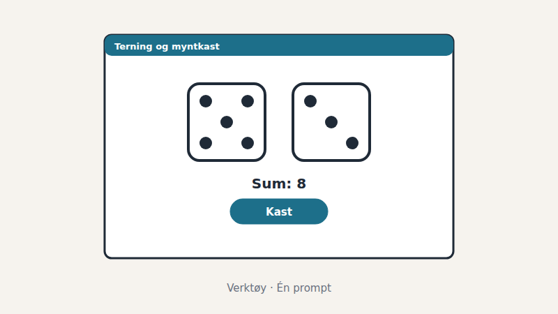

# Introduksjon {.intro}

Ein app som kastar terningar og mynt. Nyttig til brettspel, og når klassen skal
bestemme kven som startar. Denne appen lagar du med éin prompt.



## Før du startar {.tip}

Gjer [Din første app frå chatten](../forste_app/forste_app_nn) først. Har du
ikkje gitt KI-en skildringa av KIT Apps i chatten du bruker, gjer du steg 3 der
først.


# Steg 1: Lag appen {.activity}

## Sjekkliste {.check}

- [ ] Lim inn denne prompten i chatten. Endre han gjerne, så appen blir din:

  ```
  Lag ein app for KIT Apps som kastar ein til seks terningar og kan
  kaste mynt. Vis terningane som store prikkar, og vis summen. Store
  knappar, nynorsk tekst.
  ```

- [ ] Kopier koden. Trykk **New** i KIT Apps, skriv eit namn i **App Name**, lim
  inn koden og trykk **Run App**. Appen blir lagra av seg sjølv.

- [ ] Verkar han ikkje? Trykk **Copy a fix request for your AI** og lim det inn
  i chatten.

- [ ] Får du ein ny versjon frå KI-en, trykkjer du **Edit**, byter ut all koden
  og trykkjer **Save Changes**.


# Steg 2: Test appen {.activity}

## Test prosjektet {.flag}

| Test | Dette skal skje |
|---|---|
| Kast ein terning mange gonger | Du får alle tala frå 1 til 6 |
| Kast tre terningar | Summen stemmer |
| Kast mynt ti gonger | Både krone og mynt kjem |

- [ ] Gjer alle testane. Rett det som ikkje verkar, éin ting om gongen.

- [ ] La ein annan prøve appen utan at du forklarer noko.


# Steg 3: Byggj vidare {.activity}

Vel det du vil ha, og be om éin ting om gongen. Be alltid om heile fila på nytt,
og test igjen etter kvar endring.

- **Historikk:**

  ```
  Vis dei ti siste kasta under terningane.
  ```

- **Animasjon:**

  ```
  La terningane rulle eit halvt sekund før dei stoppar.
  ```

## Lagre {.save}

Appen ligg i lista i KIT Apps. Vil du ha han som eige program, sjå [Gjer han
til ein ferdig app](../ferdig_app/ferdig_app_nn).


## Utfordring {.challenge}

Kast ein terning 60 gonger og tel kor mange av kvart tal du får. Er det omtrent
like mange? Be KI-en lage eit søylediagram som tel for deg.
