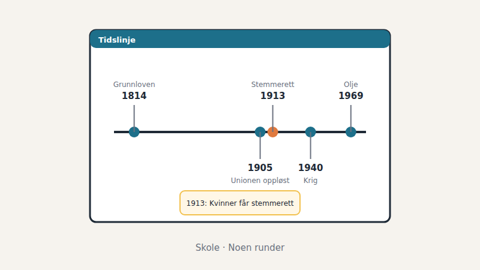

# Introduksjon {.intro}

En tidslinje der du legger inn hendelser fra et tema, for eksempel andre
verdenskrig, din egen familie eller historien til mobiltelefonen. Når hendelsene
står i riktig avstand fra hverandre, ser du sammenhenger du ikke ser i en liste.
Denne appen lager du med én prompt og noen runder med forbedringer.



## Før du starter {.tip}

Gjør [Din første app fra chatten](../forste_app/forste_app) først. Har du ikke
gitt KI-en beskrivelsen av KIT Apps i chatten du bruker, gjør du steg 3 der
først.


# Steg 1: Lag appen {.activity}

## Sjekkliste {.check}

- [ ] Lim inn denne prompten i chatten. Endre den gjerne, så appen blir din:

  ```
  Lag en tidslinje for KIT Apps. Jeg skal kunne legge inn hendelser med
  år, tittel og en kort tekst. Vis dem på en vannrett linje der
  avstanden mellom hendelsene passer med årene. Når jeg klikker på en
  hendelse, vises teksten. Husk hendelsene. Norsk tekst.
  ```

- [ ] Legg inn minst åtte hendelser fra et tema du jobber med på skolen. Skriv
  dem selv, eller sjekk dem i læreboka eller på en pålitelig nettside hvis KI-en
  foreslår dem.

- [ ] Kopier koden. Trykk **New** i KIT Apps, skriv et navn i **App Name**, lim
  inn koden og trykk **Run App**. Appen lagres av seg selv.

- [ ] Virker den ikke? Trykk **Copy a fix request for your AI** og lim det inn i
  chatten.

- [ ] Får du en ny versjon fra KI-en, trykker du **Edit**, bytter ut all koden
  og trykker **Save Changes**.


# Steg 2: Test appen {.activity}

## Test prosjektet {.flag}

| Test | Dette skal skje |
|---|---|
| Legg inn 1814 og 1905 | 1905 står lenger til høyre, med riktig avstand |
| Klikk på en hendelse | Teksten vises |
| Legg inn et år før 0, som -500 | Appen takler det, eller sier fra |

- [ ] Gjør alle testene. Rett det som ikke virker, én ting om gangen.

- [ ] La en annen prøve appen uten at du forklarer noe.


# Steg 3: Bygg videre {.activity}

Velg det du vil ha, og be om én ting om gangen. Be alltid om hele filen på nytt,
og test igjen etter hver endring.

- **Kategorier:**

  ```
  Gi hver hendelse en kategori med egen farge, for eksempel politikk,
  krig og oppfinnelser.
  ```

- **Zoom:**

  ```
  La meg zoome inn på en periode, for eksempel 1900 til 1950.
  ```

- **Quiz:**

  ```
  Lag en knapp som skjuler årstallene og lar meg dra hendelsene i riktig
  rekkefølge.
  ```

## Lagre {.save}

Appen ligger i lista i KIT Apps. Vil du ha den som eget program, se [Gjør den
til en ferdig app](../ferdig_app/ferdig_app).


## Utfordring {.challenge}

Lag to tidslinjer for samme periode, for eksempel Norge og et annet land. Hva
skjedde samtidig?
