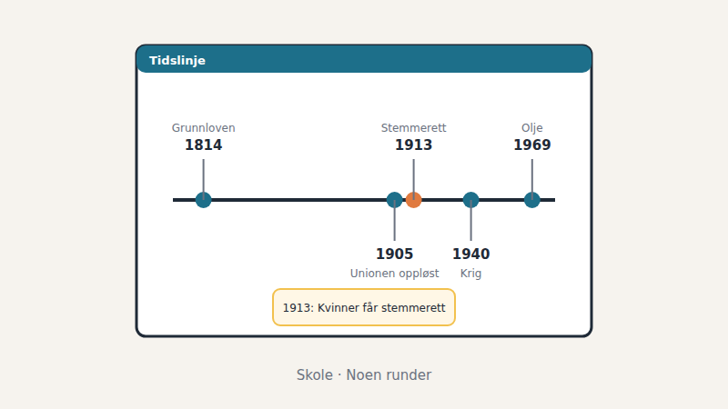

# Introduksjon {.intro}

Ei tidslinje der du legg inn hendingar frå eit tema, til dømes andre
verdskrigen, din eigen familie eller historia til mobiltelefonen. Når hendingane
står i rett avstand frå kvarandre, ser du samanhengar du ikkje ser i ei liste.
Denne appen lagar du med éin prompt og nokre rundar med forbetringar.



## Før du startar {.tip}

Gjer [Din første app frå chatten](../forste_app/forste_app_nn) først. Har du
ikkje gitt KI-en skildringa av KIT Apps i chatten du bruker, gjer du steg 3 der
først.


# Steg 1: Lag appen {.activity}

## Sjekkliste {.check}

- [ ] Lim inn denne prompten i chatten. Endre han gjerne, så appen blir din:

  ```
  Lag ei tidslinje for KIT Apps. Eg skal kunne leggje inn hendingar med
  år, tittel og ein kort tekst. Vis dei på ei vassrett linje der
  avstanden mellom hendingane passar med åra. Når eg klikkar på ei
  hending, blir teksten vist. Hugs hendingane. Nynorsk tekst.
  ```

- [ ] Legg inn minst åtte hendingar frå eit tema du jobbar med på skulen. Skriv
  dei sjølv, eller sjekk dei i læreboka eller på ei påliteleg nettside viss
  KI-en føreslår dei.

- [ ] Kopier koden. Trykk **New** i KIT Apps, skriv eit namn i **App Name**, lim
  inn koden og trykk **Run App**. Appen blir lagra av seg sjølv.

- [ ] Verkar han ikkje? Trykk **Copy a fix request for your AI** og lim det inn
  i chatten.

- [ ] Får du ein ny versjon frå KI-en, trykkjer du **Edit**, byter ut all koden
  og trykkjer **Save Changes**.


# Steg 2: Test appen {.activity}

## Test prosjektet {.flag}

| Test | Dette skal skje |
|---|---|
| Legg inn 1814 og 1905 | 1905 står lenger til høgre, med rett avstand |
| Klikk på ei hending | Teksten blir vist |
| Legg inn eit år før 0, som -500 | Appen taklar det, eller seier frå |

- [ ] Gjer alle testane. Rett det som ikkje verkar, éin ting om gongen.

- [ ] La ein annan prøve appen utan at du forklarer noko.


# Steg 3: Bygg vidare {.activity}

Vel det du vil ha, og be om éin ting om gongen. Be alltid om heile fila på nytt,
og test igjen etter kvar endring.

- **Kategoriar:**

  ```
  Gi kvar hending ein kategori med eigen farge, til dømes politikk, krig
  og oppfinningar.
  ```

- **Zoom:**

  ```
  La meg zoome inn på ein periode, til dømes 1900 til 1950.
  ```

- **Quiz:**

  ```
  Lag ein knapp som skjuler årstala og lèt meg dra hendingane i rett
  rekkjefølgje.
  ```

## Lagre {.save}

Appen ligg i lista i KIT Apps. Vil du ha han som eige program, sjå [Gjer han til
ein ferdig app](../ferdig_app/ferdig_app_nn).


## Utfordring {.challenge}

Lag to tidslinjer for same periode, til dømes Noreg og eit anna land. Kva
skjedde samtidig?
