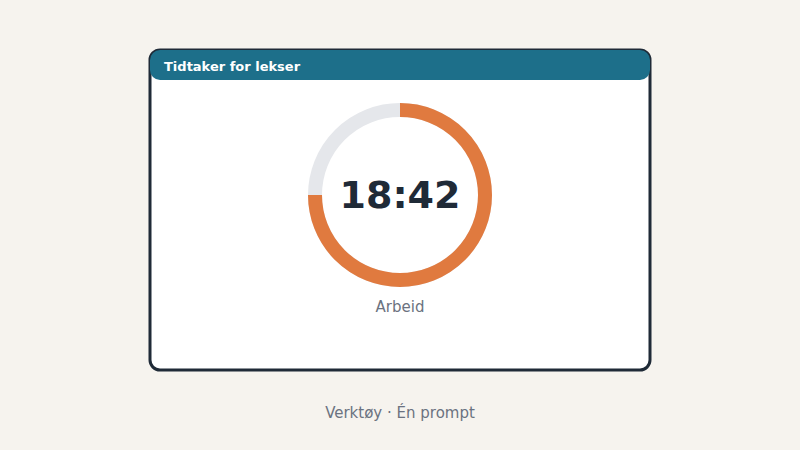

# Introduksjon {.intro}

En tidtaker som deler lekselesingen i økter med pauser mellom. Mange klarer å
holde fokus lenger når de vet at pausen kommer. Denne appen lager du med én
prompt.



## Før du starter {.tip}

Gjør [Din første app fra chatten](../forste_app/forste_app) først. Har du ikke
gitt KI-en beskrivelsen av KIT Apps i chatten du bruker, gjør du steg 3 der
først.


# Steg 1: Lag appen {.activity}

## Sjekkliste {.check}

- [ ] Lim inn denne prompten i chatten. Endre den gjerne, så appen blir din:

  ```
  Lag en tidtaker for KIT Apps med 25 minutter arbeid og 5 minutter
  pause. Vis tiden som store tall og en ring som minker. Knapper for
  start, pause og nullstill. Si tydelig fra når det er pause. Norsk
  tekst.
  ```

- [ ] Kopier koden, trykk **New** i KIT Apps, lim inn og trykk **Run App**.

- [ ] Virker den ikke? Trykk **Copy a fix request for your AI** og lim det inn i
  chatten.

- [ ] Trykk **Save** når appen virker.


# Steg 2: Test appen {.activity}

## Test prosjektet {.flag}

| Test | Dette skal skje |
|---|---|
| Start og vent litt | Tiden teller ned |
| Trykk pause og så start | Tiden fortsetter der den var |
| Trykk nullstill | Tiden går tilbake til 25:00 |

- [ ] Gjør alle testene. Rett det som ikke virker, én ting om gangen.

- [ ] La en annen prøve appen uten at du forklarer noe.


# Steg 3: Bygg videre {.activity}

Velg det du vil ha, og be om én ting om gangen. Be alltid om hele filen på nytt,
og test igjen etter hver endring.

- **Egne tider:**

  ```
  La meg velge hvor lange øktene og pausene er.
  ```

- **Telle økter:**

  ```
  Tell hvor mange økter jeg har fullført i dag, og husk det til neste
  gang.
  ```

## Lagre {.save}

Trykk **Save** i KIT Apps. Vil du ha appen som eget program, se [Gjør den til
en ferdig app](../ferdig_app/ferdig_app).


## Utfordring {.challenge}

Bruk tidtakeren én uke. Hjalp den? Hva ville du endret?
