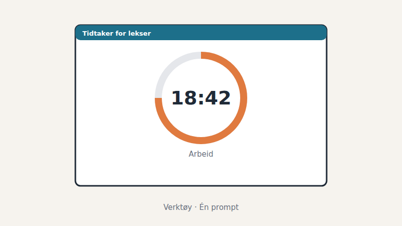

# Introduksjon {.intro}

Ein tidtakar som deler leselekser i økter med pausar mellom. Mange klarer å
halde fokus lenger når dei veit at pausen kjem. Denne appen lagar du med éin
prompt.



## Før du startar {.tip}

Gjer [Din første app frå chatten](../forste_app/forste_app_nn) først. Har du
ikkje gitt KI-en skildringa av KIT Apps i chatten du bruker, gjer du steg 3 der
først.


# Steg 1: Lag appen {.activity}

## Sjekkliste {.check}

- [ ] Lim inn denne prompten i chatten. Endre han gjerne, så appen blir din:

  ```
  Lag ein tidtakar for KIT Apps med 25 minutt arbeid og 5 minutt pause.
  Vis tida som store tal og ein ring som minkar. Knappar for start,
  pause og nullstill. Sei tydeleg frå når det er pause. Nynorsk tekst.
  ```

- [ ] Kopier koden. Trykk **New** i KIT Apps, skriv eit namn i **App Name**, lim
  inn koden og trykk **Run App**. Appen blir lagra av seg sjølv.

- [ ] Verkar han ikkje? Trykk **Copy a fix request for your AI** og lim det inn
  i chatten.

- [ ] Får du ein ny versjon frå KI-en, trykkjer du **Edit**, byter ut all koden
  og trykkjer **Save Changes**.


# Steg 2: Test appen {.activity}

## Test prosjektet {.flag}

| Test | Dette skal skje |
|---|---|
| Start og vent litt | Tida tel ned |
| Trykk pause og så start | Tida held fram der ho var |
| Trykk nullstill | Tida går tilbake til 25:00 |

- [ ] Gjer alle testane. Rett det som ikkje verkar, éin ting om gongen.

- [ ] La ein annan prøve appen utan at du forklarer noko.


# Steg 3: Byggj vidare {.activity}

Vel det du vil ha, og be om éin ting om gongen. Be alltid om heile fila på nytt,
og test igjen etter kvar endring.

- **Eigne tider:**

  ```
  La meg velje kor lange øktene og pausane er.
  ```

- **Telje økter:**

  ```
  Tel kor mange økter eg har fullført i dag, og hugs det til neste gong.
  ```

## Lagre {.save}

Appen ligg i lista i KIT Apps. Vil du ha han som eige program, sjå [Gjer han
til ein ferdig app](../ferdig_app/ferdig_app_nn).


## Utfordring {.challenge}

Bruk tidtakaren éi veke. Hjelpte han? Kva ville du endra?
