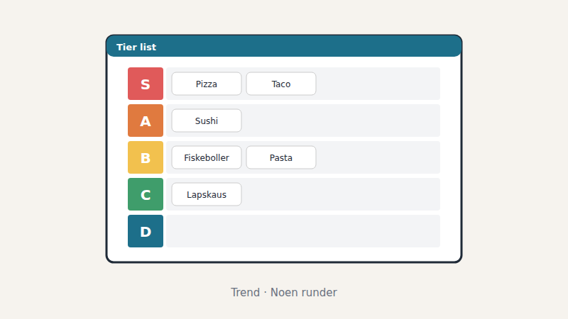

# Introduksjon {.intro}

En tier list der du rangerer ting i rader fra S (best) til D: spill, snacks,
artister, fag eller ferieplaner. Du drar tingene inn i radene og laster ned
resultatet som et bilde du kan dele. Denne appen lager du med én prompt og noen
runder med forbedringer.



## Før du starter {.tip}

Gjør [Din første app fra chatten](../forste_app/forste_app) først. Har du ikke
gitt KI-en beskrivelsen av KIT Apps i chatten du bruker, gjør du steg 3 der
først.


# Steg 1: Lag appen {.activity}

## Sjekkliste {.check}

- [ ] Lim inn denne prompten i chatten. Endre den gjerne, så appen blir din:

  ```
  Lag en tier list for KIT Apps med radene S, A, B, C og D i hver sin
  farge. Jeg skal kunne skrive inn ting som blir små kort, og dra
  kortene inn i radene og mellom dem. Jeg skal kunne gi lista en tittel.
  Husk lista. Norsk tekst.
  ```

- [ ] Kopier koden. Trykk **New** i KIT Apps, skriv et navn i **App Name**, lim
  inn koden og trykk **Run App**. Appen lagres av seg selv.

- [ ] Virker den ikke? Trykk **Copy a fix request for your AI** og lim det inn i
  chatten.

- [ ] Får du en ny versjon fra KI-en, trykker du **Edit**, bytter ut all koden
  og trykker **Save Changes**.

## Tenk deg om {.tip}

Laster du ned bildet fra KIT Apps, kan du også bruke **PNG** under del-ikonet.
Gratisversjonen setter et lite merke på bildet. Del aldri bilder med navn eller
bilder av andre uten at de har sagt ja.


# Steg 2: Test appen {.activity}

## Test prosjektet {.flag}

| Test | Dette skal skje |
|---|---|
| Legg til fem kort | Alle vises i en rad for usorterte |
| Dra et kort fra A til S | Kortet flytter seg |
| Lukk og åpne | Lista er der fortsatt |

- [ ] Gjør alle testene. Rett det som ikke virker, én ting om gangen.

- [ ] La en annen prøve appen uten at du forklarer noe.


# Steg 3: Bygg videre {.activity}

Velg det du vil ha, og be om én ting om gangen. Be alltid om hele filen på nytt,
og test igjen etter hver endring.

- **Bilde:**

  ```
  Lag en knapp som laster ned lista som et bilde.
  ```

- **Mobil:**

  ```
  Gjør det mulig å flytte kort ved å trykke på dem, ikke bare dra.
  ```

## Lagre {.save}

Appen ligger i lista i KIT Apps. Vil du ha den som eget program, se [Gjør den
til en ferdig app](../ferdig_app/ferdig_app).


## Utfordring {.challenge}

Lag en tier list over noe fra skolen, som tema i et fag. Hvorfor havnet ting der
de havnet?
