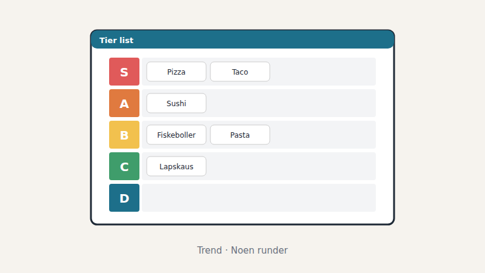

# Introduksjon {.intro}

Ei tier list der du rangerer ting i rader frå S (best) til D: spel, snacks,
artistar, fag eller ferieplanar. Du dreg tinga inn i radene og lastar ned
resultatet som eit bilete du kan dele. Denne appen lagar du med éin prompt og
nokre rundar med forbetringar.



## Før du startar {.tip}

Gjer [Din første app frå chatten](../forste_app/forste_app_nn) først. Har
du ikkje gitt KI-en skildringa av KIT Apps i chatten du brukar, gjer du steg 3
der først.


# Steg 1: Lag appen {.activity}

## Sjekkliste {.check}

- [ ] Lim inn denne prompten i chatten. Endre han gjerne, så appen blir din:

  ```
  Lag ei tier list for KIT Apps med radene S, A, B, C og D i kvar sin
  farge. Eg skal kunne skrive inn ting som blir små kort, og dra korta
  inn i radene og mellom dei. Eg skal kunne gi lista ein tittel. Hugs
  lista. Nynorsk tekst.
  ```

- [ ] Kopier koden. Trykk **New** i KIT Apps, skriv eit namn i **App Name**, lim
  inn koden og trykk **Run App**. Appen blir lagra av seg sjølv.

- [ ] Verkar han ikkje? Trykk **Copy a fix request for your AI** og lim det inn
  i chatten.

- [ ] Får du ein ny versjon frå KI-en, trykkjer du **Edit**, byter ut all koden
  og trykkjer **Save Changes**.

## Tenk deg om {.tip}

Lastar du ned biletet frå KIT Apps, kan du også bruke **PNG** under dele-ikonet.
Gratisversjonen set eit lite merke på biletet. Del aldri bilete med namn eller
bilete av andre utan at dei har sagt ja.


# Steg 2: Test appen {.activity}

## Test prosjektet {.flag}

| Test | Dette skal skje |
|---|---|
| Legg til fem kort | Alle blir viste i ei rad for usorterte |
| Dra eit kort frå A til S | Kortet flyttar seg |
| Lukk og opne | Lista er der framleis |

- [ ] Gjer alle testane. Rett det som ikkje verkar, éin ting om gongen.

- [ ] La ein annan prøve appen utan at du forklarer noko.


# Steg 3: Byggj vidare {.activity}

Vel det du vil ha, og be om éin ting om gongen. Be alltid om heile fila på nytt,
og test igjen etter kvar endring.

- **Bilete:**

  ```
  Lag ein knapp som lastar ned lista som eit bilete.
  ```

- **Mobil:**

  ```
  Gjer det mogleg å flytte kort ved å trykke på dei, ikkje berre dra.
  ```

## Lagre {.save}

Appen ligg i lista i KIT Apps. Vil du ha han som eige program, sjå [Gjer han til
ein ferdig app](../ferdig_app/ferdig_app_nn).


## Utfordring {.challenge}

Lag ei tier list over noko frå skulen, som tema i eit fag. Kvifor hamna ting der
dei hamna?
