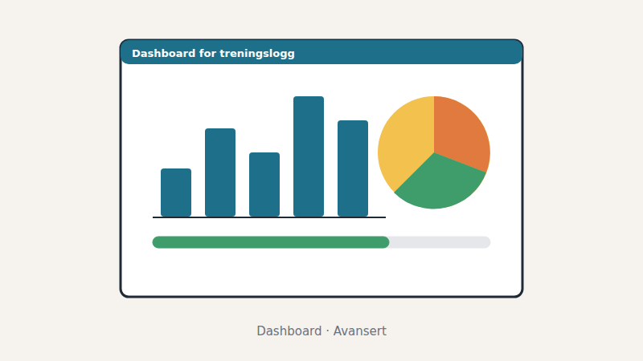

# Introduksjon {.intro}

Et dashboard der du fører treningen din og ser fremgangen i grafer. Du lager det
i flere runder: først loggen, så grafene, så mål. Denne appen bygger du i flere
runder. Start lite, og legg til én ting om gangen.



## Før du starter {.tip}

Gjør [Din første app fra chatten](../forste_app/forste_app) først. Har du ikke
gitt KI-en beskrivelsen av KIT Apps i chatten du bruker, gjør du steg 3 der
først.


# Steg 1: Lag appen {.activity}

## Sjekkliste {.check}

- [ ] Lim inn denne prompten i chatten. Endre den gjerne, så appen blir din:

  ```
  Lag en treningslogg for KIT Apps. Jeg skal kunne registrere en økt med
  dato, type (løping, styrke, ballspill, annet) og minutter. Vis øktene
  i en liste der jeg kan slette en økt. Husk alt med
  window.appStudio.storage hvis det finnes, ellers localStorage. Ikke
  lag grafer ennå. Norsk tekst.
  ```

- [ ] Når loggen virker, ber du om ett tillegg om gangen: «Legg til et
  søylediagram med minutter per uke», så «Legg til et kakediagram med fordeling
  på type», og til slutt «Legg til et ukesmål i minutter og en fremdriftslinje».

- [ ] Kopier koden, trykk **New** i KIT Apps, lim inn og trykk **Run App**.

- [ ] Virker den ikke? Trykk **Copy a fix request for your AI** og lim det inn i
  chatten.

- [ ] Trykk **Save** når appen virker.


# Steg 2: Test appen {.activity}

## Test prosjektet {.flag}

| Test | Dette skal skje |
|---|---|
| Registrer tre økter | Alle tre vises i lista |
| Slett én økt | Den forsvinner, også fra grafene |
| Legg inn økter i to uker | Søylediagrammet viser to søyler |
| Lukk og åpne | Alt er der fortsatt |

- [ ] Gjør alle testene. Rett det som ikke virker, én ting om gangen.

- [ ] La en annen prøve appen uten at du forklarer noe.


# Steg 3: Bygg videre {.activity}

Velg det du vil ha, og be om én ting om gangen. Be alltid om hele filen på nytt,
og test igjen etter hver endring.

- **Eksport:**

  ```
  Lag eksport og import av alle økter som en fil.
  ```

- **Rekorder:**

  ```
  Vis lengste økt og flest minutter på én uke.
  ```

## Lagre {.save}

Trykk **Save** i KIT Apps. Vil du ha appen som eget program, se [Gjør den til
en ferdig app](../ferdig_app/ferdig_app).


## Utfordring {.challenge}

Bruk dashboardet en måned. Hvilken graf brukte du mest, og hvilken trengte du
ikke?
