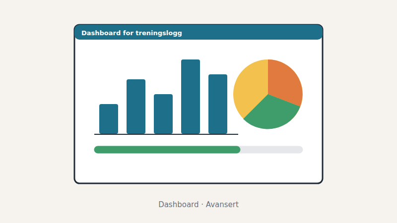

# Introduksjon {.intro}

Eit dashboard der du fører treninga di og ser framgangen i grafar. Du lagar det
i fleire rundar: først loggen, så grafane, så mål. Denne appen byggjer du i
fleire rundar. Start smått, og legg til éin ting om gongen.



## Før du startar {.tip}

Gjer [Din første app frå chatten](../forste_app/forste_app_nn) først. Har du
ikkje gitt KI-en skildringa av KIT Apps i chatten du bruker, gjer du steg 3 der
først.


# Steg 1: Lag appen {.activity}

## Sjekkliste {.check}

- [ ] Lim inn denne prompten i chatten. Endre han gjerne, så appen blir din:

  ```
  Lag ein treningslogg for KIT Apps. Eg skal kunne registrere ei økt med
  dato, type (løping, styrke, ballspel, anna) og minutt. Vis øktene i ei
  liste der eg kan slette ei økt. Hugs alt med window.appStudio.storage
  viss det finst, elles localStorage. Ikkje lag grafar enno. Nynorsk
  tekst.
  ```

- [ ] Når loggen verkar, ber du om eitt tillegg om gongen: «Legg til eit
  søylediagram med minutt per veke», så «Legg til eit kakediagram med fordeling
  på type», og til slutt «Legg til eit vekemål i minutt og ei framdriftslinje».

- [ ] Kopier koden. Trykk **New** i KIT Apps, skriv eit namn i **App Name**, lim
  inn koden og trykk **Run App**. Appen blir lagra av seg sjølv.

- [ ] Verkar han ikkje? Trykk **Copy a fix request for your AI** og lim det inn
  i chatten.

- [ ] Får du ein ny versjon frå KI-en, trykkjer du **Edit**, byter ut all koden
  og trykkjer **Save Changes**.


# Steg 2: Test appen {.activity}

## Test prosjektet {.flag}

| Test | Dette skal skje |
|---|---|
| Registrer tre økter | Alle tre blir viste i lista |
| Slett éi økt | Ho forsvinn, også frå grafane |
| Legg inn økter i to veker | Søylediagrammet viser to søyler |
| Lukk og opne | Alt er der framleis |

- [ ] Gjer alle testane. Rett det som ikkje verkar, éin ting om gongen.

- [ ] La ein annan prøve appen utan at du forklarer noko.


# Steg 3: Byggj vidare {.activity}

Vel det du vil ha, og be om éin ting om gongen. Be alltid om heile fila på nytt,
og test igjen etter kvar endring.

- **Eksport:**

  ```
  Lag eksport og import av alle øktene som ei fil.
  ```

- **Rekordar:**

  ```
  Vis lengste økt og flest minutt på éi veke.
  ```

## Lagre {.save}

Appen ligg i lista i KIT Apps. Vil du ha han som eige program, sjå [Gjer han
til ein ferdig app](../ferdig_app/ferdig_app_nn).


## Utfordring {.challenge}

Bruk dashboardet ein månad. Kva graf brukte du mest, og kva for ein trong du
ikkje?
