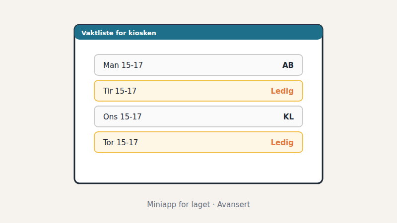

# Introduksjon {.intro}

En vaktliste for kiosken på idrettslaget, skolen eller ungdomsbedriften. Flere
skal kunne se og bytte vakter. Du lager den som en ferdig app som deler data i
en delt mappe. Denne appen bygger du i flere runder. Start lite, og legg til én
ting om gangen.



## Før du starter {.tip}

Gjør [Din første app fra chatten](../forste_app/forste_app) først. Har du ikke
gitt KI-en beskrivelsen av KIT Apps i chatten du bruker, gjør du steg 3 der
først.


# Steg 1: Lag appen {.activity}

## Sjekkliste {.check}

- [ ] Lim inn denne prompten i chatten. Endre den gjerne, så appen blir din:

  ```
  Lag en vaktliste for KIT Apps. Den skal vise en uke med vakter (dag,
  tid, navn). Jeg skal kunne legge til vakter, skrive meg på en ledig
  vakt og bytte vakt. Ledige vakter skal vises tydelig. Bruk
  window.appStudio.shared hvis det finnes, så flere kan dele data i en
  delt mappe. Finnes det ikke, bruk localStorage. Norsk tekst.
  ```

- [ ] Pakk appen som i [Gjør den til en ferdig app](../ferdig_app/ferdig_app).
  Velg en delt mappe som bare de som skal ta vakter, har tilgang til, for
  eksempel i OneDrive. Bruk fornavn eller initialer, ikke mer.

- [ ] Kopier koden. Trykk **New** i KIT Apps, skriv et navn i **App Name**, lim
  inn koden og trykk **Run App**. Appen lagres av seg selv.

- [ ] Virker den ikke? Trykk **Copy a fix request for your AI** og lim det inn i
  chatten.

- [ ] Får du en ny versjon fra KI-en, trykker du **Edit**, bytter ut all koden
  og trykker **Save Changes**.


# Steg 2: Test appen {.activity}

## Test prosjektet {.flag}

| Test | Dette skal skje |
|---|---|
| Legg til en vakt | Den vises som ledig |
| Skriv deg på | Navnet ditt står på vakten |
| To PC-er med samme delte mappe | Endringer på den ene vises på den andre |

- [ ] Gjør alle testene. Rett det som ikke virker, én ting om gangen.

- [ ] La en annen prøve appen uten at du forklarer noe.


# Steg 3: Bygg videre {.activity}

Velg det du vil ha, og be om én ting om gangen. Be alltid om hele filen på nytt,
og test igjen etter hver endring.

- **Påminnelse:**

  ```
  Vis øverst hvilke vakter som er i dag.
  ```

- **Oversikt:**

  ```
  Vis hvor mange vakter hver person har tatt.
  ```

## Lagre {.save}

Appen ligger i lista i KIT Apps. Vil du ha den som eget program, se [Gjør den
til en ferdig app](../ferdig_app/ferdig_app).


## Utfordring {.challenge}

La de som skal bruke vaktlista, teste den en uke. Hva savnet de? Er det
personopplysninger i lista som ikke trengs?
