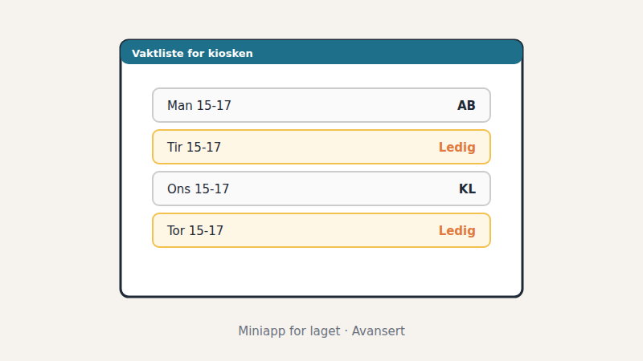

# Introduksjon {.intro}

Ei vaktliste for kiosken på idrettslaget, skulen eller ungdomsbedrifta. Fleire
skal kunne sjå og byte vakter. Du lagar ho som ein ferdig app som deler data i
ei delt mappe. Denne appen byggjer du i fleire rundar. Start smått, og legg til
éin ting om gongen.



## Før du startar {.tip}

Gjer [Din første app frå chatten](../forste_app/forste_app_nn) først. Har du
ikkje gitt KI-en skildringa av KIT Apps i chatten du bruker, gjer du steg 3 der
først.


# Steg 1: Lag appen {.activity}

## Sjekkliste {.check}

- [ ] Lim inn denne prompten i chatten. Endre han gjerne, så appen blir din:

  ```
  Lag ei vaktliste for KIT Apps. Ho skal vise ei veke med vakter (dag,
  tid, namn). Eg skal kunne leggje til vakter, skrive meg på ei ledig
  vakt og byte vakt. Ledige vakter skal visast tydeleg. Bruk
  window.appStudio.shared viss det finst, så fleire kan dele data i ei
  delt mappe. Finst det ikkje, bruk localStorage. Nynorsk tekst.
  ```

- [ ] Pakk appen som i [Gjer han til ein ferdig
  app](../ferdig_app/ferdig_app_nn). Vel ei delt mappe som berre dei som skal ta
  vakter, har tilgang til, til dømes i OneDrive. Bruk førenamn eller initialar,
  ikkje meir.

- [ ] Kopier koden. Trykk **New** i KIT Apps, skriv eit namn i **App Name**, lim
  inn koden og trykk **Run App**. Appen blir lagra av seg sjølv.

- [ ] Verkar han ikkje? Trykk **Copy a fix request for your AI** og lim det inn
  i chatten.

- [ ] Får du ein ny versjon frå KI-en, trykkjer du **Edit**, byter ut all koden
  og trykkjer **Save Changes**.


# Steg 2: Test appen {.activity}

## Test prosjektet {.flag}

| Test | Dette skal skje |
|---|---|
| Legg til ei vakt | Ho blir vist som ledig |
| Skriv deg på | Namnet ditt står på vakta |
| To PC-ar med same delte mappe | Endringar på den eine blir viste på den andre |

- [ ] Gjer alle testane. Rett det som ikkje verkar, éin ting om gongen.

- [ ] La ein annan prøve appen utan at du forklarer noko.


# Steg 3: Byggj vidare {.activity}

Vel det du vil ha, og be om éin ting om gongen. Be alltid om heile fila på nytt,
og test igjen etter kvar endring.

- **Påminning:**

  ```
  Vis øvst kva vakter som er i dag.
  ```

- **Oversikt:**

  ```
  Vis kor mange vakter kvar person har teke.
  ```

## Lagre {.save}

Appen ligg i lista i KIT Apps. Vil du ha han som eige program, sjå [Gjer han
til ein ferdig app](../ferdig_app/ferdig_app_nn).


## Utfordring {.challenge}

La dei som skal bruke vaktlista, teste ho ei veke. Kva sakna dei? Er det
personopplysningar i lista som ikkje trengst?
