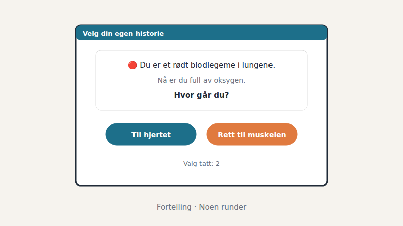

# Introduksjon {.intro}

En historie der leseren tar valg som bestemmer hva som skjer. Du er et rødt
blodlegeme på vei gjennom kroppen, en vikingjente som skal over Nordsjøen, eller
en elev på første dag på ny skole. For å velge riktig må du kunne noe om temaet.
Denne appen lager du med én prompt og noen runder med forbedringer.



## Før du starter {.tip}

Gjør [Din første app fra chatten](../forste_app/forste_app) først. Har du ikke
gitt KI-en beskrivelsen av KIT Apps i chatten du bruker, gjør du steg 3 der
først.


# Steg 1: Lag appen {.activity}

## Sjekkliste {.check}

- [ ] Lim inn denne prompten i chatten. Endre den gjerne, så appen blir din:

  ```
  Lag en «velg din egen historie»-app for KIT Apps. Hver side har en
  tekst og to eller tre valg som fører til andre sider. Noen sider er
  slutter, gode eller dårlige. Historien skal ligge i en liste i koden,
  så jeg lett kan bytte den ut. Lag et kort eksempel der du er et rødt
  blodlegeme som skal frakte oksygen fra lungene til en muskel. Vis hvor
  mange valg jeg har tatt, og en knapp for å starte på nytt. Norsk
  tekst.
  ```

- [ ] Tegn historien på papir først, som bokser og piler: start, valg og
  slutter. Skriv tekstene selv, og gi dem til KI-en. Sjekk at det faglige
  stemmer.

- [ ] Kopier koden. Trykk **New** i KIT Apps, skriv et navn i **App Name**, lim
  inn koden og trykk **Run App**. Appen lagres av seg selv.

- [ ] Virker den ikke? Trykk **Copy a fix request for your AI** og lim det inn i
  chatten.

- [ ] Får du en ny versjon fra KI-en, trykker du **Edit**, bytter ut all koden
  og trykker **Save Changes**.

## Tenk deg om {.tip}

En god valgfortelling har valg der det faglige betyr noe. «Går du til venstre
eller høyre?» lærer deg lite. «Skal du gjennom en arterie eller en vene?» lærer
deg mye.


# Steg 2: Test appen {.activity}

## Test prosjektet {.flag}

| Test | Dette skal skje |
|---|---|
| Følg alle valgene | Ingen valg fører til en side som ikke finnes |
| Kom til en slutt | Du kan starte på nytt |
| Les alle sidene | Faktaene stemmer |

- [ ] Gjør alle testene. Rett det som ikke virker, én ting om gangen.

- [ ] La en annen prøve appen uten at du forklarer noe.


# Steg 3: Bygg videre {.activity}

Velg det du vil ha, og be om én ting om gangen. Be alltid om hele filen på nytt,
og test igjen etter hver endring.

- **Inventar:**

  ```
  La leseren samle ting underveis, som trengs senere i historien.
  ```

- **Bilder:**

  ```
  Gi hver side en enkel tegning eller emoji som passer til stemningen.
  ```

## Lagre {.save}

Appen ligger i lista i KIT Apps. Vil du ha den som eget program, se [Gjør den
til en ferdig app](../ferdig_app/ferdig_app).


## Utfordring {.challenge}

Bytt historie med en medelev. Hvilke valg var vanskelige, og hva lærte du?
