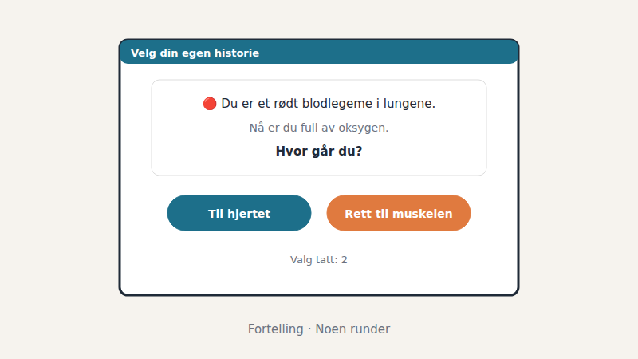

# Introduksjon {.intro}

Ei historie der lesaren tek val som avgjer kva som skjer. Du er ein raud
blodlekam på veg gjennom kroppen, ei vikingjente som skal over Nordsjøen, eller
ein elev på første dag på ny skule. For å velje rett må du kunne noko om temaet.
Denne appen lagar du med éin prompt og nokre rundar med forbetringar.



## Før du startar {.tip}

Gjer [Din første app frå chatten](../forste_app/forste_app_nn) først. Har du
ikkje gitt KI-en skildringa av KIT Apps i chatten du bruker, gjer du steg 3 der
først.


# Steg 1: Lag appen {.activity}

## Sjekkliste {.check}

- [ ] Lim inn denne prompten i chatten. Endre han gjerne, så appen blir din:

  ```
  Lag ein «vel di eiga historie»-app for KIT Apps. Kvar side har ein
  tekst og to eller tre val som fører til andre sider. Nokre sider er
  slutter, gode eller dårlege. Historia skal liggje i ei liste i koden,
  så eg lett kan byte henne ut. Lag eit kort døme der du er ein raud
  blodlekam som skal frakte oksygen frå lungene til ein muskel. Vis kor
  mange val eg har teke, og ein knapp for å starte på nytt. Nynorsk
  tekst.
  ```

- [ ] Teikn historia på papir først, som boksar og piler: start, val og slutter.
  Skriv tekstane sjølv, og gi dei til KI-en. Sjekk at det faglege stemmer.

- [ ] Kopier koden. Trykk **New** i KIT Apps, skriv eit namn i **App Name**, lim
  inn koden og trykk **Run App**. Appen blir lagra av seg sjølv.

- [ ] Verkar han ikkje? Trykk **Copy a fix request for your AI** og lim det inn
  i chatten.

- [ ] Får du ein ny versjon frå KI-en, trykkjer du **Edit**, byter ut all koden
  og trykkjer **Save Changes**.

## Tenk deg om {.tip}

Ei god valforteljing har val der det faglege betyr noko. «Går du til venstre
eller høgre?» lærer deg lite. «Skal du gjennom ein arterie eller ei vene?» lærer
deg mykje.


# Steg 2: Test appen {.activity}

## Test prosjektet {.flag}

| Test | Dette skal skje |
|---|---|
| Følg alle vala | Ingen val fører til ei side som ikkje finst |
| Kom til ein slutt | Du kan starte på nytt |
| Les alle sidene | Fakta stemmer |

- [ ] Gjer alle testane. Rett det som ikkje verkar, éin ting om gongen.

- [ ] La ein annan prøve appen utan at du forklarer noko.


# Steg 3: Bygg vidare {.activity}

Vel det du vil ha, og be om éin ting om gongen. Be alltid om heile fila på nytt,
og test igjen etter kvar endring.

- **Inventar:**

  ```
  La lesaren samle ting undervegs, som trengst seinare i historia.
  ```

- **Bilete:**

  ```
  Gi kvar side ei enkel teikning eller ein emoji som passar til
  stemninga.
  ```

## Lagre {.save}

Appen ligg i lista i KIT Apps. Vil du ha han som eige program, sjå [Gjer han til
ein ferdig app](../ferdig_app/ferdig_app_nn).


## Utfordring {.challenge}

Byt historie med ein medelev. Kva val var vanskelege, og kva lærte du?
