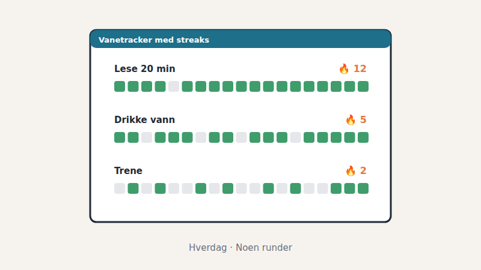

# Introduksjon {.intro}

En app der du krysser av vaner hver dag, som lesing, trening eller å drikke
vann. Appen teller hvor mange dager på rad du har klart det, en streak. Mange
apper bruker streaks for å få oss til å komme tilbake. Nå lager du din egen.
Denne appen lager du med én prompt og noen runder med forbedringer.



## Før du starter {.tip}

Gjør [Din første app fra chatten](../forste_app/forste_app) først. Har du ikke
gitt KI-en beskrivelsen av KIT Apps i chatten du bruker, gjør du steg 3 der
først.


# Steg 1: Lag appen {.activity}

## Sjekkliste {.check}

- [ ] Lim inn denne prompten i chatten. Endre den gjerne, så appen blir din:

  ```
  Lag en vanetracker for KIT Apps. Jeg skal kunne legge inn vaner og
  krysse av for i dag. For hver vane vis streak (dager på rad) og et
  rutenett med de siste 30 dagene. Husk alt. Norsk tekst.
  ```

- [ ] Kopier koden. Trykk **New** i KIT Apps, skriv et navn i **App Name**, lim
  inn koden og trykk **Run App**. Appen lagres av seg selv.

- [ ] Virker den ikke? Trykk **Copy a fix request for your AI** og lim det inn i
  chatten.

- [ ] Får du en ny versjon fra KI-en, trykker du **Edit**, bytter ut all koden
  og trykker **Save Changes**.

## Tenk deg om {.tip}

Streaks kan gjøre en app vanedannende. Hvorfor bruker apper dem? Er det greit å
lage en app som gjør folk stresset hvis de mister en streak?


# Steg 2: Test appen {.activity}

## Test prosjektet {.flag}

| Test | Dette skal skje |
|---|---|
| Kryss av en vane i dag | Streaken blir 1 |
| Fjern krysset | Streaken går ned igjen |
| Lukk og åpne | Kryssene er der fortsatt |

- [ ] Gjør alle testene. Rett det som ikke virker, én ting om gangen.

- [ ] La en annen prøve appen uten at du forklarer noe.


# Steg 3: Bygg videre {.activity}

Velg det du vil ha, og be om én ting om gangen. Be alltid om hele filen på nytt,
og test igjen etter hver endring.

- **Mål:**

  ```
  La meg sette et mål for hvor mange dager i uka.
  ```

- **Pause:**

  ```
  La meg ta fri en dag uten å miste streaken, maks én gang i uka.
  ```

## Lagre {.save}

Appen ligger i lista i KIT Apps. Vil du ha den som eget program, se [Gjør den
til en ferdig app](../ferdig_app/ferdig_app).


## Utfordring {.challenge}

Sammenlign appen din med en app du bruker selv som har streaks. Hva gjør den for
at du skal komme tilbake?
