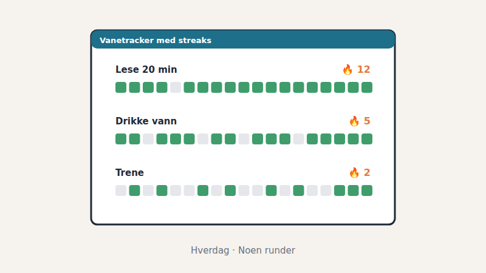

# Introduksjon {.intro}

Ein app der du kryssar av vanar kvar dag, som lesing, trening eller å drikke
vatn. Appen tel kor mange dagar på rad du har klart det, ein streak. Mange appar
brukar streaks for å få oss til å kome tilbake. No lagar du din eigen. Denne
appen lagar du med éin prompt og nokre rundar med forbetringar.



## Før du startar {.tip}

Gjer [Din første app frå chatten](../forste_app/forste_app_nn) først. Har
du ikkje gitt KI-en skildringa av KIT Apps i chatten du brukar, gjer du steg 3
der først.


# Steg 1: Lag appen {.activity}

## Sjekkliste {.check}

- [ ] Lim inn denne prompten i chatten. Endre han gjerne, så appen blir din:

  ```
  Lag ein vanetrackar for KIT Apps. Eg skal kunne leggje inn vanar og
  krysse av for i dag. For kvar vane: vis streak (dagar på rad) og eit
  rutenett med dei siste 30 dagane. Hugs alt. Nynorsk tekst.
  ```

- [ ] Kopier koden. Trykk **New** i KIT Apps, skriv eit namn i **App Name**, lim
  inn koden og trykk **Run App**. Appen blir lagra av seg sjølv.

- [ ] Verkar han ikkje? Trykk **Copy a fix request for your AI** og lim det inn
  i chatten.

- [ ] Får du ein ny versjon frå KI-en, trykkjer du **Edit**, byter ut all koden
  og trykkjer **Save Changes**.

## Tenk deg om {.tip}

Streaks kan gjere ein app vanedannande. Kvifor brukar appar dei? Er det greitt å
lage ein app som gjer folk stressa viss dei mistar ein streak?


# Steg 2: Test appen {.activity}

## Test prosjektet {.flag}

| Test | Dette skal skje |
|---|---|
| Kryss av ein vane i dag | Streaken blir 1 |
| Fjern krysset | Streaken går ned igjen |
| Lukk og opne | Krossane er der framleis |

- [ ] Gjer alle testane. Rett det som ikkje verkar, éin ting om gongen.

- [ ] La ein annan prøve appen utan at du forklarer noko.


# Steg 3: Byggj vidare {.activity}

Vel det du vil ha, og be om éin ting om gongen. Be alltid om heile fila på nytt,
og test igjen etter kvar endring.

- **Mål:**

  ```
  La meg setje eit mål for kor mange dagar i veka.
  ```

- **Pause:**

  ```
  La meg ta fri ein dag utan å miste streaken, maks éin gong i veka.
  ```

## Lagre {.save}

Appen ligg i lista i KIT Apps. Vil du ha han som eige program, sjå [Gjer han til
ein ferdig app](../ferdig_app/ferdig_app_nn).


## Utfordring {.challenge}

Samanlikn appen din med ein app du brukar sjølv som har streaks. Kva gjer han
for at du skal kome tilbake?
