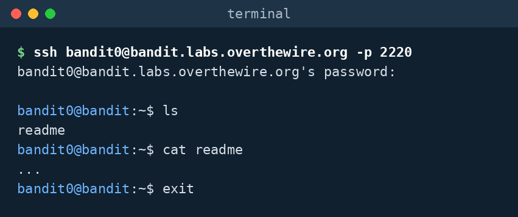

# Introduksjon {.intro}

Nå er det på tide med et ekte **wargame**. Bandit er laget av OverTheWire, og
er der mange hackere har tatt sine første steg. Du logger inn på en ekte
server på internett, med lov, og leter etter passordet til neste nivå. Ingen
konto, ingen installasjon. Bare deg og terminalen.



```
FRA:   K, Byrå 404
TIL:   Analytiker
EMNE:  Prøve på ekte

Du har trent i laben. Nå skal du ut på en ekte server. Den er laget
for å bli angrepet, så du har lov. Kom deg til nivå 10.

Hilsen K
```

## Før du starter {.tip}

Gjør [Inn i terminalen](../inn_i_terminalen/inn_i_terminalen) og [Nåla i
høystakken](../nalen_i_hoystakken/nalen_i_hoystakken) først. Bandit er på
engelsk, men hintene her er på norsk.


# Steg 1: Logg inn med SSH {.activity}

**SSH** (secure shell) er måten man logger inn på en annen maskin over
nettet. Du får en terminal på den andre maskinen.

## Sjekkliste {.check}

- [ ] Åpne [Bandit nivå 0](https://overthewire.org/wargames/bandit/bandit0.html)
  og les oppgaven.

- [ ] Logg inn fra terminalen. Passordet for nivå 0 er `bandit0`:

  ```
  ssh bandit0@bandit.labs.overthewire.org -p 2220
  ```

  Første gang spør den om du stoler på maskinen. Skriv `yes`. Når du skriver
  passordet, vises ingenting. Det er meningen.

- [ ] Når du er inne, står det `bandit0@bandit:~$`. Nå er du på serveren.

- [ ] Logg ut med `exit`.

## Tips {.protip}

Skriv ned passordet til hvert nivå i en egen fil på din maskin. Da slipper du
å starte på nytt neste gang.


# Steg 2: Nivå 0 til 10 {.activity}

Les oppgaven for hvert nivå på nettsiden. Står du fast, les hintet. Les bare
ett hint om gangen.

| Nivå | Hint |
|---|---|
| 0 til 1 | Du har gjort dette før. `ls` og `cat`. |
| 1 til 2 | Fila heter `-`. Terminalen tror det er et valg. Prøv `cat ./-` |
| 2 til 3 | Filnavnet har mellomrom og starter med `--`. Sett `./` foran og navnet i anførselstegn, eller bruk Tab |
| 3 til 4 | Skjult fil. Du vet hvordan. |
| 4 til 5 | Bare én fil er lesbar tekst. `file ./*` viser hva slags filer det er |
| 5 til 6 | Bruk `find` med `-size` og noe som betyr «ikke kjørbar» |
| 6 til 7 | Fila ligger et sted på hele serveren. `find /` med `-user`, `-group` og `-size`, og send feilmeldingene bort med `2>/dev/null` |
| 7 til 8 | `grep` etter ordet de nevner |
| 8 til 9 | Bare én linje finnes én gang. `sort` og `uniq -u` |
| 9 til 10 | Fila er mest binær. `strings` henter ut tekst, og så `grep` etter `=` |

## Sjekkliste {.check}

- [ ] Kom deg til nivå 5. Da kan du kalle deg Bandit-rekrutt.

- [ ] Kom deg til nivå 10.

## Tips {.protip}

Mange skriver løsninger på nettet. Ikke les dem. Når du endelig finner
passordet selv, er det den beste følelsen i hele hackingen. Hvis du leser
fasiten, mister du den.


# Steg 3: Hva lærte du? {.activity}

## Sjekkliste {.check}

- [ ] Lag ditt eget jukseark med nye kommandoer du lærte i Bandit, og hva de
  gjør.

## Test deg selv {.flag}

- [ ] Hva gjør `2>/dev/null`?

- [ ] Hva er forskjellen på å logge inn på Bandit og å logge inn på en annen
  server du har funnet?


## Utfordring {.challenge}

Hvor langt kommer du? Bandit har over 30 nivåer. Klassen kan ha en tavle med
hvor langt hver har kommet. Etter Bandit kan du prøve wargamet **Natas**, som
handler om nettsider.
