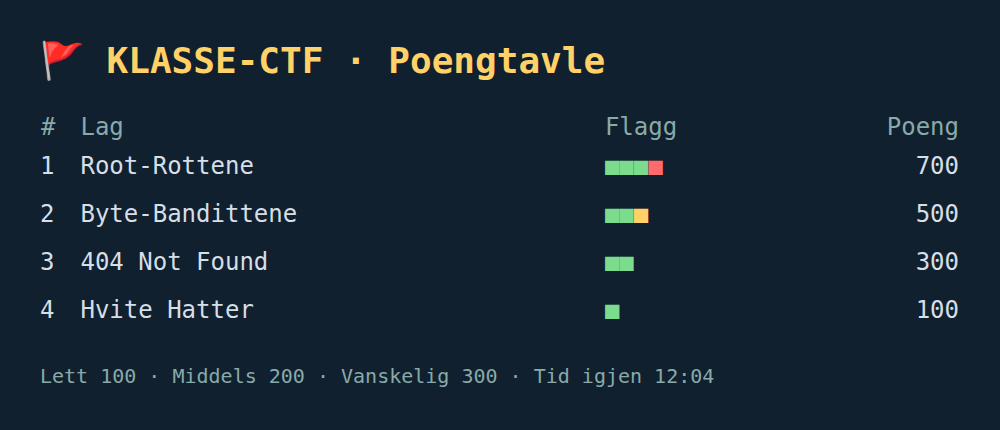

# Introduksjon {.intro}

Du har funnet flagg hele kurset. Nå er det din tur til å gjemme dem. En
**CTF** (Capture the Flag) er en konkurranse der deltakerne løser oppgaver for
å finne flagg. I denne oppgaven lager du en mini-CTF for klassen, med oppgaver
du har funnet på selv. Etterpå får du tips om hvor du kan fortsette.



```
FRA:   K, Byrå 404
TIL:   Hvit hatt
EMNE:  Siste oppdrag

Du er klar. Den beste måten å vise at du kan noe, er å lære det
bort. Lag et oppdrag som kunne lurt meg.

Hilsen K
```


# Steg 1: Finn på oppgavene {.activity}

En god CTF-oppgave er lett å forstå, vanskelig å løse og har ett riktig svar.

## Sjekkliste {.check}

- [ ] Velg tre oppgaver: én lett, én middels og én vanskelig. Bruk det du har
  lært:

  | Kategori | Ideer |
  |---|---|
  | Terminal | Et flagg i en skjult mappe, i en fil på nøyaktig 404 byte, eller i en fil med et rart navn |
  | Kryptografi | Et flagg kodet med base64 eller cæsarchiffer |
  | Passord | En SHA-256-hash av et ord fra en ordliste |
  | Metadata | Et flagg i kommentarfeltet i metadataene til et bilde |
  | Nettside | Et flagg i kildekoden, i en JavaScript-fil eller bak en knapp som er skjult med CSS |
  | Detektiv | En logg der deltakerne må finne én bestemt linje |

- [ ] Bestem flaggformatet, for eksempel `KLASSE{...}`.

- [ ] Skriv en kort historie og et hint til hver oppgave. Hintet skal hjelpe,
  ikke gi svaret.

## Tips {.protip}

Lag oppgavene som filer i en mappe, eller som en nettside du kjører på din
egen maskin. Base64 kan du lage i terminalen med
`echo -n 'KLASSE{hei}' | base64`.


# Steg 2: Test oppgavene {.activity}

## Sjekkliste {.check}

- [ ] La en medelev prøve oppgavene før konkurransen. Fikk de til den lette?
  Satt de fast på den vanskelige så lenge at det ble kjedelig?

- [ ] Juster oppgavene og hintene.

- [ ] Lag en fasit til læreren.


# Steg 3: Kjør konkurransen {.activity}

## Sjekkliste {.check}

- [ ] Lag en poengtavle på tavla eller i et regneark. Lett gir 100 poeng,
  middels 200 og vanskelig 300.

- [ ] Del ut oppgavene. Bestem hvor lang tid dere har, for eksempel 45
  minutter.

- [ ] Etterpå: Den som laget oppgaven, viser hvordan den løses.

## Ekte sak {.protip}

Hvert år arrangeres det CTF-konkurranser for ungdom over hele verden. Det
finnes et europamesterskap, **European Cybersecurity Challenge**, med lag fra
over 40 land. Mange av dem som jobber med sikkerhet i dag, startet med CTF.


# Steg 4: Hvor går du videre? {.activity}

| Hvor | Hva | Passer for |
|---|---|---|
| [OverTheWire](https://overthewire.org/wargames/) | Flere wargames etter Bandit, som Natas for nettsider | Alle. Ingen konto |
| [picoCTF](https://picoctf.org) | Hundrevis av oppgaver fra Carnegie Mellon University, åpne hele året | Fra 13 år. Under 18 må en foresatt godkjenne kontoen, eller læreren lager kontoer for klassen |
| [CyberSmart fra NTNU](https://www.ntnu.edu/ccis/cybersmart) | Sikkerhetsuker og kurs for unge og lærere i Norge | Spør læreren om skolen kan være med |
| [cybertalent.no](https://cybertalent.no) | Om å jobbe med cybersikkerhet i Etterretningstjenesten | Når du blir eldre |

## Sjekkliste {.check}

- [ ] Velg ett sted og prøv én oppgave denne uka.

- [ ] Sjekk aldersgrensen og vilkårene der du registrerer deg.

## Test deg selv {.flag}

- [ ] Hva gjør en CTF-oppgave god?

- [ ] Hvilke regler gjelder fortsatt, selv om du har lært mye? Se
  [Hvit hatt](../hvit_hatt/hvit_hatt).


## Utfordring {.challenge}

Kjør `python3 sjekk.py status`. Har du alle 16 flaggene og graden **Hvit
hatt**? Da har du fullført Hackerskolen. Ta skjermbilde av flaggboka og vis
den fram.
