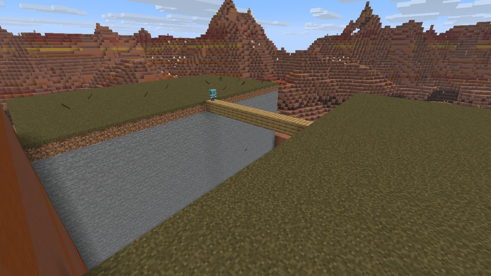

# Introduksjon {.intro}

Du står ved kanten av en dal eller ei elv, og du vil over. Roboten kan bygge en
bro. Men hvor lang må den være? Roboten **måler** først hvor bred dalen er, og
husker tallet i en **variabel**. Så legger den akkurat så mange planker som
trengs. Til slutt lager du en **funksjon med en parameter**, så du kan skrive
`bro` i chatten ved hver dal du kommer til.

Du bør ha gjort oppgaven [Steinsti og
trapp](../steinsti_og_trapp/steinsti_og_trapp.html) først.




# Før du starter {.activity}

## Sjekkliste {.check}

- [ ] Start Minecraft med Halison Code. Åpne en vanlig verden i `Kreativ` modus
  (Creative) med `Tillat kommandoer` på (Allow Commands). Den må ha trær og
  fjell, så ikke velg `Superflat`.

- [ ] Trykk `T` for å åpne chatten, skriv `/robot spawn` og trykk Enter. Roboten
  dukker opp ved føttene dine og ser samme vei som deg.

- [ ] Trykk `T` igjen, skriv `/halisoncode` og trykk Enter. Editoren åpnes i
  nettleseren. Trykk `Nytt prosjekt`.

- [ ] Skriv `/gamerule halisoncode:pause_on_lost_focus false` i chatten. Da går
  ikke spillet på pause når du bytter til editoren, og du ser hva roboten gjør
  mens du jobber. Du trenger bare gjøre det én gang i hver verden.

## Slik bytter du mellom Minecraft og editoren {.tip}

- Du lager programmet i nettleseren og ser roboten i Minecraft. Bytt vindu med
  `Alt` + `Tab` (på Mac `Cmd` + `Tab`). Hold inne `Alt` og trykk `Tab` til
  Minecraft er valgt, og slipp.

- Trykk alltid på `Kjør` i editoren **før** du bytter til Minecraft. Programmet
  kjører fra nettleseren, så la editoren stå åpen.

- Viser Minecraft pausemenyen når du kommer tilbake, trykk `Fortsett spill`
  (Back to Game). Roboten står stille så lenge spillet er på pause. Har du ikke
  skrevet `/gamerule halisoncode:pause_on_lost_focus false`, gjør det nå. Du kan
  også trykke `F3` + `P` i Minecraft.

- Er roboten borte eller langt unna, skriv `/robot spawn` igjen. Vil du stoppe
  et program, trykk stoppknappen i editoren eller skriv `/robot stop`.


# Steg 1: Mål dalen {.activity}

`robot mål fritt fremover opptil 32` fra gruppen `Måling` i kategorien `Robot`
teller hvor mange tomme blokker det er foran roboten før den treffer noe.
Roboten står stille mens den måler.

Broen skal ligge i samme høyde som bakken. Derfor flytter roboten seg først ut
over dalen og ett hakk ned, så den er der broen skal være.

## Sjekkliste {.check}

- [ ] Finn en dal eller ei elv der bakken er like høy på begge sider. Still deg
  helt ytterst på kanten, og se rett over til den andre siden.

- [ ] Skriv `/robot spawn`. Lag et nytt prosjekt.

- [ ] I `ved start`: `robot flytt fremover med 1` og så `robot flytt ned med 1`.

- [ ] Åpne `Variabler` og lag en variabel som heter `bredde`.

- [ ] Legg til `sett bredde til`, og dra `robot mål fritt fremover opptil 32`
  inn i feltet.

- [ ] Legg til `robot si`, og dra `bredde` inn i feltet.

## Test prosjektet {.flag}

__Trykk på `Kjør`.__

- [ ] Bytt til Minecraft med `Alt` + `Tab` og se på roboten.

- [ ] Hvilket tall sier roboten? Tell selv hvor mange blokker det er over til
  den andre siden. Roboten står allerede over det første hullet, så tallet skal
  være én mindre enn hele bredden. Stemmer det?

## Tips {.tip}

Finner du ingen dal, kan du lage en selv. Se mot øst (`F3` viser `Facing:
east`), og skriv `/fill ~1 ~-8 ~-2 ~10 ~-1 ~2 air` i chatten. Da blir det en
grop som er 10 blokker bred rett foran deg.


# Steg 2: Legg broen {.activity}

I Steinsti og trapp så du at `robot hjelp plasser ved flytting` legger en blokk
der roboten var, for hvert steg den tar. Nå bruker vi det til å lage en bro.

## Sjekkliste {.check}

- [ ] Øverst i `ved start`: `robot gi eikeplanker antall 64 i plass 1` og `robot
  velg plass 1`.

- [ ] Nederst: `robot hjelp plasser ved flytting sant`.

- [ ] Så `robot flytt fremover med`, og dra `bredde` inn i feltet for antall.

- [ ] Så `robot flytt opp med 1`.

- [ ] Til slutt `robot hjelp plasser ved flytting usant`.

## Test prosjektet {.flag}

__Gå til en ny dal, skriv `/robot spawn` og trykk `Kjør`.__

- [ ] Bytt til Minecraft med `Alt` + `Tab` og se på roboten.

- [ ] Ligger det en bro helt over? Gå over den.

- [ ] Ta bort `robot flytt opp med 1` og prøv igjen. Hva mangler nå?

## Tips {.protip}

Roboten legger planken i blokken den forlater. Etter `bredde` steg står den
fortsatt i det siste hullet. Når den flytter seg opp, legger den den siste
planken under seg.


# Steg 3: En funksjon for broen {.activity}

Programmet for broen er det samme hver gang. Det eneste som endrer seg, er
lengden. Da lager vi en **funksjon** med lengden som **parameter**.

## Sjekkliste {.check}

- [ ] Åpne `Avansert` og `Funksjoner`. Trykk `Lag en funksjon...` og kall den
  `byggBro`.

- [ ] Trykk på `Ny parameter`, velg `Tall`, og kall den `lengde`. Trykk
  `Ferdig`.

- [ ] Flytt alle blokkene fra `robot gi` til den siste `robot hjelp` inn i
  funksjonen.

- [ ] I `robot flytt fremover med`, bytt ut `bredde` med `lengde` fra
  funksjonen.

- [ ] I `ved start`, etter `robot si`, legg til `kjør byggBro` med `bredde` som
  lengde.

## Test prosjektet {.flag}

__Kjør programmet ved en ny dal.__

- [ ] Bytt til Minecraft med `Alt` + `Tab` og se på roboten.

- [ ] Virker det like godt som før?

- [ ] Hvorfor er det lurt at funksjonen ikke måler selv? Tenk på en bro der du
  vil bestemme lengden.


# Steg 4: Bro fra chatten {.activity}

Nå vil vi bygge en bro ved hver dal, bare ved å skrive `bro`. Men hva om dalen
er bredere enn 32? Da finner ikke roboten den andre siden, og målingen gir 32.
Da skal roboten si fra i stedet for å bygge.

## Sjekkliste {.check}

- [ ] Dra `når chatkommando` fra `Spiller` ut, og skriv `bro`.

- [ ] Flytt alle blokkene fra `ved start` inn i den.

- [ ] Dra en `hvis ... ellers` fra `Logikk` inn under `sett bredde til`.

- [ ] Betingelsen: `bredde` `=` `32`. Inni `hvis`: `robot si Dalen er for
  bred!`.

- [ ] Flytt `robot si bredde` og `kjør byggBro` inn i `ellers`.

- [ ] Trykk `Kjør` én gang.

## Test prosjektet {.flag}

__Still deg ytterst på kanten av en dal, skriv `/robot spawn` og så `bro`.__

- [ ] Trykk `Kjør` i editoren først. Bytt så til Minecraft med `Alt` + `Tab`.

- [ ] Bygger roboten en bro i riktig lengde?

- [ ] Prøv ved et stort hav. Sier roboten at det er for bredt?

## Tips {.tip}

Roboten måler gjennom vann, for vann stopper den ikke. Planker kan legges rett i
vannet, så det går fint å bygge bro over ei elv også.


# Programmet i JavaScript {.activity}

```javascript
function byggBro(lengde: number) {
    agent.setItem(Block.OakPlanks, 64, 1)
    agent.setSlot(1)
    agent.setAssist(AgentAssist.PlaceOnMove, true)
    agent.move(SixDirection.Forward, lengde)
    agent.move(SixDirection.Up, 1)
    agent.setAssist(AgentAssist.PlaceOnMove, false)
}
player.onChat("bro", function (num1, num2, num3) {
    agent.move(SixDirection.Forward, 1)
    agent.move(SixDirection.Down, 1)
    let bredde = agent.measure(SixDirection.Forward, 32)
    if (bredde == 32) {
        agent.say("Dalen er for bred!")
    } else {
        agent.say("" + bredde)
        byggBro(bredde)
    }
})
```

## Utfordring {.challenge}

- [ ] Gi broen **rekkverk**. Gi roboten `eikegjerde` i plass 2. Etter broen kan
  roboten snu, flytte seg til siden og ett hakk opp, og gå tilbake langs kanten
  mens den legger gjerde.

- [ ] Lag broen tre blokker bred, med en `gjenta 3 ganger` rundt broen og et
  steg til siden mellom hver gang.

- [ ] Sett en fakkel på hver ende av broen, så du finner den i mørket.

- [ ] `robot mål åpning` måler hele bredden der roboten står, begge veier langs
  en akse (`x` eller `z`). Prøv den i stedet for `robot mål fritt`. Får du samme
  tall?
