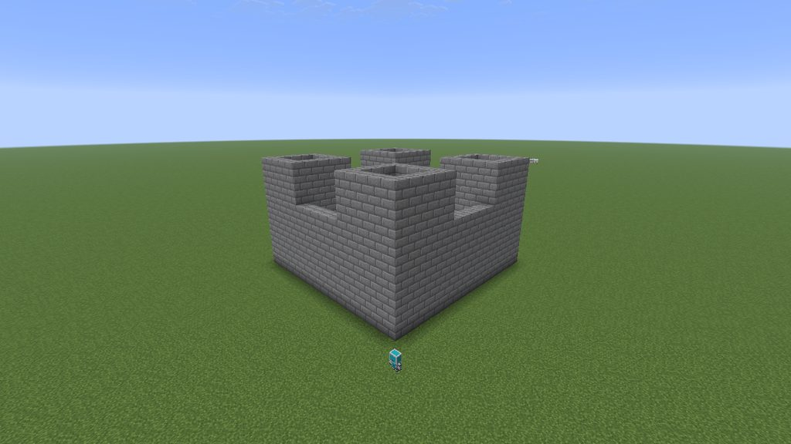
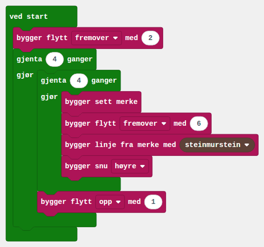

# Introduksjon {.intro}

Halison Code har en **usynlig bygger**. Den kan gå, snu seg og legge blokker,
akkurat som en penn som tegner. I stedet for å regne ut hjørner, sier du hvor
byggeren skal gå. Du starter med en mur, lager en firkant og et tårn med
**løkker**, og til slutt bygger du et lite slott med en **funksjon med
parametere**.

Har du prøvd **skilpaddegrafikk** i Python? Byggeren virker på samme måte.
Skilpadda tegner en strek når den går, og byggeren legger blokker.

Du bør ha gjort oppgaven [Bygg et hus](../bygg_et_hus/bygg_et_hus.html) først.




# Før du starter {.activity}

## Sjekkliste {.check}

- [ ] Start Minecraft med Halison Code. Åpne en flat verden i `Kreativ` modus
  (Creative) med `Tillat kommandoer` på (Allow Commands). Velg `Superflat` under
  `Verdenstype` (World Type).

- [ ] Trykk `T` for å åpne chatten, skriv `/robot spawn` og trykk Enter. Roboten
  dukker opp ved føttene dine og ser samme vei som deg.

- [ ] Trykk `T` igjen, skriv `/halisoncode` og trykk Enter. Editoren åpnes i
  nettleseren. Trykk `Nytt prosjekt`.

- [ ] Skriv `/gamerule halisoncode:pause_on_lost_focus false` i chatten. Da går
  ikke spillet på pause når du bytter til editoren, og du ser hva roboten gjør
  mens du jobber. Du trenger bare gjøre det én gang i hver verden.

## Slik bytter du mellom Minecraft og editoren {.tip}

- Du lager programmet i nettleseren og ser roboten i Minecraft. Bytt vindu med
  `Alt` + `Tab` (på Mac `Cmd` + `Tab`). Hold inne `Alt` og trykk `Tab` til
  Minecraft er valgt, og slipp.

- Trykk alltid på `Kjør` i editoren **før** du bytter til Minecraft. Programmet
  kjører fra nettleseren, så la editoren stå åpen.

- Viser Minecraft pausemenyen når du kommer tilbake, trykk `Fortsett spill`
  (Back to Game). Roboten står stille så lenge spillet er på pause. Har du ikke
  skrevet `/gamerule halisoncode:pause_on_lost_focus false`, gjør det nå. Du kan
  også trykke `F3` + `P` i Minecraft.

- Er roboten borte eller langt unna, skriv `/robot spawn` igjen. Vil du stoppe
  et program, trykk stoppknappen i editoren eller skriv `/robot stop`.


# Steg 1: Byggeren går og legger blokker {.activity}

Byggeren starter ved føttene dine og ser mot **sør** hver gang programmet
starter, uansett hvilken vei du ser. Blokkene finner du i kategorien `Bygger`.
Roboten er den som bygger, så den må være innenfor 32 blokker.

## Sjekkliste {.check}

- [ ] Lag et nytt prosjekt.

- [ ] Legg `bygger flytt fremover med 2` i `ved start`, så byggeren ikke starter
  oppi deg.

- [ ] Legg til `gjenta 4 ganger` fra `Løkker`, og endre `4` til `10`.

- [ ] Inni løkka: `bygger plasser steinmurstein` og `bygger flytt fremover med
  1`.

## Test prosjektet {.flag}

__Trykk på `Kjør`.__

- [ ] Bytt til Minecraft med `Alt` + `Tab` og se på roboten.

- [ ] Ligger det en rad med 10 steinmurstein mot sør? Trykk `F3` og se på
  `Facing` for å finne sør.


# Steg 2: En firkant {.activity}

Å legge én og én blokk er tregt. `bygger sett merke` husker hvor byggeren står.
`bygger linje fra merke med` legger en hel linje fra merket og frem til der
byggeren er nå.

En firkant er fire like sider. Etter hver side snur byggeren seg.

## Sjekkliste {.check}

- [ ] Ta løkka ut av `ved start` og slett den. La `bygger flytt fremover med 2`
  stå.

- [ ] Legg til en ny `gjenta 4 ganger`.

- [ ] Inni løkka: `bygger sett merke`, `bygger flytt fremover med 6`, `bygger
  linje fra merke med steinmurstein` og `bygger snu høyre`.

## Test prosjektet {.flag}

__Gå litt bort fra den gamle raden og kjør.__

- [ ] Bytt til Minecraft med `Alt` + `Tab` og se på roboten.

- [ ] Er det en firkant på bakken? Hvor mange blokker er hver side?

- [ ] Byggeren gikk 6, men siden ble 7 blokker. Hvorfor?

## Tips {.protip}

I Python med skilpadde ser en firkant slik ut:

```python
for i in range(4):
    forward(100)
    right(90)
```

Byggeren gjør det samme, men med blokker i stedet for en strek.


# Steg 3: En mur rundt {.activity}

En firkant er ett lag. Legger vi mange lag oppå hverandre, får vi en mur. Da
legger vi firkant-løkka **inni** en ny løkke.

## Sjekkliste {.check}

- [ ] Dra en ny `gjenta 4 ganger` inn under `bygger flytt fremover med 2`.

- [ ] Flytt hele firkant-løkka inn i den nye løkka.

- [ ] Under firkant-løkka, men fortsatt inni den store løkka: `bygger flytt opp
  med 1`.



## Test prosjektet {.flag}

__Gå til et nytt sted og kjør.__

- [ ] Bytt til Minecraft med `Alt` + `Tab` og se på roboten.

- [ ] Er det en mur som er 4 blokker høy?

- [ ] Hvor mange ganger kjørte `bygger linje fra merke med`?


# Steg 4: Et tårn i din størrelse {.activity}

Nå lager vi en funksjon som bygger et tårn. Med to **parametere** kan du
bestemme hvor bredt og hvor høyt tårnet blir.

## Sjekkliste {.check}

- [ ] Åpne `Avansert` og `Funksjoner`. Lag en funksjon `byggTårn`. Trykk på `Ny
  parameter`, velg `Tall`, og kall den `side`. Lag en til som heter `høyde`.

- [ ] Flytt den store løkka fra `ved start` inn i funksjonen.

- [ ] I den store løkka, bytt ut `4` med `høyde`. I firkant-løkka, bytt ut `6` i
  `bygger flytt fremover` med `side`.

- [ ] Nederst i funksjonen, etter den store løkka: `bygger flytt ned med`
  `høyde`. Da står byggeren der den startet.

- [ ] Dra `når chatkommando` fra `Spiller`, og skriv `tårn`. Legg inn `bygger
  teleporter til ~2 ~0 ~2`, `bygger vend mot øst` og `kjør byggTårn` med `num1`
  som side og `num2` som høyde.

- [ ] Trykk `Kjør` én gang.

## Test prosjektet {.flag}

__Skriv `tårn 4 10` i chatten. Gå et annet sted og skriv `tårn 8 5`.__

- [ ] Trykk `Kjør` i editoren først. Bytt så til Minecraft med `Alt` + `Tab`.

- [ ] Blir tårnene så brede og høye som du ba om?

## Tips {.tip}

`bygger teleporter til ~2 ~0 ~2` flytter byggeren til et sted ved siden av deg.
Uten den ville neste tårn startet der byggeren var sist.


# Steg 5: Et slott {.activity}

Et slott har et tårn i hvert hjørne og en mur mellom tårnene. Det er en firkant
der hver side er et tårn og en mur. `bygger fyll fra merke med` fyller en hel
boks fra merket til byggeren, så muren blir laget med én blokk.

## Sjekkliste {.check}

- [ ] Lag en ny funksjon `byggSlott`, uten parametere.

- [ ] Inni: `gjenta 4 ganger` med disse blokkene: `kjør byggTårn` med side `4`
  og høyde `9`, `bygger sett merke`, `bygger flytt fremover med 14`, `bygger
  flytt opp med 5`, `bygger fyll fra merke med steinmurstein erstatt`, `bygger
  flytt ned med 5` og `bygger snu høyre`.

- [ ] Lag chatkommandoen `slott`, med `bygger teleporter til ~2 ~0 ~2`, `bygger
  vend mot øst` og `kjør byggSlott`.

- [ ] Trykk `Kjør` én gang.

## Test prosjektet {.flag}

__Gå til et åpent sted, skriv `/robot spawn` og så `slott`.__

- [ ] Trykk `Kjør` i editoren først. Bytt så til Minecraft med `Alt` + `Tab`.

- [ ] Står det fire tårn med mur imellom?

- [ ] Hvor mange ganger kjørte `bygger linje fra merke med` til sammen? Tips: 4
  slott-sider, 9 lag i hvert tårn og 4 sider i hvert lag.


# Programmet i JavaScript {.activity}

```javascript
function byggTårn(side: number, høyde: number) {
    for (let i = 0; i < høyde; i++) {
        for (let j = 0; j < 4; j++) {
            builder.mark()
            builder.move(SixDirection.Forward, side)
            builder.line(Block.StoneBricks)
            builder.turn(TurnDirection.Right)
        }
        builder.move(SixDirection.Up, 1)
    }
    builder.move(SixDirection.Down, høyde)
}
function byggSlott() {
    for (let k = 0; k < 4; k++) {
        byggTårn(4, 9)
        builder.mark()
        builder.move(SixDirection.Forward, 14)
        builder.move(SixDirection.Up, 5)
        builder.fill(Block.StoneBricks, FillOperation.Replace)
        builder.move(SixDirection.Down, 5)
        builder.turn(TurnDirection.Right)
    }
}
player.onChat("tårn", function (num1, num2, num3) {
    builder.teleportTo(pos(2, 0, 2))
    builder.face(CompassDirection.East)
    byggTårn(num1, num2)
})
player.onChat("slott", function (num1, num2, num3) {
    builder.teleportTo(pos(2, 0, 2))
    builder.face(CompassDirection.East)
    byggSlott()
})
```

## Utfordring {.challenge}

- [ ] Slottet har ingen port. Lag en med `fyll med luft` fra `Blokker`, eller
  flytt byggeren til midten av en mur og bruk `bygger fyll fra merke med luft`.

- [ ] Gi tårnene tinder: annenhver blokk på toppen. Tips: `bygger plasser` og
  `bygger flytt fremover med 2` i en løkke.

- [ ] Gi `byggSlott` en parameter for hvor langt det er mellom tårnene.

- [ ] Lag andre figurer med byggeren: en spiral der hver side blir litt lengre,
  eller en trapp med `bygger flytt opp` og `bygger flytt fremover` annenhver
  gang.
