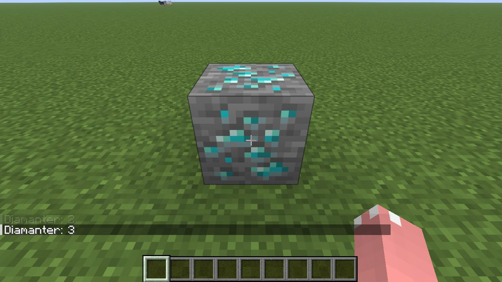

# Introduksjon {.intro}

Til nå har programmene dine startet når du trykker `Kjør` eller skriver noe i
chatten. Et program kan også vente på at noe skjer i spillet. Det kalles en
**hendelse**. I denne oppgaven lager du en diamantvarsler: hver gang du knuser
diamantmalm, sier programmet fra i chatten og teller hvor mange du har funnet.
Til slutt sier det god morgen når en ny dag begynner.

Du bør ha gjort oppgaven [Kom i gang](../kom_i_gang/kom_i_gang.html) først.




# Før du starter {.activity}

## Sjekkliste {.check}

- [ ] Start Minecraft med Halison Code. Åpne en vanlig verden i `Kreativ` modus
  (Creative) med `Tillat kommandoer` på (Allow Commands). Den må ha fjell og
  grotter med malm, så ikke velg `Superflat`.

- [ ] Trykk `T` for å åpne chatten, skriv `/robot spawn` og trykk Enter. Roboten
  dukker opp ved føttene dine og ser samme vei som deg.

- [ ] Trykk `T` igjen, skriv `/halisoncode` og trykk Enter. Editoren åpnes i
  nettleseren. Trykk `Nytt prosjekt`.

- [ ] Skriv `/gamerule halisoncode:pause_on_lost_focus false` i chatten. Da går
  ikke spillet på pause når du bytter til editoren, og du ser hva roboten gjør
  mens du jobber. Du trenger bare gjøre det én gang i hver verden.

## Slik bytter du mellom Minecraft og editoren {.tip}

- Du lager programmet i nettleseren og ser roboten i Minecraft. Bytt vindu med
  `Alt` + `Tab` (på Mac `Cmd` + `Tab`). Hold inne `Alt` og trykk `Tab` til
  Minecraft er valgt, og slipp.

- Trykk alltid på `Kjør` i editoren **før** du bytter til Minecraft. Programmet
  kjører fra nettleseren, så la editoren stå åpen.

- Viser Minecraft pausemenyen når du kommer tilbake, trykk `Fortsett spill`
  (Back to Game). Roboten står stille så lenge spillet er på pause. Har du ikke
  skrevet `/gamerule halisoncode:pause_on_lost_focus false`, gjør det nå. Du kan
  også trykke `F3` + `P` i Minecraft.

- Er roboten borte eller langt unna, skriv `/robot spawn` igjen. Vil du stoppe
  et program, trykk stoppknappen i editoren eller skriv `/robot stop`.


# Steg 1: Diamanter! {.activity}

`når diamantmalm blir ødelagt` er en hendelse. Koden inni kjører hver gang du
selv knuser en slik blokk.

## Sjekkliste {.check}

- [ ] Åpne kategorien `Blokker` og dra `når (blokk) blir ødelagt` ut på
  arbeidsflaten. Den skal ikke inn i `ved start`. Velg `diamantmalm`.

- [ ] Åpne `Spiller` og dra `si i chatten` inn i den. Skriv `Diamanter!`.

- [ ] Trykk `Kjør`.

## Test prosjektet {.flag}

__Sett ut diamantmalm og knus den.__

- [ ] Bytt til Minecraft med `Alt` + `Tab` og se på roboten.

- [ ] Trykk `E` og søk etter `Diamond Ore` (diamantmalm). Sett ut tre blokker på
  bakken.

- [ ] Knus én av dem. Står det `Diamanter!` i chatten?

- [ ] Knus de to andre. Kommer meldingen hver gang?

## Tips {.tip}

Programmet blir ikke ferdig etter siste blokk. Det fortsetter å kjøre og vente
på hendelser til du trykker stoppknappen i editoren eller skriver `/robot stop`.
La editoren stå åpen.


# Steg 2: Flere malmer {.activity}

Et program kan vente på mange slags blokker samtidig, høyst 16.

## Sjekkliste {.check}

- [ ] Dra en ny `når (blokk) blir ødelagt` ut på arbeidsflaten. Velg `gullmalm`,
  og legg inn `si i chatten Gull!`.

- [ ] Lag en til for `jernmalm` som sier `Jern!`.

- [ ] Trykk `Kjør` igjen.

## Test prosjektet {.flag}

__Sett ut gullmalm og jernmalm og knus dem.__

- [ ] Trykk `Kjør` i editoren først. Bytt så til Minecraft med `Alt` + `Tab`.

- [ ] Får hver malm sin egen melding?

- [ ] Skriv `/robot spawn`, sett en diamantmalm rett foran roboten og skriv
  `/robot destroy forward`. Kommer det en melding nå?

## Tips {.protip}

Bare blokker **du** knuser, teller. Blokker roboten eller andre spillere knuser,
gir ingen melding. Dypt nede er diamantmalm ofte `Deepslate Diamond Ore`. Det er
en annen blokk, så den gir heller ingen melding.


# Steg 3: Tell diamantene {.activity}

Nå skal programmet huske hvor mange diamanter du har funnet. Da trenger vi en
**variabel**: en boks med et navn, der programmet kan legge et tall.

## Sjekkliste {.check}

- [ ] Åpne `Variabler` og lag en variabel som heter `diamanter`.

- [ ] Dra `sett diamanter til 0` inn i `ved start`.

- [ ] Inni `når diamantmalm blir ødelagt`, over `si i chatten`, legg til `endre
  diamanter med 1`.

- [ ] Åpne `Avansert` og `Tekst`. Dra `slå sammen` inn i `si i chatten`. Skriv
  `Diamanter: ` i det første feltet, og dra variabelen `diamanter` inn i det
  andre.

- [ ] Trykk `Kjør`.

## Test prosjektet {.flag}

__Sett ut fem diamantmalm og knus dem en etter en.__

- [ ] Bytt til Minecraft med `Alt` + `Tab` og se på roboten.

- [ ] Teller tallet i chatten opp for hver blokk?

- [ ] Trykk stopp og `Kjør` igjen. Hvorfor starter tellingen på nytt?


# Steg 4: God morgen {.activity}

En annen hendelse er `når en ny dag begynner`. Den kjører hver morgen i spillet.

## Sjekkliste {.check}

- [ ] Åpne kategorien `Vær og tid` og dra `når en ny dag begynner` ut på
  arbeidsflaten.

- [ ] Inni den: `si i chatten` med `slå sammen`, `I går fant du ` og
  `diamanter`.

- [ ] Under den: `sett diamanter til 0`, så hver dag starter på null.

- [ ] Trykk `Kjør`.

## Test prosjektet {.flag}

__Knus noen diamantmalm, og spol så tiden fram til neste morgen.__

- [ ] Trykk `Kjør` i editoren først. Bytt så til Minecraft med `Alt` + `Tab`.

- [ ] Knus tre diamantmalm.

- [ ] Skriv `/time set night` i chatten, og så `/time set day`. Får du en
  melding om gårsdagens diamanter?

- [ ] Knus en diamantmalm til. Starter tellingen på 1?

## Tips {.tip}

En ny dag begynner når klokka i spillet går fra natt til morgen. Det skjer når
du sover i en seng, og når du skriver `/time set day` om natten eller kvelden.
Er det allerede morgen, skjer ingenting.


# Programmet i JavaScript {.activity}

```javascript
let diamanter = 0
blocks.onBlockBroken(Block.DiamondOre, function () {
    diamanter += 1
    player.say("Diamanter: " + diamanter)
})
blocks.onBlockBroken(Block.GoldOre, function () {
    player.say("Gull!")
})
blocks.onBlockBroken(Block.IronOre, function () {
    player.say("Jern!")
})
gameplay.onDayStart(function () {
    player.say("I går fant du " + diamanter)
    diamanter = 0
})
```

## Utfordring {.challenge}

- [ ] Lag en variabel for gull også, og si begge tallene hver morgen.

- [ ] Bruk `hvis` fra `Logikk`: når du har funnet 10 diamanter, skal programmet
  si `Du er rik!`.

- [ ] La roboten feire med `robot flytt opp med 3` og `robot flytt ned med 3`
  hver gang du finner en diamant.

- [ ] Lag en ny verden i `Overlevelse` (Survival), og bruk varsleren når du
  leter etter ekte malm i en grotte.
