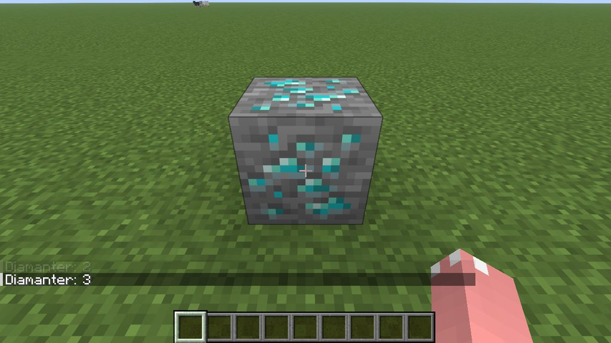

# Introduksjon {.intro}

Til no har programma dine starta når du trykkjer `Kjør` eller skriv noko i
chatten. Eit program kan òg vente på at noko skjer i spelet. Det blir kalla ei
**hending**. I denne oppgåva lagar du ein diamantvarslar: kvar gong du knuser
diamantmalm, seier programmet frå i chatten og tel kor mange du har funne.
Til slutt seier det god morgon når ein ny dag byrjar.

Du bør ha gjort oppgåva [Kom i gang](../kom_i_gang/kom_i_gang_nn.html) først.




# Før du startar {.activity}

## Sjekkliste {.check}

- [ ] Start Minecraft med Halison Code. Opne ei vanleg verd i `Skapande` modus
  (Creative) med `Tillat fusk` på (Allow Commands). Ho må ha fjell og grotter
  med malm, så ikkje vel `Vassrett` (Superflat).

- [ ] Trykk `T` for å opne chatten, skriv `/robot spawn` og trykk Enter. Roboten
  dukkar opp ved føtene dine og ser same veg som deg.

- [ ] Trykk `T` igjen, skriv `/halisoncode` og trykk Enter. Editoren opnar seg
  i nettlesaren. Trykk `Nytt prosjekt`.

- [ ] Skriv `/gamerule halisoncode:pause_on_lost_focus false` i chatten. Då går
  ikkje spelet på pause når du byter til editoren, og du ser kva roboten gjer
  medan du jobbar. Du treng berre gjere det éin gong i kvar verd.

## Slik byter du mellom Minecraft og editoren {.tip}

- Du lagar programmet i nettlesaren og ser roboten i Minecraft. Byt vindauge med
  `Alt` + `Tab` (på Mac `Cmd` + `Tab`). Hald inne `Alt` og trykk `Tab` til
  Minecraft er valt, og slepp.

- Trykk alltid på `Kjør` i editoren **før** du byter til Minecraft. Programmet
  køyrer frå nettlesaren, så la editoren stå open.

- Viser Minecraft pausemenyen når du kjem tilbake, trykk `Attende til spelet`
  (Back to Game). Roboten står stille så lenge spelet er på pause. Har du ikkje
  skrive `/gamerule halisoncode:pause_on_lost_focus false`, gjer det no. Du kan
  òg trykke `F3` + `P` i Minecraft.

- Er roboten borte eller langt unna, skriv `/robot spawn` igjen. Vil du stoppe
  eit program, trykk stoppknappen i editoren eller skriv `/robot stop`.

- Prosjektet blir lagra av seg sjølv i nettlesaren på denne datamaskina. Vil du
  ha det med til ei anna maskin, trykk lagre-knappen ved sida av prosjektnamnet
  nedst i editoren. Då får du ei `.mkcd`-fil.


# Steg 1: Diamantar! {.activity}

`når diamantmalm blir ødelagt` er ei hending. Koden inni køyrer kvar gong du
sjølv knuser ei slik blokk.

## Sjekkliste {.check}

- [ ] Opne kategorien `Blokker` og dra `når (blokk) blir ødelagt` ut på
  arbeidsflata. Han skal ikkje inn i `ved start`. Vel `diamantmalm`.

- [ ] Opne `Spiller` og dra `si i chatten` inn i han. Skriv `Diamanter!`.

- [ ] Trykk `Kjør`.

## Test prosjektet {.flag}

__Set ut diamantmalm og knus han.__

- [ ] Byt til Minecraft med `Alt` + `Tab` og sjå på roboten.

- [ ] Trykk `E` og søk etter `Diamond Ore` (diamantmalm). Set ut tre blokker på
  bakken.

- [ ] Knus éi av dei. Står det `Diamanter!` i chatten?

- [ ] Knus dei to andre. Kjem meldinga kvar gong?

## Tips {.tip}

Programmet blir ikkje ferdig etter siste blokk. Det held fram med å køyre og
vente på hendingar til du trykkjer stoppknappen i editoren eller skriv
`/robot stop`. La editoren stå open.


# Steg 2: Fleire malmar {.activity}

Eit program kan vente på mange slags blokker samtidig, høgst 16.

## Sjekkliste {.check}

- [ ] Dra ein ny `når (blokk) blir ødelagt` ut på arbeidsflata. Vel `gullmalm`,
  og legg inn `si i chatten Gull!`.

- [ ] Lag ein til for `jernmalm` som seier `Jern!`.

- [ ] Trykk `Kjør` igjen.

## Test prosjektet {.flag}

__Set ut gullmalm og jernmalm og knus dei.__

- [ ] Trykk `Kjør` i editoren først. Byt så til Minecraft med `Alt` + `Tab`.

- [ ] Får kvar malm si eiga melding?

- [ ] Skriv `/robot spawn`, set ein diamantmalm rett framfor roboten og skriv
  `/robot destroy forward`. Kjem det ei melding no?

## Tips {.protip}

Berre blokker **du** knuser, tel. Blokker roboten eller andre spelarar knuser,
gir inga melding. Djupt nede er diamantmalm ofte `Deepslate Diamond Ore`. Det
er ei anna blokk, så ho gir heller inga melding.


# Steg 3: Tel diamantane {.activity}

No skal programmet hugse kor mange diamantar du har funne. Då treng vi ein
**variabel**: ein boks med eit namn, der programmet kan leggje eit tal.

## Sjekkliste {.check}

- [ ] Opne `Variabler` og lag ein variabel som heiter `diamanter`.

- [ ] Dra `sett diamanter til 0` inn i `ved start`.

- [ ] Inni `når diamantmalm blir ødelagt`, over `si i chatten`, legg til `endre
  diamanter med 1`.

- [ ] Opne `Avansert` og `Tekst`. Dra `slå sammen` inn i `si i chatten`. Skriv
  `Diamanter: ` i det første feltet, og dra variabelen `diamanter` inn i det
  andre.

- [ ] Trykk `Kjør`.

## Test prosjektet {.flag}

__Set ut fem diamantmalm og knus dei ein etter ein.__

- [ ] Byt til Minecraft med `Alt` + `Tab` og sjå på roboten.

- [ ] Tel talet i chatten opp for kvar blokk?

- [ ] Trykk stopp og `Kjør` igjen. Kvifor startar teljinga på nytt?


# Steg 4: God morgon {.activity}

Ei anna hending er `når en ny dag begynner`. Ho køyrer kvar morgon i spelet.

## Sjekkliste {.check}

- [ ] Opne kategorien `Vær og tid` og dra `når en ny dag begynner` ut på
  arbeidsflata.

- [ ] Inni han: `si i chatten` med `slå sammen`, `I går fant du ` og
  `diamanter`.

- [ ] Under han: `sett diamanter til 0`, så kvar dag startar på null.

- [ ] Trykk `Kjør`.

## Test prosjektet {.flag}

__Knus nokre diamantmalm, og spol så tida fram til neste morgon.__

- [ ] Trykk `Kjør` i editoren først. Byt så til Minecraft med `Alt` + `Tab`.

- [ ] Knus tre diamantmalm.

- [ ] Skriv `/time set night` i chatten, og så `/time set day`. Får du ei
  melding om diamantane frå i går?

- [ ] Knus ein diamantmalm til. Startar teljinga på 1?

## Tips {.tip}

Ein ny dag byrjar når klokka i spelet går frå natt til morgon. Det skjer når du
søv i ei seng, og når du skriv `/time set day` om natta eller kvelden. Er det
allereie morgon, skjer ingenting.


# Programmet i JavaScript {.activity}

```javascript
let diamanter = 0
blocks.onBlockBroken(Block.DiamondOre, function () {
    diamanter += 1
    player.say("Diamanter: " + diamanter)
})
blocks.onBlockBroken(Block.GoldOre, function () {
    player.say("Gull!")
})
blocks.onBlockBroken(Block.IronOre, function () {
    player.say("Jern!")
})
gameplay.onDayStart(function () {
    player.say("I går fant du " + diamanter)
    diamanter = 0
})
```

## Utfordring {.challenge}

- [ ] Lag ein variabel for gull òg, og sei begge tala kvar morgon.

- [ ] Bruk `hvis` frå `Logikk`: når du har funne 10 diamantar, skal programmet
  seie `Du er rik!`.

- [ ] La roboten feire med `robot flytt opp med 3` og `robot flytt ned med 3`
  kvar gong du finn ein diamant.

- [ ] Lag ei ny verd i `Overleving` (Survival), og bruk varslaren når du leitar
  etter ekte malm i ei grotte.
