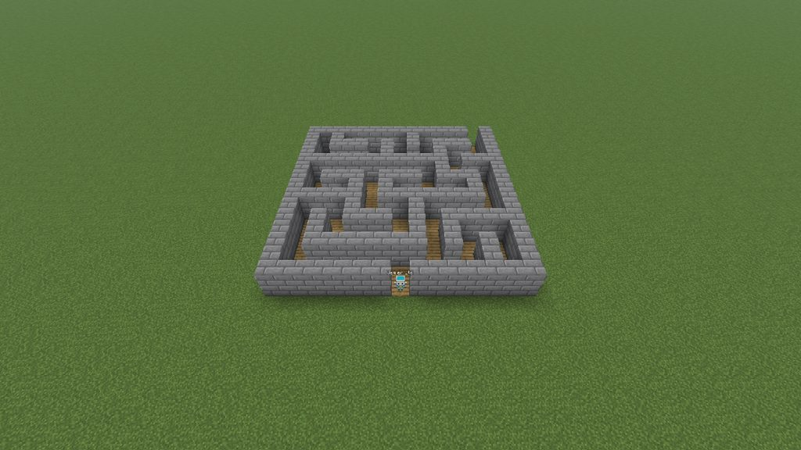

# Introduksjon {.intro}

Ein god hjelpar finn fram sjølv. I denne oppgåva lærer roboten å hugse kvar
heimen er, gå til ein stad du peikar ut og kome seg gjennom ein labyrint. Du
lærer om **posisjonar**, og om svar som er sanne eller usanne.

Du bør ha gjort oppgåva [Kom i gang](../kom_i_gang/kom_i_gang_nn.html) først.




# Før du startar {.activity}

## Sjekkliste {.check}

- [ ] Start Minecraft med Halison Code. Opne ei flat verd i `Skapande` modus
  (Creative) med `Tillat fusk` på (Allow Commands). Vel `Vassrett` (Superflat)
  under `Verdsslag` (World Type).

- [ ] Trykk `T` for å opne chatten, skriv `/robot spawn` og trykk Enter. Roboten
  dukkar opp ved føtene dine og ser same veg som deg.

- [ ] Trykk `T` igjen, skriv `/halisoncode` og trykk Enter. Editoren opnar seg i
  nettlesaren. Trykk `Nytt prosjekt`.

- [ ] Skriv `/gamerule halisoncode:pause_on_lost_focus false` i chatten. Då går
  ikkje spelet på pause når du byter til editoren, og du ser kva roboten gjer
  medan du jobbar. Du treng berre gjere det éin gong i kvar verd.

## Slik byter du mellom Minecraft og editoren {.tip}

- Du lagar programmet i nettlesaren og ser roboten i Minecraft. Byt vindauge
  med `Alt` + `Tab` (på Mac `Cmd` + `Tab`). Hald inne `Alt` og trykk `Tab` til
  Minecraft er valt, og slepp.

- Trykk alltid på `Kjør` i editoren **før** du byter til Minecraft. Programmet
  køyrer frå nettlesaren, så la editoren stå open.

- Viser Minecraft pausemenyen når du kjem tilbake, trykk `Attende til spelet`
  (Back to Game). Roboten står stille så lenge spelet er på pause. Har du ikkje
  skrive `/gamerule halisoncode:pause_on_lost_focus false`, gjer det no. Du kan
  òg trykke `F3` + `P` i Minecraft.

- Er roboten borte eller langt unna, skriv `/robot spawn` igjen. Vil du stoppe
  eit program, trykk stoppknappen i editoren eller skriv `/robot stop`.

- Prosjektet blir lagra av seg sjølv i nettlesaren på denne datamaskina. Vil du
  ha det med til ei anna maskin, trykk lagre-knappen ved sida av prosjektnamnet
  nedst i editoren. Då får du ei `.mkcd`-fil.


# Steg 1: Heime {.activity}

Roboten kan hugse éin stad som heimen sin. Etterpå finn han vegen tilbake
dit, òg rundt hindringar.

## Sjekkliste {.check}

- [ ] Dra `robot sett hjem` frå kategorien `Robot` inn i `ved start`.

- [ ] Under den: `robot flytt fremover med 5`, `robot snu venstre` og `robot
  flytt fremover med 5`.

- [ ] Til slutt skal roboten gå heim. `robot gå hjem` er ei rund blokk som
  svarar om han kom fram, så ho må liggje inni ei anna blokk. Opne `Variabler`,
  lag ein variabel `hjemme`, og legg `sett hjemme til` nedst. Dra `robot gå
  hjem` inn i den.

## Test prosjektet {.flag}

__Trykk på `Kjør`.__

- [ ] Byt til Minecraft med `Alt` + `Tab` og sjå på roboten.

- [ ] Går roboten ut og kjem tilbake?

- [ ] Set ein vegg av blokker der roboten gjekk, og køyr igjen. Kva veg går
  han no?

## Tips {.tip}

`robot gå hjem` finn ein veg sjølv. `robot flytt` går berre rett fram og stoppar
viss noko står i vegen.


# Steg 2: Kom hit! {.activity}

Ein stad i Minecraft har tre tal: **x**, **y** og **z**. Blokka `~0 ~0 ~0` frå
kategorien `Posisjoner` tyder der føtene dine er. `~0 ~0 ~3` er tre blokker mot
sør frå deg.

## Sjekkliste {.check}

- [ ] Dra `når chatkommando` frå kategorien `Spiller` ut på arbeidsflata. Skriv
  `hit` i feltet.

- [ ] Lag ein variabel `fram`. Legg `sett fram til` inn i `når chatkommando`, og
  dra `robot gå til` inn i den. Bruk posisjonen `~1 ~0 ~0`, så roboten stiller
  seg ved sida av deg og ikkje oppå deg.

- [ ] Trykk `Kjør`. Programmet ventar no på chatten.

## Test prosjektet {.flag}

__Gå eit stykke bort, trykk `T` og skriv `hit`.__

- [ ] Trykk `Kjør` i editoren først. Byt så til Minecraft med `Alt` + `Tab`.

- [ ] Kjem roboten til deg?

- [ ] Gøym deg bak ein vegg eller inni eit hus med dør. Finn roboten deg?

## Tips {.protip}

`robot gå til` svarar `sant` når han kom fram, og `usant` når han ikkje fann
nokon veg. Svaret ligg no i `fram`. Legg til ein `hvis` frå `Logikk` som sjekkar
`fram`, og la roboten seie `Eg finn deg ikkje` når svaret er `usant`.


# Steg 3: Labyrinten {.activity}

No skal roboten ut av ein labyrint. Han held venstre hand på veggen, slik du
kan gjere i ein ekte labyrint.

## Sjekkliste {.check}

- [ ] Lag eit nytt prosjekt. Dra `labyrint ved` frå kategorien `Former` inn i
  `ved start`.

- [ ] Vel hjørnet `~2 ~0 ~2`, breidd `15`, lengd `15`, veggar av
  `steinmurstein` og golv av `eikeplanker`. Frøet `42` står der allereie. Med
  same frø blir labyrinten lik kvar gong.

- [ ] Trykk `Kjør`. Ein labyrint dukkar opp ved sida av deg.

- [ ] Gå inn i opninga på nordsida av labyrinten, sjå inn i han, og skriv
  `/robot spawn`.

- [ ] Lag eit nytt prosjekt og ein variabel `stopp`. Legg `sett stopp til` i
  `ved start`, og dra `robot følg sti` inn i den. Trykk på `+` på blokka to
  gonger, og vel `eikeplanker` og `venstre`. Legg `robot si Jeg er ute!` under.

## Test prosjektet {.flag}

__Trykk på `Kjør`.__

- [ ] Byt til Minecraft med `Alt` + `Tab` og sjå på roboten.

- [ ] Kjem roboten ut på sørsida?

- [ ] Byt til `hold høyre`. Er vegen lengre eller kortare?

## Tips {.tip}

`/robot camera follow` i chatten lèt deg følgje roboten frå lufta medan han
går. Skriv `/robot camera off` for å kome tilbake.


# Programmet i JavaScript {.activity}

Labyrinten og vegen ut ser slik ut i JavaScript:

```javascript
shapes.maze(pos(2, 0, 2), 15, 15, Block.StoneBricks, Block.OakPlanks, 42)
```

```javascript
let stopp = agent.followPath(Block.OakPlanks, TurnDirection.Left)
agent.say("Jeg er ute!")
```

## Utfordring {.challenge}

- [ ] Lag ein chatkommando `hjem` som får roboten til å gå heim, og ein `sett`
  som flyttar heimen til der roboten står.

- [ ] Lag ein labyrint på 31 gonger 31. Roboten stoppar etter 256 blokker. Bruk
  ei løkke så han held fram til han er ute.

- [ ] Kapp med ein ven: kven kjem først gjennom labyrint 42, du eller roboten?
