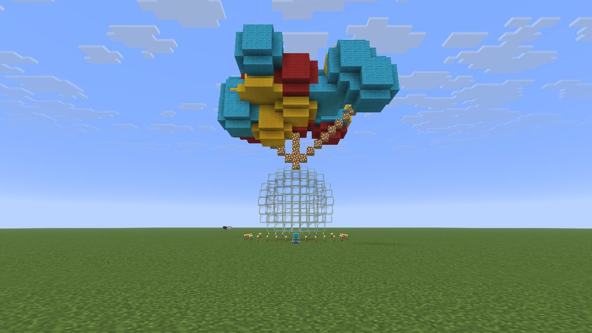

# Introduksjon {.intro}

Å byggje ei rund kule blokk for blokk er vanskeleg. Roboten klarer det med éin
blokk i programmet. I denne oppgåva bruker du kategorien `Former` til å lage ei
kule, ein ring og linjer, og set dei saman til eit stort fyrverkeri. Til slutt
lèt du **tilfeldige posisjonar** spreie fargerike kuler på himmelen.

Du bør ha gjort oppgåva [Kom i gang](../kom_i_gang/kom_i_gang_nn.html) først.




# Før du startar {.activity}

## Sjekkliste {.check}

- [ ] Start Minecraft med Halison Code. Opne ei flat verd i `Skapande` modus
  (Creative) med `Tillat fusk` på (Allow Commands). Vel `Vassrett` (Superflat)
  under `Verdsslag` (World Type).

- [ ] Trykk `T` for å opne chatten, skriv `/robot spawn` og trykk Enter. Roboten
  dukkar opp ved føtene dine og ser same veg som deg.

- [ ] Trykk `T` igjen, skriv `/halisoncode` og trykk Enter. Editoren opnar seg
  i nettlesaren. Trykk `Nytt prosjekt`.

- [ ] Skriv `/gamerule halisoncode:pause_on_lost_focus false` i chatten. Då går
  ikkje spelet på pause når du byter til editoren, og du ser kva roboten gjer
  medan du jobbar. Du treng berre gjere det éin gong i kvar verd.

## Slik byter du mellom Minecraft og editoren {.tip}

- Du lagar programmet i nettlesaren og ser roboten i Minecraft. Byt vindauge med
  `Alt` + `Tab` (på Mac `Cmd` + `Tab`). Hald inne `Alt` og trykk `Tab` til
  Minecraft er valt, og slepp.

- Trykk alltid på `Kjør` i editoren **før** du byter til Minecraft. Programmet
  køyrer frå nettlesaren, så la editoren stå open.

- Viser Minecraft pausemenyen når du kjem tilbake, trykk `Attende til spelet`
  (Back to Game). Roboten står stille så lenge spelet er på pause. Har du ikkje
  skrive `/gamerule halisoncode:pause_on_lost_focus false`, gjer det no. Du kan
  òg trykke `F3` + `P` i Minecraft.

- Er roboten borte eller langt unna, skriv `/robot spawn` igjen. Vil du stoppe
  eit program, trykk stoppknappen i editoren eller skriv `/robot stop`.

- Prosjektet blir lagra av seg sjølv i nettlesaren på denne datamaskina. Vil du
  ha det med til ei anna maskin, trykk lagre-knappen ved sida av prosjektnamnet
  nedst i editoren. Då får du ei `.mkcd`-fil.


# Steg 1: Ei glaskule {.activity}

`kule av` byggjer ei kule rundt eit sentrum. Radius er kor mange blokker det er
frå midten og ut til kanten.

## Sjekkliste {.check}

- [ ] Opne kategorien `Former` og dra `kule av` inn i `ved start`.

- [ ] Vel `glass`. Set sentrum til `~0 ~4 ~10` og radius til `4`.

- [ ] Vel `hul` til slutt. Då blir kula tom inni, som ei boble.

## Test prosjektet {.flag}

__Trykk på `Kjør`.__

- [ ] Byt til Minecraft med `Alt` + `Tab` og sjå på roboten.

- [ ] Står det ei glaskule framfor deg? Gå inn i ho. Korleis kjem du inn?

- [ ] Prøv `erstatt` i staden for `hul` ein annan stad. Kva er skilnaden?

## Tips {.tip}

`~0 ~4 ~10` er målt frå føtene dine: 4 blokker opp og 10 blokker mot sør.
Roboten byggjer alt, så han må vere innanfor 32 blokker frå kvar del. Bli
ståande nær roboten medan du jobbar. Er han borte, skriv `/robot spawn`.


# Steg 2: Ein ring av faklar {.activity}

`sirkel av` lagar ein ring. `rundt y` betyr at ringen ligg flatt på bakken.

## Sjekkliste {.check}

- [ ] Dra `sirkel av` inn under kula.

- [ ] Vel `fakkel`. Set sentrum til `~0 ~0 ~10`, radius til `6`, `rundt y` og
  `omriss`.

## Test prosjektet {.flag}

__Gå litt til sides og køyr programmet på nytt.__

- [ ] Byt til Minecraft med `Alt` + `Tab` og sjå på roboten.

- [ ] Ligg det ein ring av faklar rundt kula?

- [ ] Prøv `rundt x` eller `rundt z`. Korleis står ringen no? Byt fakkel med
  `steinmurstein` for å sjå det betre.


# Steg 3: Strålar {.activity}

`linje av` lagar ei rett linje mellom to punkt. Ho kan gå rett opp eller på
skrå.

## Sjekkliste {.check}

- [ ] Dra `linje av` inn under ringen. Vel `glødestein`, frå `~0 ~9 ~10` til
  `~0 ~20 ~10`. Det blir ein lysande stråle rett opp frå toppen av kula.

- [ ] Lag ei linje til frå `~0 ~9 ~10` til `~8 ~17 ~10`, og ei tredje til `~-8
  ~17 ~10`. No går strålane på skrå ut til kvar side.

## Test prosjektet {.flag}

__Køyr programmet på ein ny stad.__

- [ ] Byt til Minecraft med `Alt` + `Tab` og sjå på roboten.

- [ ] Ser du tre strålar som sprutar ut frå kula?

- [ ] Lag to strålar til, mot `~0 ~17 ~2` og `~0 ~17 ~18`. Kvar hamnar dei?


# Steg 4: Fyrverkeri med tilfeldige kuler {.activity}

Eit fyrverkeri er aldri likt to gonger. `velg tilfeldig posisjon` gir ein ny
stad kvar gong, ein eller annan stad inni ein boks.

## Sjekkliste {.check}

- [ ] Opne `Løkker` og dra `gjenta 5 ganger` inn nedst i `ved start`.

- [ ] Inni løkka: `kule av` med `rød ull`, radius `2` og `erstatt`.

- [ ] Opne `Posisjoner` og dra `velg tilfeldig posisjon` inn i sentrum. Set han
  frå `~-8 ~14 ~2` til `~8 ~20 ~18`.

- [ ] Lag to kuler til i løkka på same måte, med `gul ull` og `lyseblå ull`.

## Test prosjektet {.flag}

__Køyr programmet to gonger på to nye stader.__

- [ ] Byt til Minecraft med `Alt` + `Tab` og sjå på roboten.

- [ ] Kor mange ullkuler er det på himmelen?

- [ ] Ligg kulene på same stad begge gongene?

## Tips {.protip}

Vil du rydde, fyller du området med `luft`: `fyll med luft fra ~-10 ~0 ~0 til
~10 ~22 ~20`. Køyr det medan du står på same stad som då du bygde.


# Programmet i JavaScript {.activity}

```javascript
shapes.sphere(Block.Glass, pos(0, 4, 10), 4, ShapeOperation.Hollow)
shapes.circle(Block.Torch, pos(0, 0, 10), 6, Axis.Y, ShapeOperation.Outline)
shapes.line(Block.Glowstone, pos(0, 9, 10), pos(0, 20, 10))
shapes.line(Block.Glowstone, pos(0, 9, 10), pos(8, 17, 10))
shapes.line(Block.Glowstone, pos(0, 9, 10), pos(-8, 17, 10))
for (let index = 0; index < 5; index++) {
    shapes.sphere(Block.RedWool, positions.random(pos(-8, 14, 2), pos(8, 20, 18)), 2, ShapeOperation.Replace)
    shapes.sphere(Block.YellowWool, positions.random(pos(-8, 14, 2), pos(8, 20, 18)), 2, ShapeOperation.Replace)
    shapes.sphere(Block.LightBlueWool, positions.random(pos(-8, 14, 2), pos(8, 20, 18)), 2, ShapeOperation.Replace)
}
```

## Utfordring {.challenge}

- [ ] Lag ein chatkommando `fyr` som byggjer fyrverkeriet der du står, så du kan
  fylle heile himmelen.

- [ ] Gi kulene tilfeldig storleik. Finn blokka i `Matematikk` som vel eit
  tilfeldig tal, og bruk ho som radius.

- [ ] Bygg ein snømann av tre kuler med `snøblokk`, eller ein planet med ein
  ring rundt.
