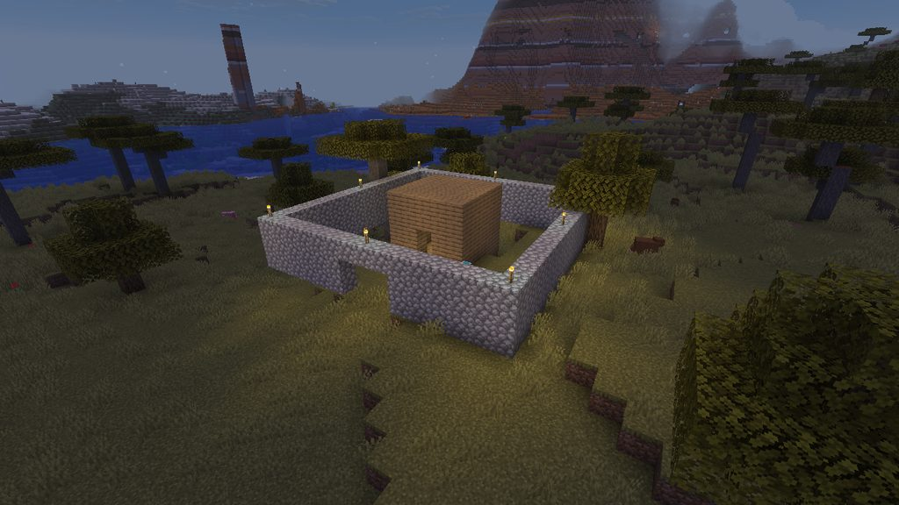

# Introduksjon {.intro}

Du klarte den første natta i et lite hus. Men monstrene kommer tilbake hver
kveld. Nå skal huset få en **mur** rundt seg, med en port og lys, så det blir et
fort.

En mur tar lang tid å bygge, så roboten får jobbe i flere dager. Hver morgen
henter den stein og bygger ett nytt lag på muren. Før kvelden kommer, er den
ferdig for dagen og går hjem. Du lærer å bruke **hendelser** som skjer av seg
selv, uten at du skriver noe i chatten.

Her får du ikke steg for steg. Du får oppdraget, verktøyene og noen tips. Resten
er opp til deg.

Du bør ha gjort oppgavene [Hus før natta](../hus_for_natten/hus_for_natten.html)
og [Byggeren](../byggeren/byggeren.html).




# Før du starter {.activity}

## Sjekkliste {.check}

- [ ] Start Minecraft med Halison Code. Åpne verdenen fra Hus før natta, eller
  lag en ny vanlig verden i `Overlevelse` (Survival) med `Tillat kommandoer` på
  (Allow Commands). Den må ha trær og fjell, så ikke velg `Superflat`.

- [ ] Trykk `T` for å åpne chatten, skriv `/robot spawn` og trykk Enter. Roboten
  dukker opp ved føttene dine og ser samme vei som deg.

- [ ] Trykk `T` igjen, skriv `/halisoncode` og trykk Enter. Editoren åpnes i
  nettleseren. Trykk `Nytt prosjekt`.

- [ ] Skriv `/gamerule halisoncode:pause_on_lost_focus false` i chatten. Da går
  ikke spillet på pause når du bytter til editoren, og du ser hva roboten gjør
  mens du jobber. Du trenger bare gjøre det én gang i hver verden.

## Slik bytter du mellom Minecraft og editoren {.tip}

- Du lager programmet i nettleseren og ser roboten i Minecraft. Bytt vindu med
  `Alt` + `Tab` (på Mac `Cmd` + `Tab`). Hold inne `Alt` og trykk `Tab` til
  Minecraft er valgt, og slipp.

- Trykk alltid på `Kjør` i editoren **før** du bytter til Minecraft. Programmet
  kjører fra nettleseren, så la editoren stå åpen.

- Viser Minecraft pausemenyen når du kommer tilbake, trykk `Fortsett spill`
  (Back to Game). Roboten står stille så lenge spillet er på pause. Har du ikke
  skrevet `/gamerule halisoncode:pause_on_lost_focus false`, gjør det nå. Du kan
  også trykke `F3` + `P` i Minecraft.

- Er roboten borte eller langt unna, skriv `/robot spawn` igjen. Vil du stoppe
  et program, trykk stoppknappen i editoren eller skriv `/robot stop`.


# Oppdraget {.activity}

## Sjekkliste {.check}

- [ ] Du trenger et hus. Bruk det fra Hus før natta, eller bygg et nytt.

- [ ] Muren skal gå helt rundt huset, med minst to blokker luft mellom muren og
  huset.

- [ ] Muren skal være minst tre blokker høy.

- [ ] Muren skal ha en port: en åpning du kan gå gjennom.

- [ ] Det skal være fakler på muren, så det er lyst rundt huset om natta.

- [ ] Roboten bygger **ett lag hver morgen**, av seg selv, og stopper før
  kvelden.

- [ ] Du er ferdig når muren har alle lagene, porten og lysene.

## Regler {.protip}

- Roboten får ikke bruke `agent.setItem`. Alt den bygger med, må den grave eller
  hogge selv, eller få av deg.

- Du får hjelpe til, men det er roboten som skal gjøre det meste av jobben.

- Roboten skal starte et nytt lag med `gameplay.onDayStart`, ikke med en
  chatkommando. Du får bruke en chatkommando første dag.

- Roboten skal være ferdig og hjemme før `tid på døgnet` er 12000.


# Verktøykassa {.activity}

Dette har du lært før, og litt nytt:

| Hva                      | Kode                                                            |
| ------------------------ | --------------------------------------------------------------- |
| Bygge en ring av blokker | to `blocks.fill`: først hele firkanten, så luft inni            |
| Lage port                | `blocks.fill(Block.Air, a, b, FillOperation.Replace)`           |
| Bygge med byggeren       | `builder.mark()`, `builder.move` og `builder.fill` fra Byggeren |
| Sette en fakkel          | `blocks.place(Block.Torch, p)`                                  |
| Lage fakler              | `agent.craft(Item.Torch, 4)`, med kull og pinner                |
| Hvor du står             | `player.position()`                                             |
| Et nøyaktig sted         | `world(x, y, z)` og `p.getValue(Axis.X)`                        |
| Hvor mye tid er igjen    | `gameplay.timeOfDay()`, 0 er soloppgang og 12000 solnedgang     |
| Gjøre noe hver morgen    | `gameplay.onDayStart(function () { })`                          |
| Når noe går galt         | `try { } catch (e) { }` fra Hus før natta                       |

## Tips {.tip}

- En ring lager du med to fyll. Fyll først hele firkanten med stein, og fyll så
  det som er inni med luft. Da står bare kanten igjen. `FillOperation.Outline`
  og `Hollow` hjelper ikke når boksen er én blokk høy, for da er hele boksen
  kant, og du får en fylt firkant.

- `pos` er målt fra føttene dine. Om morgenen står du kanskje et annet sted, og
  da havner muren feil. Lagre midten av fortet én gang, og bruk nøyaktige
  steder:

```javascript
let midt = player.position()
let x = midt.getValue(Axis.X)
let y = midt.getValue(Axis.Y)
let z = midt.getValue(Axis.Z)
```

- Roboten må være innenfor 32 blokker fra alt den bygger. Sett hjemmet til
  roboten ved fortet med `agent.setHome()`.

- Regn ut hvor mye stein ett lag trenger før du begynner å grave. En ring på 15
  ganger 15 blokker trenger 4 · 15 - 4 = 56 blokker.

- Høyreklikk på roboten etter at den har gravd stein. Hva fikk den? Det er det
  du kan bygge muren av.

- Du trenger ikke vente en hel dag for å teste. Skriv `/time set 23900`, så
  kommer morgenen om fem sekunder.


# Del 1: Hvor er fortet? {.activity}

## Sjekkliste {.check}

- [ ] Lag `player.onChat("fort", ...)`, som lagrer midten av fortet der du står,
  og setter hjemmet til roboten.

- [ ] Lag en variabel `lag` som husker hvor mange lag muren har.


# Del 2: Ett lag {.activity}

## Sjekkliste {.check}

- [ ] Lag en funksjon `byggLag()`, som bygger neste lag av muren og legger 1 til
  `lag`.

- [ ] Sørg for at porten blir stående åpen når nye lag kommer på.

- [ ] Prøv funksjonen med en chatkommando først.

## Test prosjektet {.flag}

__Bygg ett lag med chatkommandoen din.__

- [ ] Trykk `Kjør` i editoren først. Bytt så til Minecraft med `Alt` + `Tab`.

- [ ] Går muren rundt huset? Er porten der?


# Del 3: Hent stein om dagen {.activity}

## Sjekkliste {.check}

- [ ] Lag en funksjon `hentStein()`, som graver til roboten har nok til ett lag.
  Den skal stoppe og gå hjem hvis klokka nærmer seg 12000.

- [ ] Hvor lang tid trenger roboten for å gå hjem? Stopp i god tid.


# Del 4: Hver morgen {.activity}

## Sjekkliste {.check}

- [ ] Bruk `gameplay.onDayStart` så roboten henter stein og bygger et lag hver
  morgen.

- [ ] Når muren er høy nok, skal roboten sette opp fakler og si fra at fortet er
  ferdig. Etter det skal den ikke bygge flere lag.

## Test prosjektet {.flag}

__La programmet kjøre i flere dager.__

- [ ] Trykk `Kjør` i editoren først. Bytt så til Minecraft med `Alt` + `Tab`.

- [ ] Skriv `/time set 23900`. Starter roboten av seg selv når det blir morgen?

- [ ] Er roboten hjemme før det blir kveld?

- [ ] Hvor mange dager tok det å bygge hele fortet?

## Utfordring {.challenge}

- [ ] Bruk `agent.lightLevel()` for å sjekke at det ikke er mørkt noe sted
  innenfor muren. Monstre kan dukke opp der lyset er 0.

- [ ] Gi muren tårn i hjørnene, eller en gang på toppen der du kan gå.

- [ ] La roboten si i chatten om morgenen hvor mange lag som er igjen.

- [ ] Gjør fortet rundt i stedet for firkantet, med `shapes.circle`.

- [ ] Prøv i Python i stedet for JavaScript.
