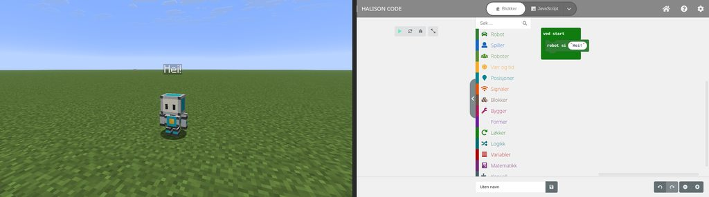

# Introduksjon {.intro}

Denne veiledningen er for en voksen som gjør datamaskinen klar. Elevene trenger
ikke gjøre dette selv. Installasjonen tar omtrent ti minutter.

Halison Code er en mod til **Minecraft Java Edition**. Den virker ikke i
Minecraft for nettbrett, mobil, konsoll eller Education Edition.

# Steg 1: Dette trenger du {.activity}

## Sjekkliste {.check}

- [ ] En datamaskin med Windows, macOS eller Linux, og Minecraft Java Edition.

- [ ] En nettleser: Chrome, Edge eller Firefox.

- [ ] Halison Code-filen (en `.jar`-fil) for Minecraft-versjonen og modlasteren
  din. Filene ligger under **Assets** øverst på [utgivelsessiden til
  Halison Code](https://github.com/halisonworks/mod-halisoncode/releases).
  Filnavnet sier hvilken modlaster og Minecraft-versjon filen er laget for, for
  eksempel `halisoncode-<modlaster>-<minecraftversjon>-...jar`.

## Tips {.protip}

Velg samme Minecraft-versjon på alle maskinene i klasserommet, og bruk samme
versjon av Halison Code overalt. Ulike versjoner kan ikke spille sammen.

Til og med versjon 0.0.5 het moden Codeling. Har du den fra før, fjerner du
den gamle filen fra `mods`. Roboter og prosjekter fra Codeling blir ikke med
over, så kopier JavaScript-koden du vil ta vare på, til en tekstfil først.

# Steg 2: Installer en modlaster {.activity}

En modlaster er programmet som laster inn modder i Minecraft. Halison Code
virker med modlasterne som står i [veiledningen for
spillere](https://github.com/halisonworks/mod-halisoncode/blob/develop/docs/player/guide-nb.md#installere).

## Sjekkliste {.check}

- [ ] Lukk Minecraft.

- [ ] Følg installasjonsprogrammet til modlasteren du velger. Trinnene for hver
  modlaster står i [veiledningen for
  spillere](https://github.com/halisonworks/mod-halisoncode/blob/develop/docs/player/guide-nb.md#installere).

- [ ] Åpne Minecraft Launcher og start profilen modlasteren laget. Lukk spillet
  igjen når menyen vises. Da lages mappa `mods`.

# Steg 3: Legg modene i mappa mods {.activity}

## Sjekkliste {.check}

- [ ] Sjekk i [veiledningen for
  spillere](https://github.com/halisonworks/mod-halisoncode/blob/develop/docs/player/guide-nb.md#installere)
  om modlasteren din trenger flere filer, for eksempel et eget API-bibliotek.
  Last dem ned for samme Minecraft-versjon.

- [ ] Åpne mappa `mods`:

  - Windows: trykk `Win+R`, skriv `%appdata%\.minecraft\mods` og trykk Enter.

  - macOS: `~/Library/Application Support/minecraft/mods`

  - Linux: `~/.minecraft/mods`

- [ ] Legg `.jar`-filen til Halison Code i mappa, sammen med eventuelle filer
  modlasteren krever.

# Steg 4: Test at alt virker {.activity}

## Sjekkliste {.check}

- [ ] Start Minecraft med profilen til modlasteren.

- [ ] Sett Minecraft til norsk: `Options...`, `Language...`, velg `Norsk bokmål
  (Norge)` og trykk `Done`. Da heter menyene det samme som i oppgavene.
  Meldingene fra roboten er foreløpig på engelsk.

- [ ] Lag en ny verden: velg `Kreativ` og gjerne verdentypen `Superflat`. Da er det
  lett å se hva roboten gjør, og roboten får blokker gratis.

- [ ] Trykk `T` for å åpne chatten, skriv `/robot spawn` og trykk Enter. En
  liten robot dukker opp ved føttene dine.

- [ ] Skriv `/halisoncode` i chatten. Nettleseren åpner Halison Code-editoren.
  Den bruker samme språk som nettleseren. Du kan bytte med `Språk` nederst på
  startsiden til editoren.

- [ ] Skriv `/gamerule halisoncode:pause_on_lost_focus false`. Da går ikke
  spillet på pause når eleven bytter til nettleseren, og eleven ser hva roboten
  gjør. Det gjelder bare denne verdenen.

## Test prosjektet {.flag}

- [ ] Ser du roboten i spillet og editoren i nettleseren? Da er alt klart, og
  elevene kan begynne på oppgaven [Kom i gang](../kom_i_gang/kom_i_gang.html).

# Hvis noe går galt {.activity}

| Problem | Hva du gjør |
| --- | --- |
| `/halisoncode` finnes ikke | Halison Code er ikke lastet. Sjekk at filen ligger i `mods` og at du startet profilen til modlasteren. |
| "Editor link expired" | Minecraft er startet på nytt. Skriv `/halisoncode` igjen. |
| "Not in a world" | Åpne en verden først, og trykk Kjør igjen. |
| "Robot is not loaded" | Skriv `/robot spawn`, eller gå nærmere roboten. |
| Spillet går på pause når du bytter til nettleseren | Skriv `/gamerule halisoncode:pause_on_lost_focus false`, eller trykk `F3` + `P`. |
| Roboten venter, og loggen sier "Minecraft is paused" | Gå tilbake til spillet og lukk pausemenyen. |

Flere feilmeldinger står i [veiledningen for
spillere](https://github.com/halisonworks/mod-halisoncode/blob/develop/docs/player/guide-nb.md#feilsøking).
