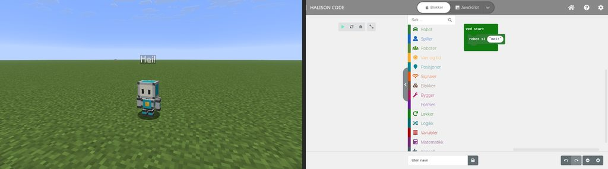

# Introduksjon {.intro}

Denne rettleiinga er for ein vaksen som gjer datamaskina klar. Elevane treng
ikkje gjere dette sjølve. Installasjonen tek omtrent ti minutt.

Halison Code er ein mod til **Minecraft Java Edition**. Han verkar ikkje i
Minecraft for nettbrett, mobil, konsoll eller Education Edition.

# Steg 1: Dette treng du {.activity}

## Sjekkliste {.check}

- [ ] Ei datamaskin med Windows, macOS eller Linux, og Minecraft Java Edition.

- [ ] Ein nettlesar: Chrome, Edge eller Firefox.

- [ ] Halison Code-fila (ei `.jar`-fil) for Minecraft-versjonen og modlastaren
  din. Filene ligg under **Assets** øvst på [utgjevingssida til
  Halison Code](https://github.com/halisonworks/mod-halisoncode/releases).
  Filnamnet seier kva modlastar og Minecraft-versjon fila er laga for, til
  dømes `halisoncode-<modlaster>-<minecraftversjon>-...jar`.

## Tips {.protip}

Vel same Minecraft-versjon på alle maskinene i klasserommet, og bruk same
versjon av Halison Code overalt. Ulike versjonar kan ikkje spele saman.

Til og med versjon 0.0.5 heitte moden Codeling. Har du han frå før, fjernar du
den gamle fila frå `mods`. Robotar og prosjekt frå Codeling blir ikkje med
over, så kopier JavaScript-koden du vil ta vare på, til ei tekstfil først.

# Steg 2: Installer ein modlastar {.activity}

Ein modlastar er programmet som lastar inn moddar i Minecraft. Halison Code
verkar med modlastarane som står i [rettleiinga for
spelarar](https://github.com/halisonworks/mod-halisoncode/blob/develop/docs/player/guide-nb.md#installere).

## Sjekkliste {.check}

- [ ] Lukk Minecraft.

- [ ] Følg installasjonsprogrammet til modlastaren du vel. Stega for kvar
  modlastar står i [rettleiinga for
  spelarar](https://github.com/halisonworks/mod-halisoncode/blob/develop/docs/player/guide-nb.md#installere).

- [ ] Opne Minecraft Launcher og start profilen modlastaren laga. Lukk spelet
  igjen når menyen kjem fram. Då blir mappa `mods` laga.

# Steg 3: Legg moddane i mappa mods {.activity}

## Sjekkliste {.check}

- [ ] Sjekk i [rettleiinga for
  spelarar](https://github.com/halisonworks/mod-halisoncode/blob/develop/docs/player/guide-nb.md#installere)
  om modlastaren din treng fleire filer, til dømes eit eige API-bibliotek.
  Last dei ned for same Minecraft-versjon.

- [ ] Opne mappa `mods`:

  - Windows: trykk `Win+R`, skriv `%appdata%\.minecraft\mods` og trykk Enter.

  - macOS: `~/Library/Application Support/minecraft/mods`

  - Linux: `~/.minecraft/mods`

- [ ] Legg `.jar`-fila til Halison Code i mappa, saman med eventuelle filer
  modlastaren krev.

# Steg 4: Test at alt verkar {.activity}

## Sjekkliste {.check}

- [ ] Start Minecraft med profilen til modlastaren.

- [ ] Set Minecraft til nynorsk: `Options...`, `Language...`, vel `Norsk
  nynorsk (Noreg)` og trykk `Done`. Då heiter menyane det same som i
  oppgåvene. Meldingane frå roboten er førebels på engelsk.

- [ ] Lag ei ny verd: vel `Skapande` og gjerne verdstypen `Vassrett`. Då er
  det lett å sjå kva roboten gjer, og roboten får blokker gratis.

- [ ] Trykk `T` for å opne chatten, skriv `/robot spawn` og trykk Enter. Ein
  liten robot dukkar opp ved føtene dine.

- [ ] Skriv `/halisoncode` i chatten. Nettlesaren opnar Halison Code-editoren.
  Han bruker same språk som nettlesaren. Du kan byte med `Språk` nedst på
  startsida til editoren. Editoren finst berre på bokmål og engelsk, så namna
  på klossane og knappane står på bokmål.

- [ ] Skriv `/gamerule halisoncode:pause_on_lost_focus false`. Då går ikkje
  spelet på pause når eleven byter til nettlesaren, og eleven ser kva roboten
  gjer. Det gjeld berre denne verda.

## Test prosjektet {.flag}

- [ ] Ser du roboten i spelet og editoren i nettlesaren? Då er alt klart, og
  elevane kan byrje på oppgåva [Kom i gang](../kom_i_gang/kom_i_gang_nn.html).

# Om noko går gale {.activity}

| Problem | Kva du gjer |
| --- | --- |
| `/halisoncode` finst ikkje | Halison Code er ikkje lasta. Sjekk at fila ligg i `mods` og at du starta profilen til modlastaren. |
| "Editor link expired" | Minecraft er starta på nytt. Skriv `/halisoncode` igjen. |
| "Not in a world" | Opne ei verd først, og trykk Kjør igjen. |
| "Robot is not loaded" | Skriv `/robot spawn`, eller gå nærare roboten. |
| Spelet går på pause når du byter til nettlesaren | Skriv `/gamerule halisoncode:pause_on_lost_focus false`, eller trykk `F3` + `P`. |
| Roboten ventar, og loggen seier "Minecraft is paused" | Gå tilbake til spelet og lukk pausemenyen. |

Fleire feilmeldingar står i [rettleiinga for
spelarar](https://github.com/halisonworks/mod-halisoncode/blob/develop/docs/player/guide-nb.md#feilsøking).
