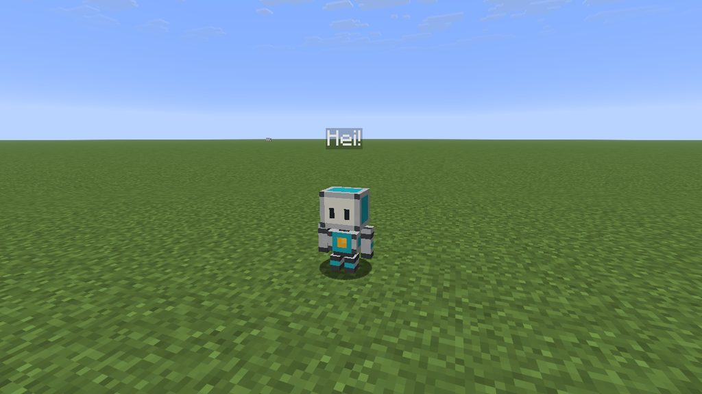
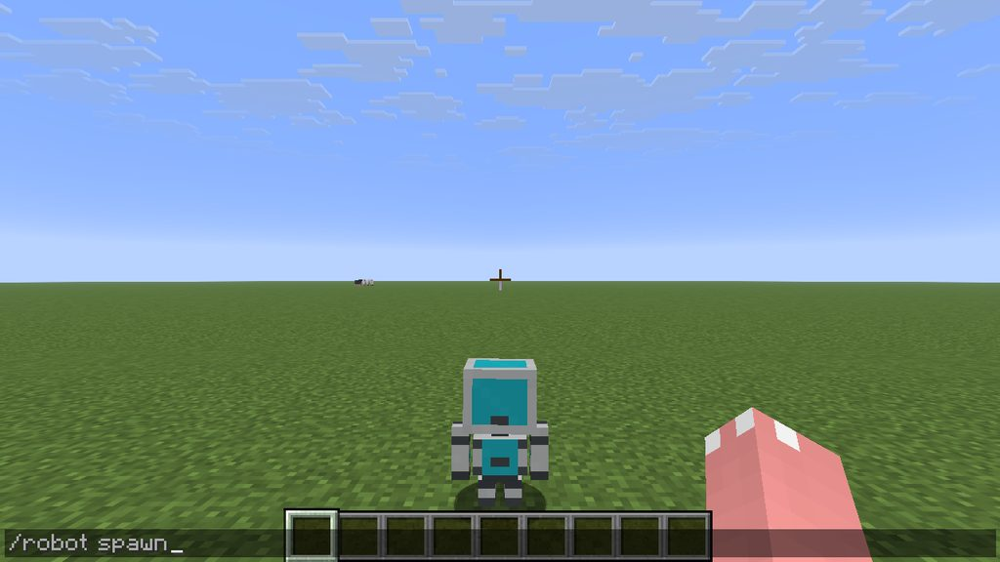
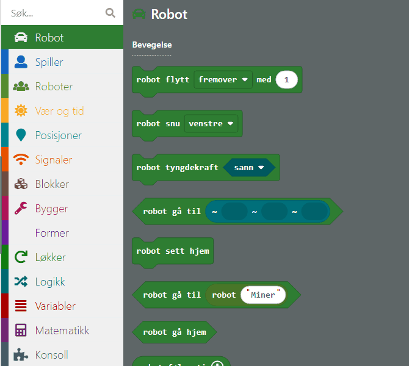
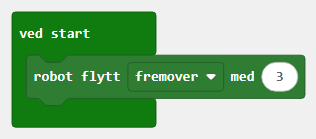

# Introduksjon {.intro}

I Halison Code har du en liten robot i Minecraft-verdenen din. Roboten gjør bare
det du forteller den. I denne oppgaven skal du lage roboten, åpne editoren og
skrive ditt første program. Programmet får roboten til å gå, snu seg og si hei.




# Steg 1: Lag roboten {.activity}

Først trenger vi en verden og en robot.

## Står Minecraft på engelsk? {.tip}

Navnene i oppgavene er fra norsk Minecraft, med engelsk i parentes. Vil du ha
Minecraft på norsk, trykk `Options...` og `Language...` på startskjermen, velg
`Norsk bokmål (Norge)` og trykk `Done`. Roboten svarer foreløpig på engelsk, for
eksempel `Kintro spawned, facing south`.

## Sjekkliste {.check}

- [ ] Start Minecraft med Halison Code. Velg `Enkeltspiller` (Singleplayer) og
  `Lag ny verden` (Create New World).

- [ ] Sett `Spillmodus` (Game Mode) til `Kreativ` (Creative), og sjekk at
  `Tillat kommandoer` (Allow Commands) er `PÅ`. Under `Verden` (World), velg
  `Superflat`. Trykk `Lag ny verden`.

- [ ] Trykk `T` for å åpne chatten. Skriv `/robot spawn` og trykk Enter.

- [ ] Skriv `/gamerule halisoncode:pause_on_lost_focus false` i chatten. Da går
  ikke spillet på pause når du bytter til editoren, og du ser hva roboten gjør
  mens du jobber. Du trenger bare gjøre det én gang i hver verden.

- [ ] Roboten dukker opp ved føttene dine. Den ser samme vei som deg.



## Tips {.tip}

Skriver du `/robot spawn` en gang til, flytter roboten seg til deg. Det er
nyttig hvis den har gått langt bort.


# Steg 2: Åpne editoren {.activity}

Programmene skriver du i nettleseren, i Halison Code-editoren.

## Sjekkliste {.check}

- [ ] Trykk `T` igjen, skriv `/halisoncode` og trykk Enter. Nettleseren åpner
  editoren.

- [ ] Trykk på `Nytt prosjekt` og gi prosjektet et navn, for eksempel `Første
  program`.

- [ ] Til venstre ser du simulatoren med `Kjør`-knappen under. I midten er
  kategoriene med blokker. Til høyre er arbeidsflaten der du bygger programmet.



## Slik bytter du mellom Minecraft og editoren {.tip}

- Du lager programmet i nettleseren og ser roboten i Minecraft. Bytt vindu med
  `Alt` + `Tab` (på Mac `Cmd` + `Tab`). Hold inne `Alt` og trykk `Tab` til
  Minecraft er valgt, og slipp.

- Trykk alltid på `Kjør` i editoren **før** du bytter til Minecraft. Programmet
  kjører fra nettleseren, så la editoren stå åpen.

- Viser Minecraft pausemenyen når du kommer tilbake, trykk `Fortsett spill`
  (Back to Game). Roboten står stille så lenge spillet er på pause. Har du ikke
  skrevet `/gamerule halisoncode:pause_on_lost_focus false`, gjør det nå. Du kan
  også trykke `F3` + `P` i Minecraft.

- Er roboten borte eller langt unna, skriv `/robot spawn` igjen. Vil du stoppe
  et program, trykk stoppknappen i editoren eller skriv `/robot stop`.

- Prosjektet lagres av seg selv i nettleseren på denne datamaskinen. Vil du ha
  det med til en annen maskin, trykk lagre-knappen ved siden av prosjektnavnet
  nederst i editoren. Da får du en `.mkcd`-fil.


# Steg 3: Få roboten til å gå {.activity}

Robotblokkene ligger i kategorien `Robot`, som er grønn.

## Sjekkliste {.check}

- [ ] Klikk på `Robot`. Dra blokken `robot flytt fremover med 1` ut på
  arbeidsflaten, og legg den inni `ved start`.

- [ ] Klikk på tallet `1` og skriv `3`.



## Test prosjektet {.flag}

__Trykk på `Kjør`-knappen under simulatoren.__

- [ ] Bytt til Minecraft med `Alt` + `Tab` og se på roboten.

- [ ] Se i Minecraft. Går roboten 3 blokker fremover?

- [ ] Prøv å endre `fremover` til `opp`, `bakover` eller `venstre`. Hva skjer
  nå?

## Tips {.tip}

Retningene er fra robotens side. `Venstre` er robotens venstre, ikke ditt.


# Steg 4: Snu og snakk {.activity}

Et program er en liste med kommandoer. Roboten gjør dem én etter én, ovenfra og
ned.

## Sjekkliste {.check}

- [ ] Dra `robot snu venstre` inn under flytt-blokken. Endre `venstre` til
  `høyre`.

- [ ] Legg til en `robot flytt fremover med 2` under snu-blokken.

- [ ] Til slutt: dra `robot si` inn nederst, og skriv `Hei!` i feltet.


## Test prosjektet {.flag}

__Trykk på `Kjør`.__

- [ ] Bytt til Minecraft med `Alt` + `Tab` og se på roboten.

- [ ] Roboten går 3 blokker, snur seg mot høyre, går 2 blokker og sier `Hei!`.

- [ ] Hva skjer hvis du bytter rekkefølgen på blokkene?


# Steg 5: Gå i en firkant {.activity}

Kan du få roboten til å gå rundt en firkant og komme tilbake dit den startet?

## Sjekkliste {.check}

- [ ] Lag et program med fire `robot flytt fremover med 3` og fire `robot snu
  venstre`, annenhver.

- [ ] Kjør programmet. Står roboten der den startet, og ser den samme vei?

## Tips {.protip}

Programmet blir langt, og du skriver det samme fire ganger. I neste oppgave
lærer du en lurere måte: en løkke.


# Steg 6: Lagre prosjektet {.activity}

Editoren lagrer prosjektet av seg selv i nettleseren. Det ligger bare i denne
nettleseren på denne datamaskinen. Vil du ha det med deg, lagrer du det som en
fil.

## Sjekkliste {.check}

- [ ] Nederst i editoren står `Uten navn`. Klikk der og skriv et navn, for
  eksempel `Kom i gang`.

- [ ] Trykk lagre-knappen rett ved siden av navnet. Nettleseren laster ned en
  fil som slutter på `.mkcd`.

- [ ] Trykk på huset øverst til høyre for å gå til startsiden. Ligger prosjektet
  ditt under `Mine prosjekter`?

## Test prosjektet {.flag}

__Åpne filen igjen.__

- [ ] På startsiden, trykk `Hent inn` og så `Hent inn en fil ...`. Velg
  `.mkcd`-filen du lastet ned.

- [ ] Kommer programmet ditt tilbake?

## Tips {.protip}

Bruker skolen maskiner som blir nullstilt, eller bytter du maskin neste gang?
Lagre filen på et sted du har med deg, for eksempel en minnepinne eller
skylagringen til skolen.


Øverst i editoren kan du bytte fra `Blokker` til `JavaScript`. Da ser du det
samme programmet skrevet som tekst:

```javascript
agent.move(SixDirection.Forward, 3)
agent.turn(TurnDirection.Right)
agent.move(SixDirection.Forward, 2)
agent.say("Hei!")
```

`agent` er roboten din. Bytt tilbake til `Blokker` for å fortsette med blokker.

## Utfordring {.challenge}

- [ ] Få roboten til å gå en trekant eller en sikksakk.

- [ ] Få roboten til å fly opp 5 blokker, si noe og komme ned igjen.

- [ ] Hvis du stopper et program midt i, trykker du på stoppknappen i editoren
  eller skriver `/robot stop` i chatten. Prøv begge.
