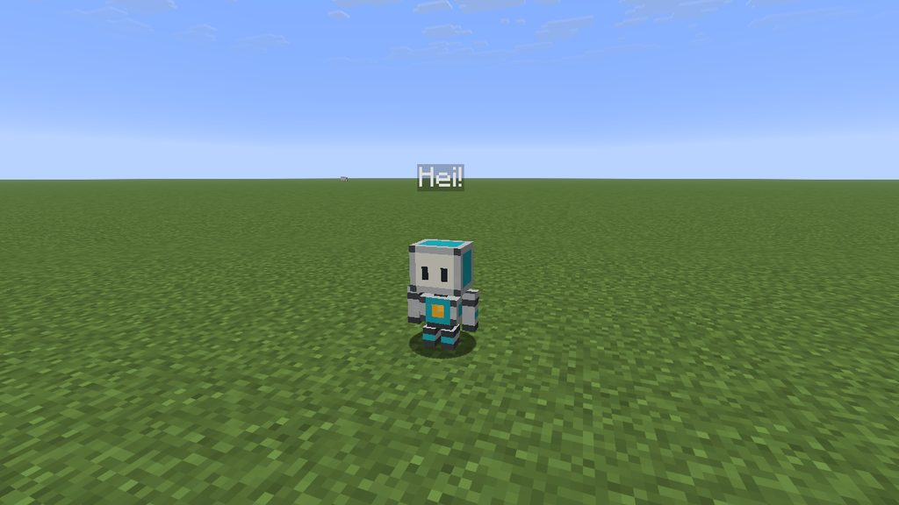
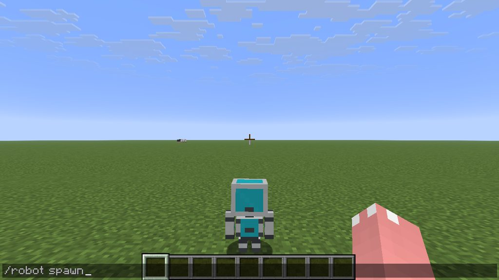
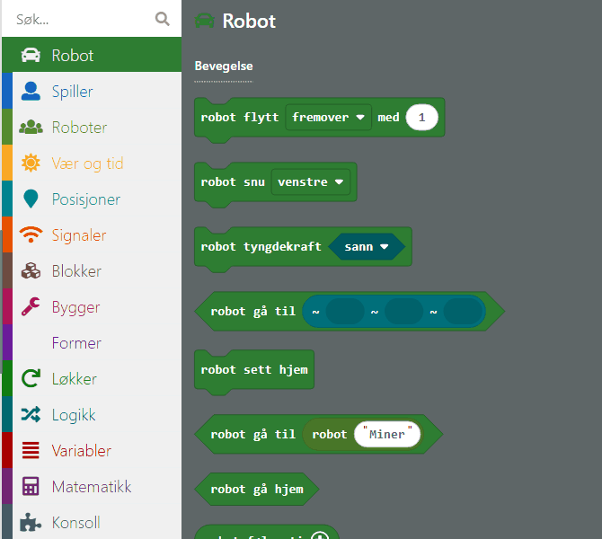
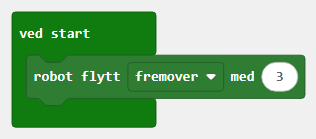

# Introduksjon {.intro}

I Halison Code har du ein liten robot i Minecraft-verda di. Roboten gjer berre
det du fortel han. I denne oppgåva skal du lage roboten, opne editoren og
skrive ditt første program. Programmet får roboten til å gå, snu seg og seie
hei.




# Steg 1: Lag roboten {.activity}

Først treng vi ei verd og ein robot.

## Står Minecraft på engelsk? {.tip}

Namna i oppgåvene er frå norsk Minecraft, med engelsk i parentes. Vil du ha
Minecraft på nynorsk, trykk `Options...` og `Language...` på startskjermen,
vel `Norsk nynorsk (Noreg)` og trykk `Done`. Roboten svarar førebels på
engelsk, til dømes `Kintro spawned, facing south`.

## Sjekkliste {.check}

- [ ] Start Minecraft med Halison Code. Vel `Einspelar` (Singleplayer) og
  `Laga ny verd` (Create New World).

- [ ] Set `Spelmodus` (Game Mode) til `Skapande` (Creative), og sjekk at
  `Tillat fusk` (Allow Commands) er `PÅ`. Under `Verd` (World), vel
  `Vassrett` (Superflat). Trykk `Laga ny verd`.

- [ ] Trykk `T` for å opne chatten. Skriv `/robot spawn` og trykk Enter.

- [ ] Skriv `/gamerule halisoncode:pause_on_lost_focus false` i chatten. Då
  går ikkje spelet på pause når du byter til editoren, og du ser kva roboten
  gjer medan du jobbar. Du treng berre gjere det éin gong i kvar verd.

- [ ] Roboten dukkar opp ved føtene dine. Han ser same veg som deg.



## Tips {.tip}

Skriv du `/robot spawn` ein gong til, flyttar roboten seg til deg. Det er
nyttig om han har gått langt bort.


# Steg 2: Opne editoren {.activity}

Programma skriv du i nettlesaren, i Halison Code-editoren. Editoren finst
berre på bokmål og engelsk, så namna på klossane og knappane står på bokmål.

## Sjekkliste {.check}

- [ ] Trykk `T` igjen, skriv `/halisoncode` og trykk Enter. Nettlesaren opnar
  editoren.

- [ ] Trykk på `Nytt prosjekt` og gi prosjektet eit namn, til dømes `Første
  program`.

- [ ] Til venstre ser du simulatoren med `Kjør`-knappen under. I midten er
  kategoriane med blokker. Til høgre er arbeidsflata der du byggjer
  programmet.



## Slik byter du mellom Minecraft og editoren {.tip}

- Du lagar programmet i nettlesaren og ser roboten i Minecraft. Byt vindauge
  med `Alt` + `Tab` (på Mac `Cmd` + `Tab`). Hald inne `Alt` og trykk `Tab` til
  Minecraft er valt, og slepp.

- Trykk alltid på `Kjør` i editoren **før** du byter til Minecraft. Programmet
  køyrer frå nettlesaren, så la editoren stå open.

- Viser Minecraft pausemenyen når du kjem tilbake, trykk `Attende til spelet`
  (Back to Game). Roboten står stille så lenge spelet er på pause. Har du ikkje
  skrive `/gamerule halisoncode:pause_on_lost_focus false`, gjer det no. Du
  kan òg trykke `F3` + `P` i Minecraft.

- Er roboten borte eller langt unna, skriv `/robot spawn` igjen. Vil du stoppe
  eit program, trykk stoppknappen i editoren eller skriv `/robot stop`.

- Prosjektet blir lagra av seg sjølv i nettlesaren på denne datamaskina. Vil
  du ha det med til ei anna maskin, trykk lagre-knappen ved sida av
  prosjektnamnet nedst i editoren. Då får du ei `.mkcd`-fil.


# Steg 3: Få roboten til å gå {.activity}

Robotblokkene ligg i kategorien `Robot`, som er grøn.

## Sjekkliste {.check}

- [ ] Klikk på `Robot`. Dra blokka `robot flytt fremover med 1` ut på
  arbeidsflata, og legg ho inni `ved start`.

- [ ] Klikk på talet `1` og skriv `3`.



## Test prosjektet {.flag}

__Trykk på `Kjør`-knappen under simulatoren.__

- [ ] Byt til Minecraft med `Alt` + `Tab` og sjå på roboten.

- [ ] Sjå i Minecraft. Går roboten 3 blokker framover?

- [ ] Prøv å endre `fremover` til `opp`, `bakover` eller `venstre`. Kva skjer
  no?

## Tips {.tip}

Retningane er frå sida til roboten. `Venstre` er venstre for roboten, ikkje
for deg.


# Steg 4: Snu og snakk {.activity}

Eit program er ei liste med kommandoar. Roboten gjer dei éin etter éin,
ovanfrå og ned.

## Sjekkliste {.check}

- [ ] Dra `robot snu venstre` inn under flytt-blokka. Endre `venstre` til
  `høyre`.

- [ ] Legg til ei `robot flytt fremover med 2` under snu-blokka.

- [ ] Til slutt: dra `robot si` inn nedst, og skriv `Hei!` i feltet.


## Test prosjektet {.flag}

__Trykk på `Kjør`.__

- [ ] Byt til Minecraft med `Alt` + `Tab` og sjå på roboten.

- [ ] Roboten går 3 blokker, snur seg mot høgre, går 2 blokker og seier
  `Hei!`.

- [ ] Kva skjer om du byter rekkjefølgja på blokkene?


# Steg 5: Gå i ein firkant {.activity}

Kan du få roboten til å gå rundt ein firkant og kome tilbake dit han starta?

## Sjekkliste {.check}

- [ ] Lag eit program med fire `robot flytt fremover med 3` og fire `robot snu
  venstre`, annakvar.

- [ ] Køyr programmet. Står roboten der han starta, og ser han same veg?

## Tips {.protip}

Programmet blir langt, og du skriv det same fire gonger. I neste oppgåve
lærer du ein lurare måte: ei løkke.


# Steg 6: Lagre prosjektet {.activity}

Editoren lagrar prosjektet av seg sjølv i nettlesaren. Det ligg berre i denne
nettlesaren på denne datamaskina. Vil du ha det med deg, lagrar du det som ei
fil.

## Sjekkliste {.check}

- [ ] Nedst i editoren står `Uten navn`. Klikk der og skriv eit namn, til
  dømes `Kom i gang`.

- [ ] Trykk lagre-knappen rett ved sida av namnet. Nettlesaren lastar ned ei
  fil som sluttar på `.mkcd`.

- [ ] Trykk på huset øvst til høgre for å gå til startsida. Ligg prosjektet
  ditt under `Mine prosjekter`?

## Test prosjektet {.flag}

__Opne fila igjen.__

- [ ] På startsida, trykk `Hent inn` og så `Hent inn en fil ...`. Vel
  `.mkcd`-fila du lasta ned.

- [ ] Kjem programmet ditt tilbake?

## Tips {.protip}

Bruker skulen maskiner som blir nullstilte, eller byter du maskin neste gong?
Lagre fila på ein stad du har med deg, til dømes ein minnepinne eller
skylagringa til skulen.


Øvst i editoren kan du byte frå `Blokker` til `JavaScript`. Då ser du det
same programmet skrive som tekst:

```javascript
agent.move(SixDirection.Forward, 3)
agent.turn(TurnDirection.Right)
agent.move(SixDirection.Forward, 2)
agent.say("Hei!")
```

`agent` er roboten din. Byt tilbake til `Blokker` for å halde fram med
blokker.

## Utfordring {.challenge}

- [ ] Få roboten til å gå ein trekant eller ein sikksakk.

- [ ] Få roboten til å fly opp 5 blokker, seie noko og kome ned igjen.

- [ ] Om du stoppar eit program midt i, trykkjer du på stoppknappen i editoren
  eller skriv `/robot stop` i chatten. Prøv begge.
