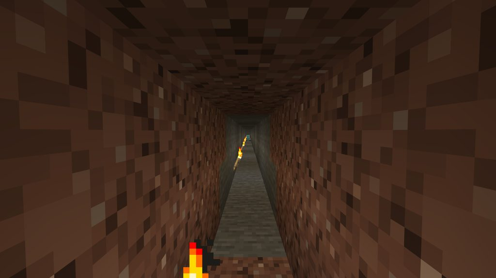

# Introduksjon {.intro}

I mørke ganger under jorda dukker det opp zombier og skjeletter. Roboten skal gå
gjennom gangen og sette opp fakler der det er for mørkt. Den har en **sensor**
som måler lyset. Du lærer å bruke en **mens-løkke** med **hvis** inni, og å
stoppe før veggen eller lava.

Du bør ha gjort oppgaven [Gruve til
grunnfjell](../gruve_til_grunnfjell/gruve_til_grunnfjell.html) først.




# Før du starter {.activity}

## Sjekkliste {.check}

- [ ] Start Minecraft med Halison Code. Åpne en vanlig verden i `Kreativ` modus
  (Creative) med `Tillat kommandoer` på (Allow Commands). Den må ha trær og
  fjell, så ikke velg `Superflat`.

- [ ] Trykk `T` for å åpne chatten, skriv `/robot spawn` og trykk Enter. Roboten
  dukker opp ved føttene dine og ser samme vei som deg.

- [ ] Trykk `T` igjen, skriv `/halisoncode` og trykk Enter. Editoren åpnes i
  nettleseren. Trykk `Nytt prosjekt`.

- [ ] Skriv `/gamerule halisoncode:pause_on_lost_focus false` i chatten. Da går
  ikke spillet på pause når du bytter til editoren, og du ser hva roboten gjør
  mens du jobber. Du trenger bare gjøre det én gang i hver verden.

## Slik bytter du mellom Minecraft og editoren {.tip}

- Du lager programmet i nettleseren og ser roboten i Minecraft. Bytt vindu med
  `Alt` + `Tab` (på Mac `Cmd` + `Tab`). Hold inne `Alt` og trykk `Tab` til
  Minecraft er valgt, og slipp.

- Trykk alltid på `Kjør` i editoren **før** du bytter til Minecraft. Programmet
  kjører fra nettleseren, så la editoren stå åpen.

- Viser Minecraft pausemenyen når du kommer tilbake, trykk `Fortsett spill`
  (Back to Game). Roboten står stille så lenge spillet er på pause. Har du ikke
  skrevet `/gamerule halisoncode:pause_on_lost_focus false`, gjør det nå. Du kan
  også trykke `F3` + `P` i Minecraft.

- Er roboten borte eller langt unna, skriv `/robot spawn` igjen. Vil du stoppe
  et program, trykk stoppknappen i editoren eller skriv `/robot stop`.


# Steg 1: Hvor mørkt er det? {.activity}

`robot lysnivå` fra kategorien `Robot` sier hvor lyst det er der roboten står. 0
er helt mørkt. 15 er dagslys, eller rett ved en fakkel. Der lyset er 0, kan
fiendtlige skapninger dukke opp.

## Sjekkliste {.check}

- [ ] Finn inngangen til en hule eller en gruvegang. Still deg i åpningen og se
  innover. Finner du ingen, lag en gang selv (se tipset under).

- [ ] Skriv `/robot spawn`. Lag et nytt prosjekt.

- [ ] I `ved start`: `robot flytt fremover med 10`.

- [ ] Så `robot si`, og dra `robot lysnivå` inn i feltet.

## Test prosjektet {.flag}

__Trykk på `Kjør`.__

- [ ] Bytt til Minecraft med `Alt` + `Tab` og se på roboten.

- [ ] Hvilket tall sier roboten? Prøv med `robot flytt fremover med 2`. Blir
  tallet større eller mindre?

## Lag en mørk gang selv {.tip}

Se mot øst (`F3` viser `Facing: east`). Skriv disse to kommandoene i chatten:

- `/fill ~1 ~-1 ~-1 ~30 ~2 ~1 stone hollow` lager en lang, hul boks av stein.
  Inni er det en gang som er én blokk bred og to høy.

- `/fill ~1 ~0 ~0 ~1 ~1 ~0 air` lager en åpning rett foran deg.

Gangen er helt mørk innerst. Roboten går inn gjennom åpningen.


# Steg 2: Gå til veggen {.activity}

Roboten vet ikke hvor lang gangen er. Den skal gå så lenge det ikke er en vegg
foran den. Da bruker vi `så lenge`, som er en **mens-løkke**: Den gjentar så
lenge betingelsen er sann.

## Sjekkliste {.check}

- [ ] Ta bort blokkene fra steg 1.

- [ ] Dra `så lenge` fra `Løkker` inn i `ved start`.

- [ ] Betingelsen: `ikke` fra `Logikk`, med `robot oppdag blokk fremover` inni.

- [ ] Inni løkka: `robot flytt fremover med 1`.

- [ ] Etter løkka: `robot si Vegg!`.

## Test prosjektet {.flag}

__Skriv `/robot spawn` i åpningen og kjør.__

- [ ] Bytt til Minecraft med `Alt` + `Tab` og se på roboten.

- [ ] Går roboten helt inn og stopper ved veggen?


# Steg 3: Fakler der det er mørkt {.activity}

## Sjekkliste {.check}

- [ ] Øverst i `ved start`: `robot gi fakkel antall 64 i plass 1` og `robot velg
  plass 1`.

- [ ] Inni løkka, etter `robot flytt fremover med 1`: en `hvis` fra `Logikk`.

- [ ] Betingelsen: `robot lysnivå` `<` `8`.

- [ ] Inni `hvis`: `robot plasser bakover`. Roboten har akkurat gått fremover,
  så bak den er det tomt gulv.

## Test prosjektet {.flag}

__Skriv de to `/fill`-kommandoene på nytt, så blir faklene borte. Kjør.__

- [ ] Bytt til Minecraft med `Alt` + `Tab` og se på roboten.

- [ ] Er det fakler i gangen nå? Hvor mange blokker er det mellom dem?

- [ ] Hvorfor setter ikke roboten en fakkel på hver blokk?

## Tips {.protip}

En fakkel gir lys 14. Lyset blir 1 svakere for hver blokk du går bort fra den.
Etter noen blokker er det under 8 igjen, og da setter roboten en ny.

## Tips {.tip}

I en ekte hule er gulvet ujevnt. Roboten flyr, så den går rett frem selv om
gulvet går ned. Er det luft under blokken bak roboten, får ikke fakkelen plass.


# Steg 4: Pass deg for lava {.activity}

`robot er trygt fremover` er usann hvis det er lava foran roboten eller under
blokken foran, et stort fall, eller en fiendtlig skapning. Roboten skal bare gå
når det er trygt.

## Sjekkliste {.check}

- [ ] Dra `og` fra `Logikk` inn i `så lenge`. Flytt `ikke robot oppdag blokk
  fremover` til venstre side.

- [ ] På høyre side: `robot er trygt fremover`.

- [ ] Etter løkka, bytt ut `robot si Vegg!` med en `hvis ... ellers`.
  Betingelsen: `robot er trygt fremover`.

- [ ] Inni `hvis`: `robot si Vegg!`. Inni `ellers`: `robot si Fare! Jeg
  stopper.`.

## Test prosjektet {.flag}

__Lag lava i gulvet midt i gangen med `/setblock ~15 ~-1 ~0 lava`. Kjør.__

- [ ] Bytt til Minecraft med `Alt` + `Tab` og se på roboten.

- [ ] Stopper roboten før lavaen? Sier den `Fare!`?

## Tips {.tip}

Kommandoen bruker `~` fra der du står. Står du ikke i åpningen, havner lavaen et
annet sted.


# Steg 5: Velg hvor lyst det skal være {.activity}

8 er et godt tall, men du vil kanskje ha det lysere. Vi lager en funksjon der
grensen er en **parameter**, og teller faklene roboten setter.

## Sjekkliste {.check}

- [ ] Åpne `Avansert` og `Funksjoner`. Lag en funksjon `lysOpp`. Trykk på `Ny
  parameter`, velg `Tall`, og kall den `grense`.

- [ ] Flytt alt fra `ved start` inn i funksjonen.

- [ ] I `robot lysnivå < 8`, bytt ut `8` med `grense` fra funksjonen.

- [ ] Lag en variabel `fakler`. Legg `sett fakler til 0` øverst i funksjonen, og
  `endre fakler med 1` inni `hvis` der roboten setter en fakkel.

- [ ] Etter `hvis ... ellers` til slutt: `pause (ms) 2000` fra `Løkker`, så du
  rekker å lese, og `robot si` med `fakler` inni.

- [ ] Dra `når chatkommando` fra `Spiller`, og skriv `lys`. Legg `kjør lysOpp`
  inn i den, med `num1` som grense.

- [ ] Trykk `Kjør` én gang.

## Test prosjektet {.flag}

__Lag en ny mørk gang. Skriv `/robot spawn` i åpningen og så `lys 8`.__

- [ ] Trykk `Kjør` i editoren først. Bytt så til Minecraft med `Alt` + `Tab`.

- [ ] Hvor mange fakler satte roboten?

- [ ] Prøv `lys 12` i en ny gang. Blir det flere fakler? Hva med `lys 3`?


# Programmet i JavaScript {.activity}

```javascript
let fakler = 0
function lysOpp(grense: number) {
    agent.setItem(Item.Torch, 64, 1)
    agent.setSlot(1)
    fakler = 0
    while (!(agent.detect(AgentDetection.Block, SixDirection.Forward)) && agent.isSafe(SixDirection.Forward)) {
        agent.move(SixDirection.Forward, 1)
        if (agent.lightLevel() < grense) {
            agent.place(SixDirection.Back)
            fakler += 1
        }
    }
    if (agent.isSafe(SixDirection.Forward)) {
        agent.say("Vegg!")
    } else {
        agent.say("Fare! Jeg stopper.")
    }
    loops.pause(2000)
    agent.say("" + fakler)
}
player.onChat("lys", function (num1, num2, num3) {
    lysOpp(num1)
})
```

## Utfordring {.challenge}

- [ ] La roboten si `Lava!` når det er lava foran den, og `Fare!` ellers. Bruk
  `robot oppdag væske fremover` `=` `lava`.

- [ ] Når roboten kommer til en vegg, kan den snu og prøve en annen vei. Se om
  det er fritt til venstre eller høyre med `robot oppdag blokk`.

- [ ] La roboten gå hjem til slutt. Bruk `robot sett hjem` før løkka og `robot
  gå hjem` etter.

- [ ] Sett glødestein i taket i stedet for fakler på gulvet, slik som i Gruve
  til grunnfjell.
