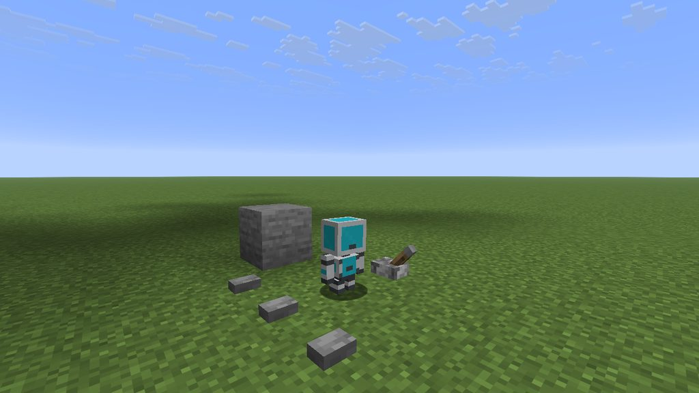

# Introduksjon {.intro}

I Minecraft kan knapper og spaker sende **redstonesignaler**. Roboten kan merke
slike signaler. I denne oppgaven lager du en fjernkontroll av knapper: hver gang
du trykker på en knapp ved siden av roboten, går den ett steg. Til slutt lærer
roboten å snu når noe står i veien.

Du bør ha gjort oppgaven [Kom i gang](../kom_i_gang/kom_i_gang.html) først.




# Før du starter {.activity}

## Sjekkliste {.check}

- [ ] Start Minecraft med Halison Code. Åpne en flat verden i `Kreativ` modus
  (Creative) med `Tillat kommandoer` på (Allow Commands). Velg `Superflat` under
  `Verdenstype` (World Type).

- [ ] Trykk `T` for å åpne chatten, skriv `/robot spawn` og trykk Enter. Roboten
  dukker opp ved føttene dine og ser samme vei som deg.

- [ ] Trykk `T` igjen, skriv `/halisoncode` og trykk Enter. Editoren åpnes i
  nettleseren. Trykk `Nytt prosjekt`.

- [ ] Skriv `/gamerule halisoncode:pause_on_lost_focus false` i chatten. Da går
  ikke spillet på pause når du bytter til editoren, og du ser hva roboten gjør
  mens du jobber. Du trenger bare gjøre det én gang i hver verden.

## Slik bytter du mellom Minecraft og editoren {.tip}

- Du lager programmet i nettleseren og ser roboten i Minecraft. Bytt vindu med
  `Alt` + `Tab` (på Mac `Cmd` + `Tab`). Hold inne `Alt` og trykk `Tab` til
  Minecraft er valgt, og slipp.

- Trykk alltid på `Kjør` i editoren **før** du bytter til Minecraft. Programmet
  kjører fra nettleseren, så la editoren stå åpen.

- Viser Minecraft pausemenyen når du kommer tilbake, trykk `Fortsett spill`
  (Back to Game). Roboten står stille så lenge spillet er på pause. Har du ikke
  skrevet `/gamerule halisoncode:pause_on_lost_focus false`, gjør det nå. Du kan
  også trykke `F3` + `P` i Minecraft.

- Er roboten borte eller langt unna, skriv `/robot spawn` igjen. Vil du stoppe
  et program, trykk stoppknappen i editoren eller skriv `/robot stop`.


# Steg 1: Én knapp, ett steg {.activity}

`når roboten får redstonesignal` er en **hendelse**. Koden inni kjører hver gang
roboten får et nytt signal, for eksempel når du trykker på en knapp rett ved
siden av den.

## Sjekkliste {.check}

- [ ] Åpne kategorien `Robot` og dra `når roboten får redstonesignal` ut på
  arbeidsflaten. Den skal ikke inn i `ved start`.

- [ ] Legg `robot flytt fremover med 1` inn i den.

- [ ] Trykk `Kjør`.

## Test prosjektet {.flag}

__Sett ut en knapp ved siden av roboten og trykk på den.__

- [ ] Bytt til Minecraft med `Alt` + `Tab` og se på roboten.

- [ ] Trykk `E` og søk etter `Stone Button` (steinknapp). Still deg bak roboten,
  og sett knappen på bakken rett til høyre for den.

- [ ] Høyreklikk på knappen. Går roboten ett steg fremover?

- [ ] Høyreklikk på knappen igjen. Hvorfor skjer det ingenting nå?

## Tips {.tip}

Programmet blir ikke ferdig etter siste blokk. Det fortsetter å kjøre og vente
på signaler til du trykker stoppknappen i editoren eller skriver `/robot stop`.
Bare standardroboten din, den du får med `/robot spawn` uten navn, har denne
hendelsen.


# Steg 2: En rad med knapper {.activity}

Signalet når bare blokkene rett ved siden av knappen. Når roboten har gått ett
steg, er knappen ikke lenger ved siden av den. Vi trenger en knapp for hvert
steg.

## Sjekkliste {.check}

- [ ] Skriv `/robot spawn`, så roboten kommer tilbake til føttene dine og ser
  samme vei som deg.

- [ ] Legg en rad med fem knapper på bakken til høyre for roboten, én i hver
  rute fremover. Den første knappen står rett ved siden av roboten.

## Test prosjektet {.flag}

__Trykk på knappene en etter en.__

- [ ] Trykk `Kjør` i editoren først. Bytt så til Minecraft med `Alt` + `Tab`.

- [ ] Trykk på den første knappen. Trykk så på knappen roboten står ved nå. Går
  den ett steg for hvert trykk?

- [ ] Hva skjer hvis du hopper over en knapp?

## Tips {.protip}

En spak (`Lever`) virker også. Roboten går et steg når du slår spaken på. Slår
du den av, skjer det ingenting, for det er bare et nytt signal som teller.


# Steg 3: Snu når noe står i veien {.activity}

Nå setter vi en blokk i veien. Roboten skal se den og snu i stedet for å gå.

## Sjekkliste {.check}

- [ ] Åpne `Logikk` og dra `hvis ... ellers` inn i `når roboten får
  redstonesignal`.

- [ ] Sett betingelsen til `robot oppdag blokk fremover`.

- [ ] Inni `hvis`: `robot snu venstre`.

- [ ] Flytt `robot flytt fremover med 1` inn i `ellers`.

- [ ] Trykk `Kjør`.

## Test prosjektet {.flag}

__Sett en steinblokk i veien foran den siste knappen.__

- [ ] Trykk `Kjør` i editoren først. Bytt så til Minecraft med `Alt` + `Tab`.

- [ ] Still deg der roboten sto først, og se samme vei som knapperaden. Skriv
  `/robot spawn`, så roboten står ved den første knappen igjen.

- [ ] Sett en `Stone`-blokk (stein) på bakken én rute foran den siste knappen.

- [ ] Trykk deg fremover med knappene. Hva gjør roboten når den kommer til
  steinen?

- [ ] Trykk en gang til på den samme knappen. Hvor går roboten nå?


# Programmet i JavaScript {.activity}

```javascript
agent.onRedstonePowered(function () {
    if (agent.detect(AgentDetection.Block, SixDirection.Forward)) {
        agent.turn(TurnDirection.Left)
    } else {
        agent.move(SixDirection.Forward, 1)
    }
})
```

## Utfordring {.challenge}

- [ ] Lag en bane med knapper som går rundt et hjørne, med en steinblokk der
  roboten skal snu.

- [ ] Lag en variabel `steg` som teller hvor mange steg roboten har gått, og la
  roboten si tallet med `robot si`.

- [ ] Bruk en spak i stedet for knapper, og la roboten gå tre steg og tilbake
  igjen for hvert signal, så den alltid ender ved spaken.
