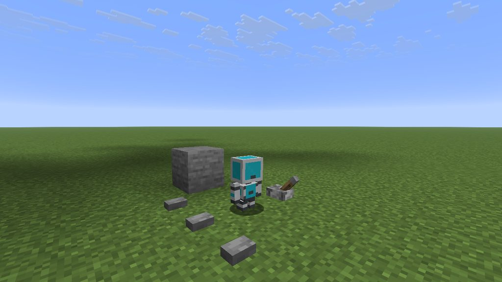

# Introduksjon {.intro}

I Minecraft kan knappar og spakar sende **redstonesignal**. Roboten kan merke
slike signal. I denne oppgåva lagar du ein fjernkontroll av knappar: kvar gong
du trykkjer på ein knapp ved sida av roboten, går han eitt steg. Til slutt lærer
roboten å snu når noko står i vegen.

Du bør ha gjort oppgåva [Kom i gang](../kom_i_gang/kom_i_gang_nn.html) først.




# Før du startar {.activity}

## Sjekkliste {.check}

- [ ] Start Minecraft med Halison Code. Opne ei flat verd i `Skapande` modus
  (Creative) med `Tillat fusk` på (Allow Commands). Vel `Vassrett` (Superflat)
  under `Verdsslag` (World Type).

- [ ] Trykk `T` for å opne chatten, skriv `/robot spawn` og trykk Enter. Roboten
  dukkar opp ved føtene dine og ser same veg som deg.

- [ ] Trykk `T` igjen, skriv `/halisoncode` og trykk Enter. Editoren opnar seg
  i nettlesaren. Trykk `Nytt prosjekt`.

- [ ] Skriv `/gamerule halisoncode:pause_on_lost_focus false` i chatten. Då går
  ikkje spelet på pause når du byter til editoren, og du ser kva roboten gjer
  medan du jobbar. Du treng berre gjere det éin gong i kvar verd.

## Slik byter du mellom Minecraft og editoren {.tip}

- Du lagar programmet i nettlesaren og ser roboten i Minecraft. Byt vindauge med
  `Alt` + `Tab` (på Mac `Cmd` + `Tab`). Hald inne `Alt` og trykk `Tab` til
  Minecraft er valt, og slepp.

- Trykk alltid på `Kjør` i editoren **før** du byter til Minecraft. Programmet
  køyrer frå nettlesaren, så la editoren stå open.

- Viser Minecraft pausemenyen når du kjem tilbake, trykk `Attende til spelet`
  (Back to Game). Roboten står stille så lenge spelet er på pause. Har du ikkje
  skrive `/gamerule halisoncode:pause_on_lost_focus false`, gjer det no. Du kan
  òg trykke `F3` + `P` i Minecraft.

- Er roboten borte eller langt unna, skriv `/robot spawn` igjen. Vil du stoppe
  eit program, trykk stoppknappen i editoren eller skriv `/robot stop`.

- Prosjektet blir lagra av seg sjølv i nettlesaren på denne datamaskina. Vil du
  ha det med til ei anna maskin, trykk lagre-knappen ved sida av prosjektnamnet
  nedst i editoren. Då får du ei `.mkcd`-fil.


# Steg 1: Éin knapp, eitt steg {.activity}

`når roboten får redstonesignal` er ei **hending**. Koden inni køyrer kvar gong
roboten får eit nytt signal, til dømes når du trykkjer på ein knapp rett ved
sida av han.

## Sjekkliste {.check}

- [ ] Opne kategorien `Robot` og dra `når roboten får redstonesignal` ut på
  arbeidsflata. Han skal ikkje inn i `ved start`.

- [ ] Legg `robot flytt fremover med 1` inn i han.

- [ ] Trykk `Kjør`.

## Test prosjektet {.flag}

__Set ut ein knapp ved sida av roboten og trykk på han.__

- [ ] Byt til Minecraft med `Alt` + `Tab` og sjå på roboten.

- [ ] Trykk `E` og søk etter `Stone Button` (steinknapp). Still deg bak
  roboten, og set knappen på bakken rett til høgre for han.

- [ ] Høgreklikk på knappen. Går roboten eitt steg framover?

- [ ] Høgreklikk på knappen igjen. Kvifor skjer det ingenting no?

## Tips {.tip}

Programmet blir ikkje ferdig etter siste blokk. Det held fram med å køyre og
vente på signal til du trykkjer stoppknappen i editoren eller skriv
`/robot stop`. Berre standardroboten din, den du får med `/robot spawn` utan
namn, har denne hendinga.


# Steg 2: Ei rad med knappar {.activity}

Signalet når berre blokkene rett ved sida av knappen. Når roboten har gått eitt
steg, er knappen ikkje lenger ved sida av han. Vi treng ein knapp for kvart
steg.

## Sjekkliste {.check}

- [ ] Skriv `/robot spawn`, så roboten kjem tilbake til føtene dine og ser
  same veg som deg.

- [ ] Legg ei rad med fem knappar på bakken til høgre for roboten, éin i kvar
  rute framover. Den første knappen står rett ved sida av roboten.

## Test prosjektet {.flag}

__Trykk på knappane ein etter ein.__

- [ ] Trykk `Kjør` i editoren først. Byt så til Minecraft med `Alt` + `Tab`.

- [ ] Trykk på den første knappen. Trykk så på knappen roboten står ved no. Går
  han eitt steg for kvart trykk?

- [ ] Kva skjer viss du hoppar over ein knapp?

## Tips {.protip}

Ein spak (`Lever`) verkar òg. Roboten går eitt steg når du slår spaken på. Slår
du han av, skjer det ingenting, for det er berre eit nytt signal som tel.


# Steg 3: Snu når noko står i vegen {.activity}

No set vi ei blokk i vegen. Roboten skal sjå ho og snu i staden for å gå.

## Sjekkliste {.check}

- [ ] Opne `Logikk` og dra `hvis ... ellers` inn i `når roboten får
  redstonesignal`.

- [ ] Set vilkåret til `robot oppdag blokk fremover`.

- [ ] Inni `hvis`: `robot snu venstre`.

- [ ] Flytt `robot flytt fremover med 1` inn i `ellers`.

- [ ] Trykk `Kjør`.

## Test prosjektet {.flag}

__Set ei steinblokk i vegen framfor den siste knappen.__

- [ ] Trykk `Kjør` i editoren først. Byt så til Minecraft med `Alt` + `Tab`.

- [ ] Still deg der roboten stod først, og sjå same veg som knapperada. Skriv
  `/robot spawn`, så roboten står ved den første knappen igjen.

- [ ] Set ei `Stone`-blokk (stein) på bakken éi rute framfor den siste knappen.

- [ ] Trykk deg framover med knappane. Kva gjer roboten når han kjem til
  steinen?

- [ ] Trykk ein gong til på den same knappen. Kvar går roboten no?


# Programmet i JavaScript {.activity}

```javascript
agent.onRedstonePowered(function () {
    if (agent.detect(AgentDetection.Block, SixDirection.Forward)) {
        agent.turn(TurnDirection.Left)
    } else {
        agent.move(SixDirection.Forward, 1)
    }
})
```

## Utfordring {.challenge}

- [ ] Lag ei bane med knappar som går rundt eit hjørne, med ei steinblokk der
  roboten skal snu.

- [ ] Lag ein variabel `steg` som tel kor mange steg roboten har gått, og la
  roboten seie talet med `robot si`.

- [ ] Bruk ein spak i staden for knappar, og la roboten gå tre steg og tilbake
  igjen for kvart signal, så han alltid endar ved spaken.
