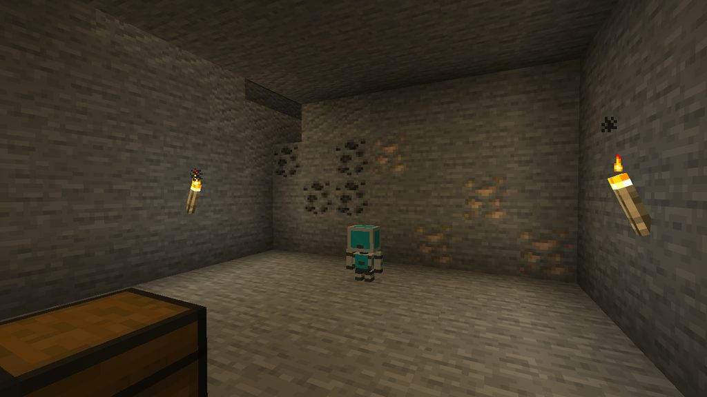

# Introduksjon {.intro}

Under bakken ligger kull, jern og gull i veggene i hulene. I denne oppgaven
lager du en robot som leter etter malm, lager en **liste** over alt den fant,
**sorterer** lista så den tar det nærmeste først, og graver ut bare malmen. Den
passer seg for lava, og når den er ferdig, går den hjem og legger alt i en
kiste. Du skriver programmet i **JavaScript**.

Du bør ha gjort oppgavene [Skogsroboten](../skogsroboten/skogsroboten.html) og

[Gruve til grunnfjell](../gruve_til_grunnfjell/gruve_til_grunnfjell.html)

først.




# Før du starter {.activity}

## Sjekkliste {.check}

- [ ] Start Minecraft med Halison Code. Åpne en vanlig verden i `Kreativ` modus
  (Creative) med `Tillat kommandoer` på (Allow Commands). Den må ha trær og
  fjell, så ikke velg `Superflat`.

- [ ] Trykk `T` for å åpne chatten, skriv `/robot spawn` og trykk Enter. Roboten
  dukker opp ved føttene dine og ser samme vei som deg.

- [ ] Trykk `T` igjen, skriv `/halisoncode` og trykk Enter. Editoren åpnes i
  nettleseren. Trykk `Nytt prosjekt`.

- [ ] Skriv `/gamerule halisoncode:pause_on_lost_focus false` i chatten. Da går
  ikke spillet på pause når du bytter til editoren, og du ser hva roboten gjør
  mens du jobber. Du trenger bare gjøre det én gang i hver verden.

## Slik bytter du mellom Minecraft og editoren {.tip}

- Du lager programmet i nettleseren og ser roboten i Minecraft. Bytt vindu med
  `Alt` + `Tab` (på Mac `Cmd` + `Tab`). Hold inne `Alt` og trykk `Tab` til
  Minecraft er valgt, og slipp.

- Trykk alltid på `Kjør` i editoren **før** du bytter til Minecraft. Programmet
  kjører fra nettleseren, så la editoren stå åpen.

- Viser Minecraft pausemenyen når du kommer tilbake, trykk `Fortsett spill`
  (Back to Game). Roboten står stille så lenge spillet er på pause. Har du ikke
  skrevet `/gamerule halisoncode:pause_on_lost_focus false`, gjør det nå. Du kan
  også trykke `F3` + `P` i Minecraft.

- Er roboten borte eller langt unna, skriv `/robot spawn` igjen. Vil du stoppe
  et program, trykk stoppknappen i editoren eller skriv `/robot stop`.

- Prosjektet lagres av seg selv i nettleseren på denne datamaskinen. Vil du ha
  det med til en annen maskin, trykk lagre-knappen ved siden av prosjektnavnet
  nederst i editoren. Da får du en `.mkcd`-fil.


# Steg 1: Finn kull {.activity}

`agent.findNearest` leter etter den nærmeste blokken av én bestemt type. Den ser
gjennom stein, men roboten kan bare gå dit det finnes en vei.

## Sjekkliste {.check}

- [ ] Finn en hule med malm i veggene, høyere enn y = 0 (se `F3`). Lenger ned er
  malmen en annen blokk, dypskifermalm, og den leter vi ikke etter her.

- [ ] Sett fakler i hula, og skriv `/difficulty peaceful`. Da kommer det ingen
  fiendtlige skapninger.

- [ ] Sett ut en kiste på gulvet. Still deg rett foran kista, se mot den, og
  skriv `/robot spawn`. Ikke stå oppå kista, for da havner roboten inni den.

- [ ] Lag et nytt prosjekt, gå til fanen `JavaScript` og kjør dette én gang.
  Roboten flytter seg opp på kista og gjør den plassen til hjemmet sitt:

```javascript
agent.move(SixDirection.Up, 1)
agent.move(SixDirection.Forward, 1)
agent.setHome()
```

- [ ] Slett koden, og skriv i stedet:

```javascript
let kull = agent.findNearest(Block.CoalOre, 24)
if (kull) {
    agent.say("Kull på " + kull.toString())
} else {
    agent.say("Ikke noe kull her")
}
```

## Test prosjektet {.flag}

__Trykk på `Kjør`.__

- [ ] Bytt til Minecraft med `Alt` + `Tab` og se på roboten.

- [ ] Finner roboten kull? Se etter i hula med `F3`. Stemmer posisjonen?

- [ ] Bytt `Block.CoalOre` med `Block.IronOre`. Finner den jern også?


# Steg 2: En liste med malm {.activity}

Vi vil lete etter flere typer malm på en gang. Da legger vi typene i én liste,
og posisjonene vi finner i en annen.

## Sjekkliste {.check}

- [ ] Slett programmet fra steg 1, og skriv:

```javascript
function finnMalm() {
    let typer = [Block.CoalOre, Block.IronOre, Block.GoldOre, Block.LapisOre]
    let funn: Position[] = []
    for (let t of typer) {
        let p = agent.findNearest(t, 24)
        if (p) {
            funn.push(p)
        }
    }
    return funn
}

let funn = finnMalm()
agent.say("Jeg fant " + funn.length + " malm")
```

## Test prosjektet {.flag}

__Kjør programmet.__

- [ ] Bytt til Minecraft med `Alt` + `Tab` og se på roboten.

- [ ] Hvor mange fant roboten? Hvorfor kan det aldri bli mer enn fire?

## Tips {.tip}

`funn.push(p)` legger `p` til bakerst i lista. `if (p)` passer på at vi bare
legger til noe når roboten faktisk fant en blokk.


# Steg 3: Nærmeste først {.activity}

Lista er i samme rekkefølge som typene, ikke etter hvor langt unna malmen er.
`positions.sortByDistance` gir en ny liste med den nærmeste først.

## Sjekkliste {.check}

- [ ] Nederst i programmet, legg til:

```javascript
let rekke = positions.sortByDistance(funn, agent.getPosition())
for (let p of rekke) {
    let avstand = Math.round(agent.getPosition().distanceTo(p))
    player.say(p.toString() + " er " + avstand + " blokker unna")
}
```

## Test prosjektet {.flag}

__Kjør programmet.__

- [ ] Bytt til Minecraft med `Alt` + `Tab` og se på roboten.

- [ ] Står avstandene i chatten fra minst til størst?


# Steg 4: Grav ut malmen {.activity}

Når roboten går til en malmblokk, stopper den på en ledig blokk ved siden av.
Den kan stå under, over eller ved siden av. Vi regner ut hvilken vei den må
grave.

## Sjekkliste {.check}

- [ ] Lim inn `grader` og `snuMot` fra Skogsroboten øverst i programmet.

- [ ] Lag disse to funksjonene under dem:

```javascript
function retningTil(mål: Position) {
    let her = agent.getPosition()
    let dy = mål.getValue(Axis.Y) - her.getValue(Axis.Y)
    if (dy > 0) {
        return SixDirection.Up
    }
    if (dy < 0) {
        return SixDirection.Down
    }
    snuMot(mål)
    return SixDirection.Forward
}

function graUt(p: Position) {
    if (!agent.moveTo(p)) {
        agent.say("Jeg finner ingen vei dit")
        return true
    }
    let retning = retningTil(p)
    agent.destroy(retning)
    return true
}
```

- [ ] Bytt ut `player.say` i løkka fra steg 3 med `graUt(p)`.

## Test prosjektet {.flag}

__Kjør programmet.__

- [ ] Bytt til Minecraft med `Alt` + `Tab` og se på roboten.

- [ ] Går roboten fra malm til malm og graver ut bare malmen?

- [ ] Høyreklikk på roboten. Har den kull og jern i inventaret?

## Tips {.protip}

Ligger malmen inni veggen, uten luft rundt, finner ikke roboten noen vei. Da
sier den fra og går videre til neste. `graUt` svarer `true` (sann) når det var
trygt. Det bruker vi i neste steg.


# Steg 5: Pass deg for lava {.activity}

Bak en malmblokk kan det ligge lava. Når malmen er borte, kan lava renne inn i
hullet. Roboten sjekker hullet etter at den har gravd.

## Sjekkliste {.check}

- [ ] I `graUt`, bytt ut den siste `return true` med:

```javascript
loops.pause(500)
if (agent.detectLiquid(retning) == Liquid.Lava || !agent.isSafe(retning)) {
    agent.say("Farlig! Jeg drar hjem.")
    return false
}
return true
```

- [ ] I løkka, stopp når det ikke er trygt:

```javascript
for (let p of rekke) {
    if (!graUt(p)) {
        break
    }
}
```

## Test prosjektet {.flag}

__Hell en bøtte lava bak en malmblokk, og kjør programmet.__

- [ ] Bytt til Minecraft med `Alt` + `Tab` og se på roboten.

- [ ] Stopper roboten og sier fra når lava renner inn?

## Tips {.tip}

`agent.isSafe` er usann hvis det er lava i blokken eller under den, et fall på
mer enn 3 blokker, eller en fiendtlig skapning rett ved. `break` hopper ut av
løkka med en gang.


# Steg 6: Hjem med fangsten {.activity}

## Sjekkliste {.check}

- [ ] Samle det som er nederst i programmet, i en funksjon `jakt(runder:
  number)`. Den skal lete, grave og så gå hjem:

```javascript
function jakt(runder: number) {
    for (let r = 0; r < runder; r++) {
        let funn = finnMalm()
        if (funn.length == 0) {
            agent.say("Ikke mer malm her")
            break
        }
        let rekke = positions.sortByDistance(funn, agent.getPosition())
        let trygt = true
        for (let p of rekke) {
            if (!graUt(p)) {
                trygt = false
                break
            }
        }
        if (!trygt) {
            break
        }
    }
    agent.goHome()
    agent.storeItems(SixDirection.Down, 0)
    agent.say("Alt er i kista!")
}

player.onChat("jakt", function (num1, num2, num3) {
    jakt(num1)
})
```

## Test prosjektet {.flag}

__Skriv `jakt 3` i chatten.__

- [ ] Trykk `Kjør` i editoren først. Bytt så til Minecraft med `Alt` + `Tab`.

- [ ] Leter roboten tre ganger, og går den hjem til slutt?

- [ ] Åpne kista. Hva fikk roboten med seg?

## Tips {.tip}

Hver runde leter roboten på nytt fra der den står. Da finner den malm som var
for langt unna i forrige runde.

## Utfordring {.challenge}

- [ ] Bruk `agent.findNearestCategory(BlockCategory.Ores, 24)` i stedet. Finner
  roboten nå også dypskifermalm og andre typer?

- [ ] La roboten si hvor mange kull den har til slutt, med
  `agent.containerCount(SixDirection.Down, Item.Coal)` når den står på kista.

- [ ] Sorter på nytt etter hver malmblokk, fra der roboten står da. Blir turen
  kortere?

- [ ] La roboten gå hjem når inventaret er fullt, med `agent.isInventoryFull()`.
