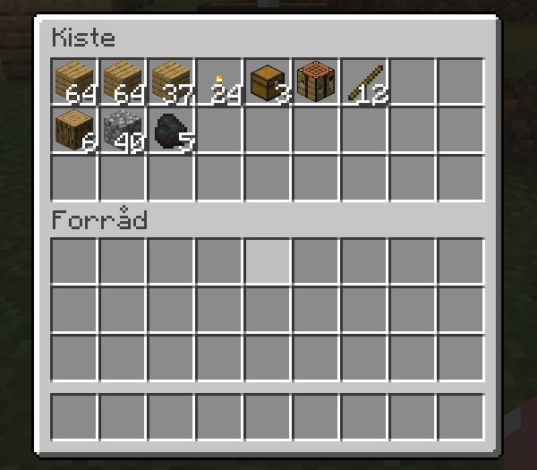

# Introduksjon {.intro}

En speedrun er å gjøre noe så fort som mulig. Her har du og roboten **fem
minutter**. På den tiden skal roboten lage så mange planker, kister og fakler
som den klarer, og legge dem i en kiste. Hver ting gir poeng. Den som får flest
poeng, vinner.

Du må sette sammen tre roboter du har laget før: en som hogger trær, en som
graver etter kull, og en som lager ting og rydder i kista.

Her får du ikke steg for steg. Du får oppdraget, reglene, verktøyene og noen
tips. Resten er opp til deg.

Du bør ha gjort oppgavene [Skogsroboten](../skogsroboten/skogsroboten.html),
[Lageret](../lageret/lageret.html) og
[Tunnelboreren](../tunnelboreren/tunnelboreren.html).

# Før du starter {.activity}

## Sjekkliste {.check}

- [ ] Start Minecraft med Halison Code. Lag en ny vanlig verden i `Overlevelse`
  (Survival) med `Tillat kommandoer` på (Allow Commands). Den må ha trær og
  fjell, så ikke velg `Superflat`.

- [ ] Trykk `T` for å åpne chatten, skriv `/robot spawn` og trykk Enter. Roboten
  dukker opp ved føttene dine og ser samme vei som deg.

- [ ] Trykk `T` igjen, skriv `/halisoncode` og trykk Enter. Editoren åpnes i
  nettleseren. Trykk `Nytt prosjekt`.

- [ ] Skriv `/gamerule halisoncode:pause_on_lost_focus false` i chatten. Da går
  ikke spillet på pause når du bytter til editoren, og du ser hva roboten gjør
  mens du jobber. Du trenger bare gjøre det én gang i hver verden.

## Slik bytter du mellom Minecraft og editoren {.tip}

- Du lager programmet i nettleseren og ser roboten i Minecraft. Bytt vindu med
  `Alt` + `Tab` (på Mac `Cmd` + `Tab`). Hold inne `Alt` og trykk `Tab` til
  Minecraft er valgt, og slipp.

- Trykk alltid på `Kjør` i editoren **før** du bytter til Minecraft. Programmet
  kjører fra nettleseren, så la editoren stå åpen.

- Viser Minecraft pausemenyen når du kommer tilbake, trykk `Fortsett spill`
  (Back to Game). Roboten står stille så lenge spillet er på pause. Har du ikke
  skrevet `/gamerule halisoncode:pause_on_lost_focus false`, gjør det nå. Du kan
  også trykke `F3` + `P` i Minecraft.

- Er roboten borte eller langt unna, skriv `/robot spawn` igjen. Vil du stoppe
  et program, trykk stoppknappen i editoren eller skriv `/robot stop`.

# Oppdraget {.activity}

Et døgn i Minecraft er 24000 tikk, og det går 20 tikk i sekundet. Fem minutter
er da 6000 tikk. Starter du ved soloppgang (`tid på døgnet` er 0), er tiden ute
ved middag, når `tid på døgnet` er 6000.

## Sjekkliste {.check}

- [ ] Finn et sted med trær, og gjerne et fjell i nærheten. Det er startstedet.

- [ ] Hent en arbeidsbenk og en kiste med `/give @s minecraft:crafting_table` og
  `/give @s minecraft:chest`. Sett dem ut ved siden av hverandre på startstedet.
  Det er **målkista**.

- [ ] Still roboten foran målkista, med arbeidsbenken ved siden av seg.

- [ ] Skriv `/time set 0`. Nå går klokka.

- [ ] Når `tid på døgnet` er 6000, er tiden ute. Alt som ligger i målkista da,
  gir poeng.

## Regler {.protip}

- Du spiller i `Overlevelse`. Arbeidsbenken og målkista er det eneste du får
  jukse inn, og du gjør det før klokka går.

- Roboten får ikke bruke `agent.setItem`, og du får ikke gi den noe. Alt den
  lager, må den hogge eller grave selv.

- Du får flytte roboten med `/robot spawn` og skrive chatkommandoer. Resten gjør
  roboten.

- Du får ikke legge noe i målkista selv. Bare roboten.

- Vil du prøve igjen, lag en ny verden, så ingen trær er hogd fra før.

## Poengtabell {.check}

| Ting i målkista              | Poeng |
| ---------------------------- | ----- |
| Én planke, av alle slags tre | 1     |
| Én fakkel                    | 2     |
| Én kiste                     | 10    |

En kiste koster 8 planker og gir 10 poeng. Fire fakler koster ett kull og én
pinne, som er en halv planke. Er det lurt å lage kister? Hvor mye kull trenger
du for at faklene skal lønne seg?

# Verktøykassa {.activity}

Dette har du lært før:

| Hva                           | Kode                                                                                     |
| ----------------------------- | ---------------------------------------------------------------------------------------- |
| Finne, hogge og hente et tre  | `hentTre()` og `skog` fra Skogsroboten                                                   |
| Grave en tunnel og finne malm | Fra Tunnelboreren                                                                        |
| Finne kull i nærheten         | `agent.findNearest(Block.CoalOre, 16)`                                                   |
| Lage planker                  | `agent.craft(Item.OakPlanks, 4)` og `agent.canCraft`                                     |
| Lage pinner, fakler og kister | `agent.craft(Item.Stick, 4)`, `agent.craft(Item.Torch, 4)`, `agent.craft(Item.Chest, 1)` |
| Legge alt i kista             | `agent.storeItems(SixDirection.Forward, 0)`                                              |
| Telle i kista                 | `agent.containerCount(SixDirection.Forward, Item.Torch)`                                 |
| Gå hjem                       | `agent.setHome()` og `agent.goHome()`                                                    |
| Hvor mye tid er igjen         | `gameplay.timeOfDay()`                                                                   |
| Kjøre noe fra chatten         | `player.onChat("lag", function (num1, num2, num3) { })`                                  |

## Tips {.tip}

- Planlegg før du skriver `/time set 0`. Klokka venter ikke mens du skriver
  kode. Bruk en øvingsverden først.

- Kister må lages ved siden av en arbeidsbenk. Planker, pinner og fakler klarer
  roboten alene.

- Hvert tre gir kanskje 4 til 6 stammer, og hver stamme gir 4 planker. Hvor
  mange trær rekker roboten på fem minutter?

- Kull ligger ofte i fjellsider og like under bakken. Er det kull i nærheten,
  kan det lønne seg å grave litt. Er det langt unna, er det kanskje bedre å
  hogge mer.

- Tre i inventaret gir ingen poeng. Husk å legge alt i målkista før tiden er
  ute.

# Del 1: Klokka {.activity}

Start med en chatkommando som holder styr på tiden.

## Sjekkliste {.check}

- [ ] Lag `player.onChat("tid", ...)`, som sier hvor mange sekunder det er igjen
  til `tid på døgnet` er 6000.

- [ ] Lag en funksjon `tidIgjen()` som svarer `true` så lenge det er mer enn ett
  minutt igjen. Den trenger du i løkkene dine.

# Del 2: Hent råvarer {.activity}

## Sjekkliste {.check}

- [ ] Lag `skog` som henter trær til tiden nesten er ute, i stedet for et
  bestemt antall. Bruk `tidIgjen()` i en `while`-løkke.

- [ ] Lag `kull`, som finner kullmalm i nærheten, går dit og graver den ut. Hva
  skal roboten gjøre hvis den ikke finner noe?

- [ ] Roboten skal komme hjem til målkista etter hver tur.

# Del 3: Lag og lever {.activity}

## Sjekkliste {.check}

- [ ] Lag `lag`, som gjør om alle stammene til planker, og så lager pinner,
  fakler og kister etter planen din.

- [ ] Lag `lever`, som legger alt i målkista.

- [ ] Lag `poeng`, som teller det som ligger i målkista og sier poengsummen i
  chatten med `player.say`.

## Test prosjektet {.flag}

__Gjør en prøverunde i en øvingsverden.__

- [ ] Trykk `Kjør` i editoren først. Bytt så til Minecraft med `Alt` + `Tab`.

- [ ] Skriv `/time set 0` og kjør chatkommandoene dine.

- [ ] Hvor mange poeng fikk du? Hva tok lengst tid?

# Del 4: Hele løpet {.activity}

Nå skal roboten klare hele løpet med én chatkommando.

## Sjekkliste {.check}

- [ ] Lag `start`, som kjører alt i riktig rekkefølge og leverer før tiden er
  ute.

- [ ] Fang feil med `try` og `catch`, som i [Hus før
  natta](../hus_for_natten/hus_for_natten.html). Et tre roboten ikke kommer til,
  skal ikke stoppe hele løpet.

## Test prosjektet {.flag}

__Lag en ny verden, og gjør speedrunen på ekte.__

- [ ] Trykk `Kjør` i editoren først. Bytt så til Minecraft med `Alt` + `Tab`.

- [ ] Skriv `/time set 0` og så `start`.

- [ ] Hvor mange poeng fikk du? Skriv det ned, og prøv å slå det.

## Utfordring {.challenge}

- [ ] Kapp med en makker i hver sin verden med samme frø (Seed). Hvem får flest
  poeng?

- [ ] Gjør roboten raskere. Hvor mange sekunder bruker den på hvert tre? Kan den
  velge det nærmeste treet hver gang?

- [ ] Lag din egen poengtabell, der også pinner eller arbeidsbenker gir poeng.
  Endrer det planen?

- [ ] Prøv i Python i stedet for JavaScript.
