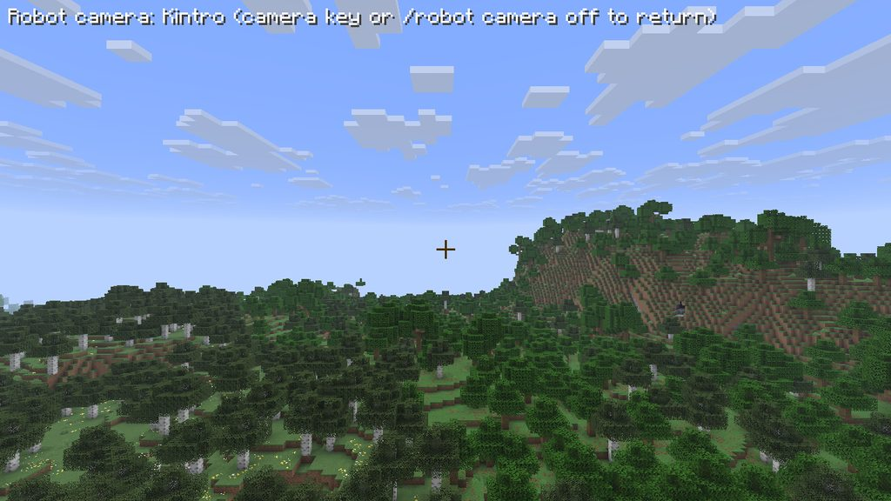

# Introduksjon {.intro}

Før du dreg ut på eventyr, er det lurt å vite kva som ventar. I denne oppgåva
blir roboten ein speidar. Han flyg opp i lufta, du ser verda gjennom auga
hans, og han fortel deg kva han finn. Du lærer om **sensorar**,
**variablar** og **viss**.

Du bør ha gjort oppgåva [Finn vegen](../finn_veien/finn_veien_nn.html) først.




# Før du startar {.activity}

## Sjekkliste {.check}

- [ ] Start Minecraft med Halison Code. Opne ei vanleg verd i `Skapande` modus
  (Creative) med `Tillat fusk` på (Allow Commands). Ho må ha tre og fjell, så
  ikkje vel `Vassrett` (Superflat).

- [ ] Trykk `T` for å opne chatten, skriv `/robot spawn` og trykk Enter. Roboten
  dukkar opp ved føtene dine og ser same veg som deg.

- [ ] Trykk `T` igjen, skriv `/halisoncode` og trykk Enter. Editoren opnar seg i
  nettlesaren. Trykk `Nytt prosjekt`.

- [ ] Skriv `/gamerule halisoncode:pause_on_lost_focus false` i chatten. Då går
  ikkje spelet på pause når du byter til editoren, og du ser kva roboten gjer
  medan du jobbar. Du treng berre gjere det éin gong i kvar verd.

## Slik byter du mellom Minecraft og editoren {.tip}

- Du lagar programmet i nettlesaren og ser roboten i Minecraft. Byt vindauge
  med `Alt` + `Tab` (på Mac `Cmd` + `Tab`). Hald inne `Alt` og trykk `Tab` til
  Minecraft er valt, og slepp.

- Trykk alltid på `Kjør` i editoren **før** du byter til Minecraft. Programmet
  køyrer frå nettlesaren, så la editoren stå open.

- Viser Minecraft pausemenyen når du kjem tilbake, trykk `Attende til spelet`
  (Back to Game). Roboten står stille så lenge spelet er på pause. Har du ikkje
  skrive `/gamerule halisoncode:pause_on_lost_focus false`, gjer det no. Du kan
  òg trykke `F3` + `P` i Minecraft.

- Er roboten borte eller langt unna, skriv `/robot spawn` igjen. Vil du stoppe
  eit program, trykk stoppknappen i editoren eller skriv `/robot stop`.

- Prosjektet blir lagra av seg sjølv i nettlesaren på denne datamaskina. Vil du
  ha det med til ei anna maskin, trykk lagre-knappen ved sida av prosjektnamnet
  nedst i editoren. Då får du ei `.mkcd`-fil.


# Steg 1: Sjå med auga til roboten {.activity}

Roboten har eit kamera. Du kan sjå gjennom det når du vil.

## Sjekkliste {.check}

- [ ] Skriv `/robot spawn` i chatten. Skriv så `/robot camera`.

- [ ] No ser du det roboten ser. Kroppen din står stille der han var.

- [ ] Skriv `/robot camera follow`. No er kameraet bak og over roboten. Rull med
  musehjulet for å kome nærare eller lenger unna.

- [ ] Skriv `/robot camera off` for å kome tilbake.


# Steg 2: Fly opp {.activity}

Roboten flyg frå start. Han dett ikkje, sjølv om det er luft under han.

## Sjekkliste {.check}

- [ ] Lag eit nytt prosjekt. Legg `robot kamera følg` i `ved start`.

- [ ] Under den: `robot flytt opp med 20`.

- [ ] Så `robot flytt fremover med 30`.

- [ ] Til slutt `robot kamera av`.

## Test prosjektet {.flag}

__Trykk på `Kjør`.__

- [ ] Byt til Minecraft med `Alt` + `Tab` og sjå på roboten.

- [ ] Følgjer kameraet roboten medan han flyg?

- [ ] Kva skjer viss roboten treffer eit fjell eller eit høgt tre?

## Tips {.tip}

Ei flytting er høgst 64 blokker. Vil du lenger, bruker du fleire `robot flytt`
etter kvarandre, eller ei løkke.


# Steg 3: Kvar er vi? {.activity}

No skal roboten fortelje kva han ser. Sensorane måler, og svara legg vi i
**variablar**. Ein variabel er ein boks med eit namn, der programmet kan leggje
eit tal eller ein tekst.

## Sjekkliste {.check}

- [ ] Etter flyturen, legg til `robot flytt ned med 20`, så roboten er nede ved
  bakken igjen.

- [ ] Legg til `robot si` og dra `robot biom` inn i tekstfeltet. Roboten seier
  namnet på biomet, til dømes `plains` eller `forest`.

- [ ] Opne `Variabler` og lag ein variabel som heiter `dyr`.

- [ ] Legg til `sett dyr til` og dra `robot tell i nærheten dyr innen 8` inn i
  den.

## Test prosjektet {.flag}

__Trykk på `Kjør`.__

- [ ] Byt til Minecraft med `Alt` + `Tab` og sjå på roboten.

- [ ] Kva biom landa roboten i?


# Steg 4: Viss ... elles {.activity}

Ein speidar seier frå om det er viktig. Med `hvis` frå `Logikk` kan roboten
velje kva han skal seie.

## Sjekkliste {.check}

- [ ] Dra ein `hvis ... ellers` inn nedst.

- [ ] Set vilkåret til `dyr > 0`. Bruk samanlikninga frå `Logikk` og
  variabelen `dyr`.

- [ ] Inni `hvis`: `robot si Her er det dyr!`

- [ ] Inni `ellers`: `robot si Ingen dyr her.`

- [ ] Under, ein ny `hvis`: `robot lysnivå < 8`. Inni den: `robot si Det er
  mørkt. Pass deg for monstre!`

## Test prosjektet {.flag}

__Køyr programmet både om dagen og om natta.__

- [ ] Byt til Minecraft med `Alt` + `Tab` og sjå på roboten.

- [ ] Seier roboten noko anna når det er mørkt?

- [ ] Fly til ein stad med kyr eller sauer. Ser roboten dei?

## Tips {.protip}

Lys under 8 tyder ikkje at monster kjem, men at det er mørkt nok. Monster
dukkar opp der lyset er 0.


# Programmet i JavaScript {.activity}

```javascript
agent.camera(CameraMode.Follow)
agent.move(SixDirection.Up, 20)
agent.move(SixDirection.Forward, 30)
agent.move(SixDirection.Down, 20)
agent.camera(CameraMode.Off)
agent.say(agent.biome())
let dyr = agent.countNearby(EntityKind.Animal, 8)
if (dyr > 0) {
    agent.say("Her er det dyr!")
} else {
    agent.say("Ingen dyr her.")
}
if (agent.lightLevel() < 8) {
    agent.say("Det er mørkt. Pass deg for monstre!")
}
```

## Utfordring {.challenge}

- [ ] La roboten fly i ein stor firkant og seie frå i kvart hjørne.

- [ ] Bruk `robot oppdag væske ned` og la roboten seie frå når han er over vatn
  eller lava.

- [ ] Lag ein chatkommando `speid` som sender roboten ut og heim igjen.
