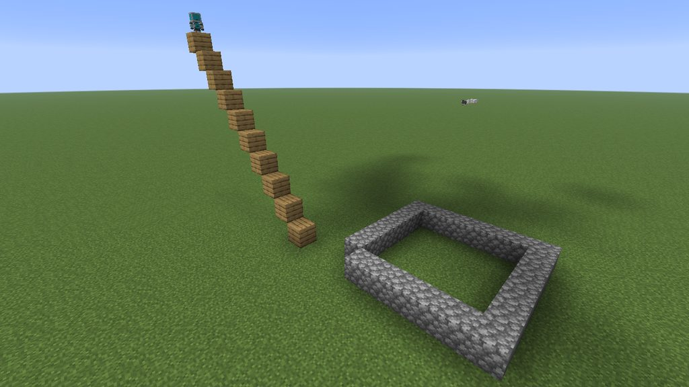

# Introduksjon {.intro}

No skal roboten byggje! Først lagar han ei trapp opp i lufta, og så legg han
ein sti av stein medan han går. Undervegs lærer du å bruke ei **løkke**, som
gjentek dei same blokkene mange gonger.

Du bør ha gjort oppgåva [Kom i gang](../kom_i_gang/kom_i_gang_nn.html) først.




# Før du startar {.activity}

## Sjekkliste {.check}

- [ ] Start Minecraft med Halison Code. Opne ei flat verd i `Skapande` modus
  (Creative) med `Tillat fusk` på (Allow Commands). Vel `Vassrett` (Superflat)
  under `Verdsslag` (World Type).

- [ ] Trykk `T` for å opne chatten, skriv `/robot spawn` og trykk Enter. Roboten
  dukkar opp ved føtene dine og ser same veg som deg.

- [ ] Trykk `T` igjen, skriv `/halisoncode` og trykk Enter. Editoren opnar seg i
  nettlesaren. Trykk `Nytt prosjekt`.

- [ ] Skriv `/gamerule halisoncode:pause_on_lost_focus false` i chatten. Då går
  ikkje spelet på pause når du byter til editoren, og du ser kva roboten gjer
  medan du jobbar. Du treng berre gjere det éin gong i kvar verd.

## Slik byter du mellom Minecraft og editoren {.tip}

- Du lagar programmet i nettlesaren og ser roboten i Minecraft. Byt vindauge
  med `Alt` + `Tab` (på Mac `Cmd` + `Tab`). Hald inne `Alt` og trykk `Tab` til
  Minecraft er valt, og slepp.

- Trykk alltid på `Kjør` i editoren **før** du byter til Minecraft. Programmet
  køyrer frå nettlesaren, så la editoren stå open.

- Viser Minecraft pausemenyen når du kjem tilbake, trykk `Attende til spelet`
  (Back to Game). Roboten står stille så lenge spelet er på pause. Har du ikkje
  skrive `/gamerule halisoncode:pause_on_lost_focus false`, gjer det no. Du kan
  òg trykke `F3` + `P` i Minecraft.

- Er roboten borte eller langt unna, skriv `/robot spawn` igjen. Vil du stoppe
  eit program, trykk stoppknappen i editoren eller skriv `/robot stop`.

- Prosjektet blir lagra av seg sjølv i nettlesaren på denne datamaskina. Vil du
  ha det med til ei anna maskin, trykk lagre-knappen ved sida av prosjektnamnet
  nedst i editoren. Då får du ei `.mkcd`-fil.


# Steg 1: Gi roboten blokker {.activity}

Roboten byggjer med blokkene han har i inventaret sitt. Han har 27 plassar,
akkurat som ei kiste.

## Sjekkliste {.check}

- [ ] Lag eit nytt prosjekt i editoren.

- [ ] Dra `robot gi eikeplanker antall 64 i plass 1` frå kategorien `Robot` inn
  i `ved start`.

- [ ] Køyr programmet. Høgreklikk på roboten i spelet for å sjå inventaret.
  Ligg det 64 eikeplankar i første plass?

## Tips {.tip}

`robot gi` verkar berre i `Skapande` modus. I `Overleving` (Survival) må roboten
samle eller få blokkene sine sjølv.


# Steg 2: Eitt trappetrinn {.activity}

Eit trappetrinn er tre kommandoar: Roboten flyttar seg opp, så framover, og
legg ei blokk under seg.

## Sjekkliste {.check}

- [ ] Under `robot gi`, legg til `robot flytt opp med 1`.

- [ ] Så `robot flytt fremover med 1`.

- [ ] Så `robot plasser ned`.

## Test prosjektet {.flag}

__Trykk på `Kjør`.__

- [ ] Byt til Minecraft med `Alt` + `Tab` og sjå på roboten.

- [ ] Ligg det ein planke under roboten no?


# Steg 3: Gjenta {.activity}

Ei trapp med ti trinn ville trengt 30 blokker. I staden bruker vi ei løkke.

## Sjekkliste {.check}

- [ ] Opne kategorien `Løkker`. Dra `gjenta 4 ganger` inn under `robot gi`.

- [ ] Flytt dei tre trappeblokkene inn i løkka.

- [ ] Endre `4` til `10`.


## Test prosjektet {.flag}

__Gå litt unna roboten, skriv `/robot spawn` og trykk `Kjør`.__

- [ ] Byt til Minecraft med `Alt` + `Tab` og sjå på roboten.

- [ ] Byggjer roboten ei trapp med ti trinn?

- [ ] Kor mange gonger køyrde `robot plasser ned`? Kor mange blokker står i
  løkka?


# Steg 4: Ein sti medan roboten går {.activity}

Roboten kan òg leggje ei blokk bak seg for kvart steg han tek. Då blir det ein
sti.

## Sjekkliste {.check}

- [ ] Lag eit nytt prosjekt. Gi roboten `brostein antall 64 i plass 1`.

- [ ] Legg til `robot velg plass 1`, så roboten byggjer med brosteinen.

- [ ] Legg til `robot hjelp plasser ved flytting sant`.

- [ ] Legg til ein `gjenta 4 ganger` med `robot flytt fremover med 3` og `robot
  snu venstre` inni.

- [ ] Etter løkka: `robot hjelp plasser ved flytting usant`, så roboten sluttar
  å byggje.


## Test prosjektet {.flag}

__Trykk på `Kjør`.__

- [ ] Byt til Minecraft med `Alt` + `Tab` og sjå på roboten.

- [ ] Lagar roboten ein firkanta sti av brostein?

- [ ] Kva skjer viss du gløymer `robot hjelp ... av` til slutt og køyrer eit
  nytt program etterpå?


# Programmet i JavaScript {.activity}

Trappa ser slik ut i JavaScript. `for`-løkka er det same som `gjenta`:

```javascript
agent.setItem(Block.OakPlanks, 64, 1)
for (let index = 0; index < 10; index++) {
    agent.move(SixDirection.Up, 1)
    agent.move(SixDirection.Forward, 1)
    agent.place(SixDirection.Down)
}
```

Editoren har òg eksempla `Trapp` og `Steinsti` på startsida, under
`Eksempler`.

## Utfordring {.challenge}

- [ ] Lag ei trapp som går ned i bakken i staden for opp.

- [ ] Lag ein sti forma som ein spiral. Tips: bruk to løkker, eller endre kor
  langt roboten går.

- [ ] Kan du byggje ei trapp som snur seg, slik at ho går rundt eit tårn?
