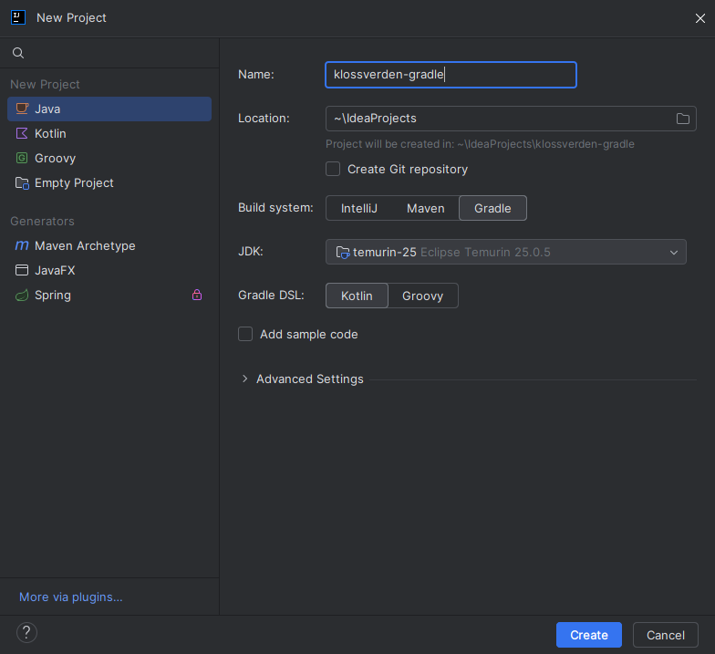
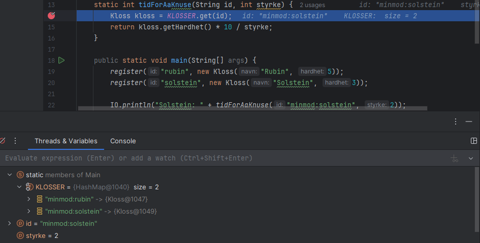

# Introduksjon {.intro}

Ekte Java-prosjekter bruker et byggeverktøy. Det laster ned biblioteker, bygger
koden og pakker den i en fil som andre kan kjøre. Det mest brukte heter
**Gradle**. Når du skal lage utvidelser til spill skrevet i Java, får du nesten
alltid et Gradle-prosjekt å starte fra.

I denne oppgaven lager du et Gradle-prosjekt, og du finner en feil på tre måter:
ved å lese feilmeldingen, ved å stoppe programmet midt i med **debuggeren**, og
ved å lese kode du ikke har skrevet selv. Til slutt bygger du en `.jar`-fil.

Du lærer snarveiene `Ctrl + klikk`, `F8` og brytpunkt i debuggeren.


# Steg 1: Lag et Gradle-prosjekt {.activity}

## Sjekkliste {.check}

- [ ] Velg **File**, **New** og **Project...**.

- [ ] Velg **Java**, og skriv `klossverden-gradle` i **Name**.

- [ ] Velg **Gradle** under **Build system**, og **Kotlin** under **Gradle
  DSL**. Velg JDK `25`.

- [ ] Ta bort krysset for **Add sample code**, og klikk **Create**.

- [ ] Vent til IntelliJ er ferdig. Første gang laster Gradle ned mye, og det kan
  ta noen minutter.



Se på filene IntelliJ har laget:

- `build.gradle.kts` sier hvordan prosjektet bygges.

- `settings.gradle.kts` sier hva prosjektet heter. IntelliJ legger til
  `org.example` foran navnet i prosjektvinduet. Det kommer fra linja
  `group = "org.example"` i `build.gradle.kts`, og du kan la det stå.

- `gradlew` og mappa `gradle` lar alle bygge prosjektet med samme versjon av
  Gradle, uten å installere noe.

- Koden skal ligge i `src/main/java`. Det er fast i alle Gradle-prosjekter.


# Steg 2: Kode med en feil {.activity}

## Sjekkliste {.check}

- [ ] Lag pakken `klossverden` i `src/main/java`.

- [ ] Lag klassen `Kloss` i pakken:

  ```java
  package klossverden;

  public class Kloss {
      private final String navn;
      private final int hardhet;

      public Kloss(String navn, int hardhet) {
          this.navn = navn;
          this.hardhet = hardhet;
      }

      public String getNavn() {
          return navn;
      }

      public int getHardhet() {
          return hardhet;
      }
  }
  ```

- [ ] Lag klassen `Main` i samme pakke. Skriv av koden nøyaktig, med feilen:

  ```java
  package klossverden;

  import java.util.HashMap;
  import java.util.Map;

  public class Main {
      static final Map<String, Kloss> KLOSSER = new HashMap<>();

      static void register(String id, Kloss kloss) {
          KLOSSER.put("minmod:" + id, kloss);
      }

      static int tidForAaKnuse(String id, int styrke) {
          Kloss kloss = KLOSSER.get(id);
          return kloss.getHardhet() * 10 / styrke;
      }

      public static void main(String[] args) {
          register("rubin", new Kloss("Rubin", 5));
          register("solstein", new Kloss("Solstein", 3));

          IO.println("Solstein: " + tidForAaKnuse("minmod:solstein", 2));
          IO.println("Rubin: " + tidForAaKnuse("rubin", 2));
      }
  }
  ```

- [ ] Kjør programmet med den grønne trekanten ved `main`.


# Steg 3: Les feilmeldingen {.activity}

Programmet krasjer. Nederst står en **stack trace**:

```text
Solstein: 15
Exception in thread "main" java.lang.NullPointerException: Cannot invoke
"klossverden.Kloss.getHardhet()" because "kloss" is null
    at klossverden.Main.tidForAaKnuse(Main.java:15)
    at klossverden.Main.main(Main.java:23)
```

Kanskje kommer det mer tekst fra Gradle under. Den ser skummel ut, men den
forteller nøyaktig hva som skjedde. Les den slik:

- **Første linje** sier hva som gikk galt. `NullPointerException` betyr at vi
  prøvde å bruke noe som ikke finnes. Variabelen `kloss` er `null`, som betyr
  _ingenting_.

- **Linjene med `at`** sier hvor. Den øverste er der feilen skjedde: linje 15 i
  `Main.java`, i metoden `tidForAaKnuse`. Linjen under sier hvem som kalte den:
  linje 23, i `main`.

## Sjekkliste {.check}

- [ ] Klikk på den blå lenken `Main.java:15`. IntelliJ hopper til linjen.

- [ ] Klikk på `Main.java:23`. Hvilken linje er det?

## Tips {.protip}

Les alltid den første linjen og den øverste `at`-linjen i _din_ kode først.
Linjer fra Java selv eller fra biblioteker kan du som regel hoppe over.


# Steg 4: Stopp programmet med debuggeren {.activity}

Vi vet _hvor_ det krasjer, men ikke _hvorfor_ `kloss` er `null`. Debuggeren lar
deg stoppe programmet og se på alle variablene.

## Sjekkliste {.check}

- [ ] Klikk i margen til venstre for linjen `Kloss kloss = KLOSSER.get(id);`.
  Det kommer en rød prikk. Det er et **brytpunkt**.

- [ ] Klikk på den grønne trekanten ved `main`, og velg **Debug** i stedet for
  **Run**.

- [ ] Programmet stopper på brytpunktet. Nederst ser du variablene. Hva er `id`?

- [ ] Åpne **static members of Main** i variabellista, og deretter `KLOSSER`.
  Hvilke nøkler finnes?

- [ ] Trykk `F8` for å gå én linje videre. Hva er `kloss` nå?

- [ ] Trykk `F9` for å la programmet kjøre videre til neste brytpunkt.



## Test prosjektet {.flag}

- [ ] Programmet stopper to ganger. Første gang er `id` lik `"minmod:solstein"`.
  Hva er den andre gangen?

Andre gang leter vi etter `"rubin"`, men i registeret heter den
`"minmod:rubin"`. Nøkkelen finnes ikke.

## Tips {.tip}

`F8` går over neste linje. `F7` går _inn i_ metoden på linjen. `F9` kjører
videre. På Mac er det de samme tastene, eller `Fn` sammen med dem.


# Steg 5: Les kode du ikke har skrevet {.activity}

Hva gjør egentlig `get` når nøkkelen ikke finnes? Det kan du sjekke selv. Hele
Java er åpen kildekode.

## Sjekkliste {.check}

- [ ] Hold inne `Ctrl` (på Mac `Cmd`) og klikk på `get` i `KLOSSER.get(id)`.

- [ ] IntelliJ åpner `Map.java` fra Java selv. Les kommentaren over `get`. Hva
  står det om `null`?

- [ ] `Ctrl + klikk` på `HashMap` på linjen med `new HashMap<>()`. Finn metoden
  `get` der også.

- [ ] Gå tilbake med `Ctrl + Alt + Venstre pil` (på Mac `Cmd + [`).

Kommentaren sier at `get` gir tilbake `null` hvis nøkkelen ikke finnes. Det er
akkurat det som skjedde.

- [ ] Rett feilen: Skriv `"minmod:rubin"` i stedet for `"rubin"` i `main`. Ta
  bort brytpunktet ved å klikke på den røde prikken.

## Test prosjektet {.flag}

- [ ] Skriver programmet `Rubin: 25` nå?

## Tips {.protip}

`Ctrl + klikk` er den beste måten å lære et nytt bibliotek på. Når du lager
utvidelser til et spill, kan du `Ctrl + klikke` deg inn i koden til spillet og
se hvordan det er laget.


# Steg 6: Bygg en jar-fil {.activity}

En `.jar`-fil er et ferdig pakket Java-program. Det er også slik utvidelser til
spill skrevet i Java blir delt.

## Sjekkliste {.check}

- [ ] Åpne `build.gradle.kts`, og legg til dette nederst:

  ```kotlin
  tasks.jar {
      manifest {
          attributes["Main-Class"] = "klossverden.Main"
      }
  }
  ```

- [ ] Klikk på elefanten som dukker opp øverst til høyre i filen, for å laste
  inn endringen i Gradle. Du kan også trykke `Ctrl + Shift + O`.

- [ ] Åpne **Gradle**-vinduet med elefanten i kanten til høyre. Åpne
  `klossverden-gradle`, **Tasks** og **build**, og dobbeltklikk på `jar`.

- [ ] Se i prosjektvinduet. Under `build/libs` ligger nå en `.jar`-fil.

`Main-Class` forteller Java hvilken klasse som har `main`.

## Test prosjektet {.flag}

- [ ] Velg **Run**, **Edit Configurations...**, klikk på `+` og velg **JAR
  Application**.

- [ ] Velg jar-filen i **Path to JAR**, og JDK `25` under **JRE**. Klikk **OK**,
  og kjør.

- [ ] Kjører programmet fra jar-filen?

## Tips {.protip}

Du kan også bygge fra **Terminal**-vinduet nederst i IntelliJ med `.\gradlew.bat
build` på Windows, eller `./gradlew build` på Mac og Linux. Det er slik
byggeservere og andre utviklere bygger prosjektet ditt.


# Utfordring {.challenge}

## Sjekkliste {.check}

- [ ] Gjør det umulig å gjøre samme feil igjen: La `tidForAaKnuse` kaste en
  `IllegalArgumentException` med en god melding når id-en ikke finnes.

- [ ] Lag et brytpunkt med betingelse: Høyreklikk på den røde prikken og skriv
  `id.equals("minmod:rubin")`. Nå stopper debuggeren bare for rubin.

- [ ] Finn et Java-prosjekt på GitHub med en `build.gradle.kts`. Åpne det i
  IntelliJ med **File**, **New** og **Project from Version Control...**, og bygg
  det.
