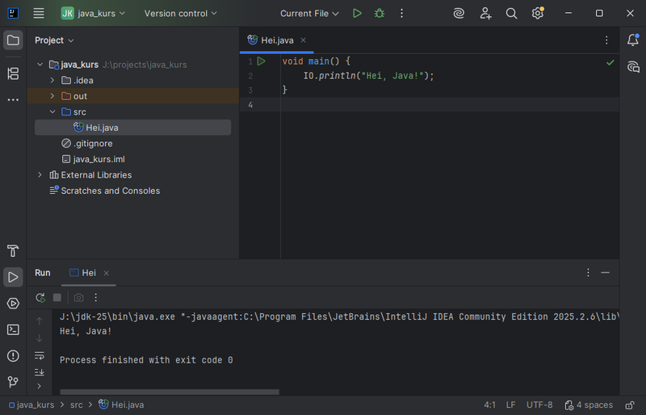

# Introduksjon {.intro}

Java er et av de mest brukte programmeringsspråkene i verden. Det brukes i
banker, i Android-apper og i noen av verdens mest populære spill. I dette kurset
lærer du Java fra starten av, og til slutt kan du nok til å begynne å lage
modder til spill skrevet i Java.

Vi skriver koden i **IntelliJ IDEA**. Det er et program som hjelper deg mens du
skriver: det fullfører ord, finner feil og retter dem for deg.

I denne oppgaven lager du ditt første program, og du lager en feil med vilje for
å se hvordan IntelliJ hjelper deg.



## Tips {.tip}

Er ikke IntelliJ og Java installert ennå? Følg
[installasjonsveiledningen](../installasjon/installasjon.html) først.


# Steg 1: Lag et nytt prosjekt {.activity}

Et **prosjekt** er en mappe med alle filene til et program.

## Sjekkliste {.check}

- [ ] Start IntelliJ IDEA. Er et annet prosjekt åpent, velger du **File**,
  **New** og **Project...**. Ellers klikker du **New Project**.

- [ ] Velg **Java** til venstre, og skriv `java_kurs` i **Name**.

- [ ] Velg **IntelliJ** under **Build system**, og `25` under **JDK**.

- [ ] Ta bort krysset for **Add sample code**, og klikk **Create**.

Til venstre ser du prosjektvinduet. Der ligger mappa `src`. Den heter så fordi
den har kildekoden din (_source_ på engelsk).


# Steg 2: Ditt første program {.activity}

## Sjekkliste {.check}

- [ ] Høyreklikk på `src`, velg **New** og **Java Class**. Skriv `Hei` og trykk
  `Enter`.

- [ ] IntelliJ lager filen `Hei.java` med litt kode i. Slett alt sammen, og
  skriv dette i stedet:

  ```java
  void main() {
      IO.println("Hei, Java!");
  }
  ```

- [ ] Klikk på den grønne trekanten til venstre for `void main()`, og velg
  **Run**.

## Test prosjektet {.flag}

- [ ] Nederst åpnes et vindu som heter **Run**. Står det `Hei, Java!` der?

Gratulerer! Du har skrevet et Java-program.

`void main()` er stedet der programmet starter. Alt mellom krøllparentesene `{`
og `}` kjøres, linje for linje. `IO.println` skriver ut en linje med tekst.
Teksten står i anførselstegn, og hver linje slutter med semikolon `;`.

## Tips {.protip}

Etter første gang kan du kjøre programmet på nytt med `Shift + F10`. På Mac er
det `Ctrl + R`.


# Steg 3: Skriv mer {.activity}

## Sjekkliste {.check}

- [ ] Legg til to linjer til, så programmet ser omtrent slik ut:

  ```java
  void main() {
      IO.println("Hei, Java!");
      IO.println("Jeg heter Ada, og jeg liker å bygge.");
      IO.println("2 + 3 = " + (2 + 3));
  }
  ```

- [ ] Bytt ut navnet og det du liker med noe om deg selv.

- [ ] Kjør programmet.

## Test prosjektet {.flag}

- [ ] Hva skriver den siste linjen ut? Hvorfor står det ikke `2 + 3` to ganger?

Det som står i anførselstegn, er tekst, og det skrives ut akkurat som det står.
`(2 + 3)` uten anførselstegn er et regnestykke. Java regner det ut før det
skrives. Tegnet `+` mellom tekst og et tall setter dem sammen til én tekst.


# Steg 4: Lag en feil med vilje {.activity}

Alle som programmerer, gjør feil hele tiden. Det viktige er å finne dem raskt.

## Sjekkliste {.check}

- [ ] Ta bort semikolonet på slutten av den første `IO.println`-linjen.

- [ ] Se at IntelliJ setter en rød strek under. Hold musepekeren over den røde
  streken og les feilmeldingen.

- [ ] Prøv å kjøre programmet. Hva skjer?

- [ ] Sett semikolonet tilbake.

## Test prosjektet {.flag}

- [ ] Virker programmet igjen?


# Steg 5: La IntelliJ rette feilen {.activity}

Noen feil kan IntelliJ rette selv. Da bruker du den viktigste snarveien i
IntelliJ: `Alt + Enter` (på Mac `Option + Enter`).

## Sjekkliste {.check}

- [ ] Legg til denne linjen nederst i `main`, før `}`:

  ```java
      hilsen();
  ```

  `hilsen` blir rødt. Java vet ikke hva `hilsen` er, for vi har ikke laget det
  ennå.

- [ ] Sett markøren på `hilsen` og trykk `Alt + Enter`.

- [ ] Velg **Create method 'hilsen'**. IntelliJ lager en ny bit kode under
  `main`.

- [ ] Skriv en `IO.println` inni den nye koden, mellom `{` og `}`, for eksempel:

  ```java
  void hilsen() {
      IO.println("Ha en fin dag!");
  }
  ```

- [ ] Kjør programmet.

## Test prosjektet {.flag}

- [ ] Kommer `Ha en fin dag!` til slutt?

Du har nettopp laget en **metode**. Det lærer du mer om i en senere oppgave.

## Tips {.protip}

Ser du en rød strek eller en gul lyspære, trykk `Alt + Enter`. IntelliJ har
nesten alltid et forslag.

## Lagre {.save}

IntelliJ lagrer automatisk. Du trenger aldri trykke `Ctrl + S`.


# Utfordring {.challenge}

## Sjekkliste {.check}

- [ ] Skriv ut en figur med flere linjer tekst, for eksempel et hus eller et
  ansikt laget av tegn som `/`, `|` og `_`. Vil du ha med `\`, må du skrive `\\`
  inni teksten.

- [ ] Hva skjer hvis du skriver `IO.print` i stedet for `IO.println`? Hva tror
  du `ln` på slutten betyr?

- [ ] Skriv ut svaret på `7 * 6` og `100 / 7`. Ble svaret på det siste som du
  trodde?
