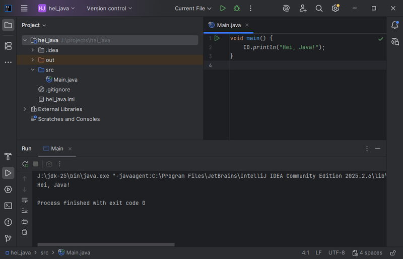
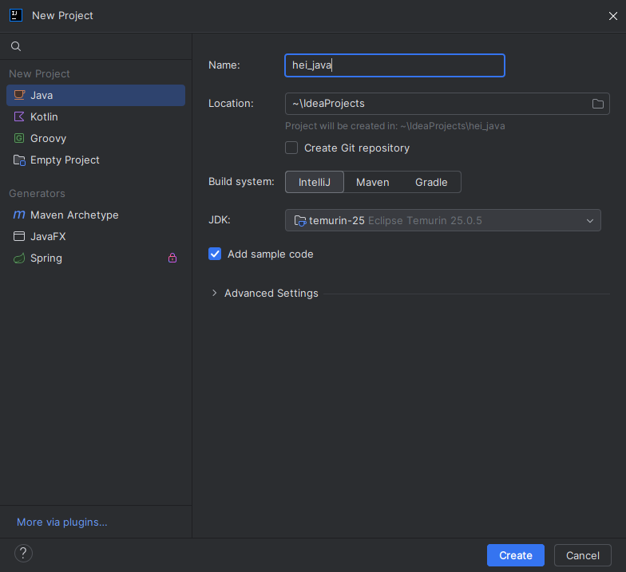

# Introduksjon {.intro}

Denne veiledningen er for en lærer, en forelder eller en elev som gjør
datamaskinen klar til Java-kurset. Det tar 15 til 30 minutter, mest fordi det
skal lastes ned omtrent 1,5 GB.

Du skal installere to ting:

- **IntelliJ IDEA**, programmet vi skriver Java i. Et slikt program kalles et
  IDE (integrert utviklingsmiljø).

- **JDK 25**, selve Java. JDK står for Java Development Kit. IntelliJ laster det
  ned for deg.

Til slutt lager du et lite prosjekt og sjekker at alt virker.

# Steg 1: Dette trenger du {.activity}

## Sjekkliste {.check}

- [ ] En datamaskin med Windows, macOS eller Linux. IntelliJ trenger minst 8 GB
  minne for å gå greit, og omtrent 5 GB ledig plass på disken.

- [ ] Lov til å installere programmer. På skolemaskiner må kanskje IT-ansvarlig
  gjøre steg 2.

- [ ] Nettilgang mens du installerer. Senere virker alt uten nett.

# Steg 2: Installer IntelliJ IDEA {.activity}

Fra versjon 2025.3 finnes IntelliJ IDEA som ett produkt. Det gamle **Community
Edition** lastes ikke lenger ned for seg. Det du trenger, er gratis i det
vanlige IntelliJ IDEA, uten konto og uten å betale.

## Sjekkliste {.check}

- [ ] Gå til
  [jetbrains.com/idea/download](https://www.jetbrains.com/idea/download/) og
  last ned **IntelliJ IDEA** for operativsystemet ditt.

- [ ] Kjør installasjonsprogrammet. Standardvalgene er fine.

- [ ] Start IntelliJ IDEA.

- [ ] IntelliJ tilbyr deg å prøve Ultimate gratis i 30 dager. Du trenger det
  ikke. Velg å fortsette med gratisversjonen. Velger du prøveperioden, går
  programmet tilbake til gratisversjonen av seg selv når den er over.

## Tips {.protip}

Alternativet er **JetBrains Toolbox**, et lite program som installerer og
oppdaterer IntelliJ. Det er praktisk hvis du vil holde flere maskiner oppdatert.

# Steg 3: Lag et prosjekt og last ned JDK 25 {.activity}

## Sjekkliste {.check}

- [ ] Klikk **New Project** på velkomstskjermen.

- [ ] Velg **Java** i lista til venstre.

- [ ] Skriv `hei_java` i **Name**. Se hvor prosjektet lagres i **Location**.

- [ ] Velg **IntelliJ** under **Build system**.

- [ ] Åpne lista **JDK** og velg **Download JDK...**.

- [ ] Velg **Version** `25` og en leverandør (**Vendor**), for eksempel
  **Eclipse Temurin** eller **Oracle OpenJDK**. Klikk **Download**.

- [ ] Kryss av for **Add sample code**, og klikk **Create**.

IntelliJ laster ned JDK-en og lager prosjektet. Det kan ta et par minutter. Følg
med på framdriften nederst i vinduet.

## Tips {.tip}

JDK-en trenger du bare laste ned én gang. I neste prosjekt ligger `25` klar i
lista **JDK**.

# Steg 4: Sjekk at alt virker {.activity}

## Sjekkliste {.check}

- [ ] Åpne `src` i prosjektvinduet til venstre, og dobbeltklikk på `Main.java`.

- [ ] Klikk på den grønne trekanten i margen ved siden av `main`, og velg
  **Run**.

- [ ] Det åpnes et vindu nederst med teksten programmet skriver ut.

## Test prosjektet {.flag}

- [ ] Kom det tekst i vinduet nederst, uten røde feilmeldinger? Da er
  datamaskinen klar.

- [ ] Velg **File**, **Project Structure** og **Project**. Står det `25` under
  **SDK**?

# Steg 5: Hvis noe går galt {.activity}

## Sjekkliste {.check}

- [ ] **Ingen grønn trekant:** Vent til IntelliJ er ferdig med å laste og
  indeksere. Se nederst i vinduet.

- [ ] **Feil om `IO` eller `void main`:** Prosjektet bruker en eldre JDK. Velg
  **File**, **Project Structure** og sett **SDK** til `25`, og **Language
  level** til `25` eller **SDK default**.

- [ ] **Nedlastingen henger:** Skolenettet kan stoppe store nedlastinger. Prøv
  et annet nett, eller be IT-ansvarlig om å installere JDK 25 på forhånd.

## Tips {.protip}

Står maskinen på et annet språk enn engelsk, kan menyene i IntelliJ likevel være
på engelsk. Oppgavene bruker de engelske navnene.
