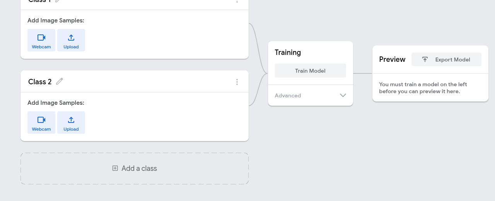

# Introduksjon {.intro}

I denne oppgaven lærer du opp en datamaskin til å kjenne igjen ting fra rommet,
for eksempel en kopp og en blyant. Du viser den eksempler med webkameraet, og så
tester du om den har lært det.

Du bruker nettstedet **Teachable Machine**. Det er på engelsk, men vi forklarer
knappene underveis.

<!-- BILDE: Teachable Machine med tre klasser og prosentstolper i Preview, mens
kameraet ser en kopp på et bord -->

## Personvern {.protip}

- Kameraet skal se på **ting**, ikke på deg eller andre. Ikke ta bilder av
  ansikter.

- Bildene du tar, blir i nettleseren din på denne PC-en. De sendes ikke til noen
  server. Når du lukker fanen, er alt borte.

# Steg 1: Lag et bildeprosjekt {.activity}

## Sjekkliste {.check}

- [ ] Gå til
  [teachablemachine.withgoogle.com](https://teachablemachine.withgoogle.com/).

- [ ] Klikk på **Get Started** (kom i gang).

- [ ] Klikk på **Image Project** (bildeprosjekt).

- [ ] Velg **Standard image model**.

Nå ser du to bokser som heter `Class 1` og `Class 2`. En **klasse** er en av
tingene maskinen skal kjenne igjen.

## Sjekkliste {.check}

- [ ] Klikk på blyanten ved `Class 1` og skriv `Kopp`.

- [ ] Gi `Class 2` navnet `Blyant`.

- [ ] Klikk på **Add a class** (legg til en klasse) og kall den `Ingenting`.

## Tips {.tip}

Du kan velge andre ting enn kopp og blyant. Velg to ting som ser ganske
forskjellige ut, og som du har ved PC-en.

# Steg 2: Samle eksempler {.activity}

Maskinen lærer av **eksempler**. Jo flere og jo mer forskjellige eksempler, jo
bedre lærer den.

## Sjekkliste {.check}

- [ ] Snu skjermen eller kameraet så det ser ned på bordet, ikke på deg.

- [ ] Klikk på **Webcam** i klassen `Kopp`. Nettleseren spør om du vil la
  nettstedet bruke kameraet. Klikk **Tillat**.

- [ ] Hold koppen foran kameraet. Hold inne knappen **Hold to Record**. Mens du
  holder inne, tar den mange bilder.

- [ ] Snu og vend på koppen mens du tar bilder. Flytt den litt nærmere og litt
  lenger unna. Ta omtrent 50 bilder.

- [ ] Gjør det samme med blyanten i klassen `Blyant`.

- [ ] I klassen `Ingenting` tar du bilder av bordet uten noe på.

<!-- BILDE: Klassen Kopp med webkamerabildet til venstre og mange små bilder av
en kopp til høyre -->

## Hvorfor trenger vi Ingenting? {.tip}

Maskinen må alltid velge en av klassene. Har den bare `Kopp` og `Blyant`, må den
si en av dem, selv om du ikke holder opp noe. Med `Ingenting` har den et tredje
valg.

# Steg 3: Tren modellen {.activity}

Nå skal maskinen finne mønstre i bildene. Det kalles å **trene** en modell.

## Sjekkliste {.check}

- [ ] Klikk på **Train Model** (tren modellen).

- [ ] Vent til den er ferdig. Bytt ikke fane mens den trener. Da står det
  **Don't switch tabs!**

Treningen skjer på din egen PC, i nettleseren. Det tar som regel under ett
minutt.

# Steg 4: Test modellen {.activity}

Til høyre, under **Preview**, ser du hva modellen tror den ser.

## Test prosjektet {.flag}

- [ ] Hold opp koppen. Hvilken klasse får den lengste stolpen?

- [ ] Hold opp blyanten. Hva skjer?

- [ ] Fjern alt fra bordet. Blir det `Ingenting`?

Tallet ved hver klasse er hvor **sikker** modellen er, i prosent. Tallene blir
til sammen 100 %.

<!-- BILDE: Preview med Output der Kopp har 98 %, Blyant 1 % og Ingenting 1 %
-->

## Test prosjektet {.flag}

- [ ] Hold opp noe den aldri har sett, for eksempel en saks. Hva tror den at det
  er?

- [ ] Hold koppen langt unna, eller bare halvveis i bildet. Er den fortsatt like
  sikker?

## Hva skjer egentlig? {.tip}

Modellen vet ikke hva en kopp *er*. Den har funnet ut hva bildene i hver klasse
har til felles, som farger og former. Når du viser den noe nytt, velger den
klassen som ligner mest. Derfor svarer den noe også når du viser den en saks.

# Steg 5: Når du er ferdig {.activity}

## Lagre {.save}

Teachable Machine lagrer ingenting av seg selv. Lukker du fanen, er bildene og
modellen borte. Det er helt greit. Du skal lage nye modeller i de neste
oppgavene.

## Utfordring {.challenge}

- [ ] Legg til en fjerde klasse med en ny ting. Hvor mange bilder trenger den
  før den blir sikker?

- [ ] Slå av lyset i rommet, eller gå til et annet bord. Virker modellen like
  godt da?

- [ ] Finn to ting som ligner, for eksempel to penner med ulik farge. Klarer
  modellen å se forskjell?
