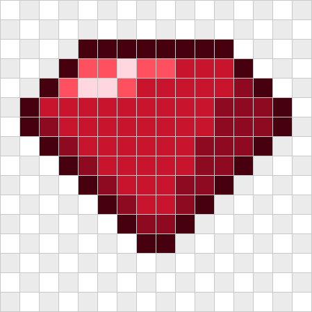

# Introduksjon {.intro}

Nå lager du din første egne ting i Minecraft: en **rubin**. Rubinen er et
**item**, en gjenstand du kan ha i inventaret og holde i handa. Den får sin egen
tekstur, et navn på engelsk og norsk, og en egen fane i kreativ modus.

Du lærer hva et **register** er, og hvilke filer et item trenger for å se riktig
ut.


# Steg 1: En metode for id-er {.activity}

Alt i Minecraft har en id på formen `navnerom:navn`. Rubinen skal hete
`rubinmod:rubin`. Vi lager en liten metode som setter sammen slike id-er, så vi
slipper å skrive mod-id-en hver gang.

## Sjekkliste {.check}

- [ ] Fortsett i prosjektet fra forrige oppgave. Åpne `RubinMod`.

- [ ] Legg til metoden `id` nederst i klassen, og et kall til `ModItems.init()`
  i `onInitialize()`. Klassen ser nå slik ut:

  ```java
  package no.kidsakoder.rubinmod;

  import net.fabricmc.api.ModInitializer;
  import net.minecraft.resources.Identifier;
  import org.slf4j.Logger;
  import org.slf4j.LoggerFactory;

  // Fabric kjører onInitialize() én gang når spillet starter,
  // fordi klassen står under "main" i fabric.mod.json.
  public class RubinMod implements ModInitializer {
      public static final String MOD_ID = "rubinmod";
      public static final Logger LOGGER = LoggerFactory.getLogger(MOD_ID);

      @Override
      public void onInitialize() {
          LOGGER.info("Hei fra rubinmod!");
          ModItems.init();
      }

      // Alt i Minecraft har en id som "navnerom:navn", for eksempel rubinmod:rubin.
      public static Identifier id(String name) {
          return Identifier.fromNamespaceAndPath(MOD_ID, name);
      }
  }
  ```

`ModItems` blir rød, fordi klassen ikke finnes ennå. Den lager vi nå.

## Tips {.tip}

`Identifier` het `ResourceLocation` i Minecraft-versjoner før 1.21.11. Ser du
`ResourceLocation` i en veiledning på nettet, er den skrevet for en eldre
versjon.


# Steg 2: Klassen ModItems {.activity}

Minecraft holder styr på alle items i et **register**, en stor oversikt der
hvert item har en id. Det ligner på registeret du lagde med `HashMap` i
Java-kurset. Et item som ikke er registrert, finnes ikke for spillet.

## Sjekkliste {.check}

- [ ] Lag klassen `ModItems` i pakken `no.kidsakoder.rubinmod`:

  ```java
  package no.kidsakoder.rubinmod;

  import java.util.function.Function;
  import net.fabricmc.fabric.api.creativetab.v1.FabricCreativeModeTab;
  import net.minecraft.core.Registry;
  import net.minecraft.core.registries.BuiltInRegistries;
  import net.minecraft.core.registries.Registries;
  import net.minecraft.network.chat.Component;
  import net.minecraft.resources.ResourceKey;
  import net.minecraft.world.item.CreativeModeTab;
  import net.minecraft.world.item.Item;
  import net.minecraft.world.item.ItemStack;

  public class ModItems {
      // Hvert item må registreres i Minecraft sitt item-register med en id.
      public static final Item RUBIN = register("rubin", Item::new, new Item.Properties());

      public static final ResourceKey<CreativeModeTab> TAB =
              ResourceKey.create(Registries.CREATIVE_MODE_TAB, RubinMod.id("rubiner"));

      public static <T extends Item> T register(
              String name, Function<Item.Properties, T> factory, Item.Properties properties) {
          ResourceKey<Item> key = ResourceKey.create(Registries.ITEM, RubinMod.id(name));
          // Item-et må vite sin egen id før det lages (setId).
          T item = factory.apply(properties.setId(key));
          return Registry.register(BuiltInRegistries.ITEM, key, item);
      }

      // Kalles fra RubinMod. Når klassen brukes første gang, lages feltene over,
      // og da blir itemene registrert.
      public static void init() {
          Registry.register(BuiltInRegistries.CREATIVE_MODE_TAB, TAB, FabricCreativeModeTab.builder()
                  .title(Component.translatable("itemGroup.rubinmod.rubiner"))
                  .icon(() -> new ItemStack(RUBIN))
                  .displayItems((parameters, output) -> {
                      output.accept(RUBIN);
                  })
                  .build());
      }
  }
  ```

Dette skjer i klassen:

- `register` lager en `ResourceKey`, id-en til itemet i registeret. Så lager den
  itemet og legger det i registeret `BuiltInRegistries.ITEM`.

- `Item::new` er en metodereferanse. Den gir `register` en oppskrift på hvordan
  itemet skal lages. Senere lager vi items av andre klasser med samme metode.

- `setId(key)` må kalles før itemet lages. Uten den krasjer spillet når det
  starter. Det er nytt i de siste Minecraft-versjonene, og mange veiledninger på
  nettet mangler det.

- `init()` lager en egen fane i kreativ modus, med rubinen som ikon.

- `init()` gjør en ting til, uten at det står i koden: Første gang klassen
  `ModItems` brukes, lager Java alle `static final`-feltene. Da kjøres
  `register("rubin", ...)`, og rubinen blir registrert.

## Tips {.protip}

Skriver du en klasse som `Registry` uten `import`, blir den rød. Trykk `Alt +
Enter` og velg **Import class**. Pass på at du velger klassen fra pakken som
står i koden over. Det finnes flere klasser med samme navn.


# Steg 3: Tegn rubinen {.activity}

Et item trenger en **tekstur**, et lite bilde. Items i Minecraft er 16 x 16
piksler.

## Sjekkliste {.check}

- [ ] Lag mappene `assets/rubinmod/textures/item` under `src/main/resources`.

- [ ] Tegn en rubin på 16 x 16 piksler med gjennomsiktig bakgrunn. Gratis
  verktøy som virker i nettleseren, er [Piskel](https://www.piskelapp.com/) og
  [Blockbench](https://www.blockbench.net/). Du kan også bruke et vanlig
  tegneprogram som lagrer PNG.

- [ ] Lagre bildet som `rubin.png` i mappa `textures/item`.



Vil du ikke tegne nå, kan du kopiere `rubin.png` fra løsningen til steget
`03_gjenstand` og tegne din egen senere. <!-- LENKE: løsningsrepo -->

## Tips {.tip}

Mappa heter `assets`, ikke `data`. Alt spilleren ser og hører, som bilder,
modeller, lyder og tekster, ligger i `assets`. Alt som bestemmer hvordan spillet
oppfører seg, som oppskrifter, ligger i `data`.


# Steg 4: Modellen {.activity}

Minecraft må vite hvordan teksturen skal brukes. Det står i to små JSON-filer.

## Sjekkliste {.check}

- [ ] Lag fila `src/main/resources/assets/rubinmod/items/rubin.json`:

  ```json
  {
    "model": {
      "type": "minecraft:model",
      "model": "rubinmod:item/rubin"
    }
  }
  ```

- [ ] Lag fila `src/main/resources/assets/rubinmod/models/item/rubin.json`:

  ```json
  {
    "parent": "minecraft:item/generated",
    "textures": {
      "layer0": "rubinmod:item/rubin"
    }
  }
  ```

Den første fila sier hvilken modell itemet `rubinmod:rubin` bruker. Den andre er
selve modellen. `item/generated` lager et flatt item av teksturen, som de fleste
items i spillet. `rubinmod:item/rubin` peker på
`assets/rubinmod/textures/item/rubin.png`.

Nå har itemet tre filer: `items/rubin.json`, `models/item/rubin.json` og
teksturen. Mangler én av dem, blir rubinen en svart og lilla rute.


# Steg 5: Navnet {.activity}

Uten navn viser spillet bare `item.rubinmod.rubin`. Navnene står i språkfiler,
én for hvert språk.

## Sjekkliste {.check}

- [ ] Lag fila `src/main/resources/assets/rubinmod/lang/en_us.json`:

  ```json
  {
    "item.rubinmod.rubin": "Ruby",
    "itemGroup.rubinmod.rubiner": "Rubies"
  }
  ```

- [ ] Lag fila `src/main/resources/assets/rubinmod/lang/no_no.json`:

  ```json
  {
    "item.rubinmod.rubin": "Rubin",
    "itemGroup.rubinmod.rubiner": "Rubiner"
  }
  ```

Norsk bokmål heter `no_no` i Minecraft, ikke `nb_no`. Lager du fila
`nb_no.json`, får du engelsk tekst selv om spillet er på norsk.

Engelsk er reservespråket. Mangler et navn på norsk, bruker spillet det
engelske.


# Steg 6: Prøv rubinen {.activity}

## Sjekkliste {.check}

- [ ] Start spillet med **runClient** og åpne verdenen din i kreativ modus.

- [ ] Åpne inventaret med `E`. Bla mellom fanene med pilene til du finner fanen
  **Rubiner**.

- [ ] Velg norsk under **Options**, **Language** hvis spillet er på engelsk.


## Test prosjektet {.flag}

- [ ] Finnes fanen **Rubiner**, med rubinen som ikon?

- [ ] Har rubinen teksturen din, og ikke en svart og lilla rute?

- [ ] Står det **Rubin** når du holder musa over den? Bytt til engelsk. Står det
  **Ruby** nå?

- [ ] Skriv `/give @s rubinmod:rubin 64` i chatten. Får du 64 rubiner?

## Tips {.protip}

Svart og lilla rute: Minecraft fant ikke modellen eller teksturen. Sjekk at
filnavnene og mappenavnene er skrevet nøyaktig som over, med små bokstaver.
Loggen sier ofte hvilken fil som mangler. Søk etter `rubin` i den.

## Utfordring {.challenge}

- [ ] Lag et item til, for eksempel en safir. Du trenger én linje i `ModItems`,
  `output.accept(...)` i fanen, en tekstur, de to modellfilene og navn i begge
  språkfilene.

- [ ] `new Item.Properties().stacksTo(16)` gjør at det bare kan ligge 16 i hver
  rute. Prøv det på det nye itemet.

- [ ] Endre oppskriften fra forrige oppgave så du får rubiner av jord i stedet
  for diamanter.
