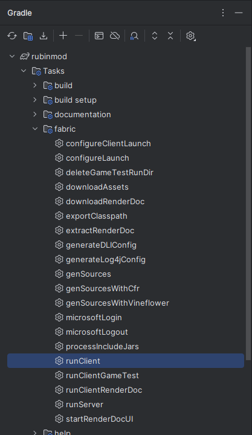

# Introduksjon {.intro}

Denne veiledningen gjør datamaskinen klar til kurset **Lag din egen
Minecraft-mod**. Den passer for en elev, en lærer eller en forelder. Det tar fra
en halvtime til en time, mest fordi mye skal lastes ned første gang.

Du skal:

- installere **JDK 25** og **IntelliJ IDEA**, som i Java-kurset

- legge til utvidelsen **Minecraft Development** i IntelliJ

- hente prosjektet `rubinmod`

- starte Minecraft med moden din fra IntelliJ


# Steg 1: Dette trenger du {.activity}

## Sjekkliste {.check}

- [ ] En datamaskin med Windows, macOS eller Linux. Minecraft og IntelliJ bruker
  mye minne samtidig, så maskinen bør ha minst 8 GB, helst 16 GB.

- [ ] **Minecraft Java Edition**, kjøpt på
  [minecraft.net](https://www.minecraft.net/). Mens du lager moden, starter du
  spillet fra IntelliJ uten å logge inn. Kontoen trenger du når du vil spille
  med moden i vanlig Minecraft. Moden virker ikke i Bedrock Edition, på
  nettbrett, mobil, konsoll eller i Education Edition.

- [ ] Nettilgang. Første gang laster prosjektet ned Minecraft og flere hundre MB
  med biblioteker.


# Steg 2: Installer JDK 25 og IntelliJ IDEA {.activity}

Har du tatt Java-kurset, har du dette allerede. Gå videre til steg 3.

## Sjekkliste {.check}

- [ ] Følg [installasjonsveiledningen i
  Java-kurset](https://oppgaver.kidsakoder.no/java/installasjon/installasjon).
  Den viser hvordan du installerer IntelliJ IDEA og laster ned JDK 25.

## Tips {.tip}

Minecraft 26.3 krever Java 25. Prosjektet laster ned Java 25 selv hvis det
mangler, men det går raskere når det allerede ligger på maskinen.


# Steg 3: Installer Minecraft Development {.activity}

**Minecraft Development** er en gratis utvidelse til IntelliJ. Den kjenner igjen
Fabric-prosjekter, gir deg hjelp når du skriver JSON-filene, og viser et lite
ikon ved klassene Minecraft kaller.

## Sjekkliste {.check}

Når du åpner et Fabric-prosjekt, foreslår IntelliJ ofte selv å installere
Minecraft Development. Da kan du klikke på forslaget og hoppe over stegene
under.

- [ ] Åpne IntelliJ og velg **File**, **Settings** (på Mac: **IntelliJ IDEA**,
  **Settings**).

- [ ] Velg **Plugins** og fanen **Marketplace**.

- [ ] Søk etter `Minecraft Development` og klikk **Install**.

- [ ] Start IntelliJ på nytt når den spør om det.


# Steg 4: Hent prosjektet {.activity}

Hele kurset bygger på samme prosjekt, `rubinmod`. Det finnes to måter å få det
på. Velg den første hvis du er usikker.

## Sjekkliste {.check}

- [ ] **Måte 1: Last ned startprosjektet.** Løsningsrepoet har ett ferdig
  prosjekt for hvert steg i kurset. Last ned repoet som en zip-fil og pakk det
  ut. Prosjektet du skal starte med, ligger i mappa `steg/01_tom_mod`.

  <!-- LENKE: løsningsrepo -->

- [ ] **Måte 2: Bruk malgeneratoren til Fabric.** Gå til
  [fabricmc.net/develop/template](https://fabricmc.net/develop/template/). Skriv
  `Rubinmod` som navn, `rubinmod` som mod-id og `no.kidsakoder.rubinmod` som
  pakke, og velg Minecraft `26.3`. Last ned zip-fila og pakk den ut.

Malgeneratoren lager noen filer mer enn kurset bruker, og klassene får litt
andre navn. I oppgaven **Tom mod** ser du hvordan filene skal se ut, så du kan
rette dem. Startprosjektet er laget slik fra før.

## Tips {.protip}

Lagre prosjektet et sted du finner igjen, for eksempel i en mappe `Modder` under
Dokumenter. Unngå mapper som synkroniseres med OneDrive eller Google Disk.
Gradle skriver mange små filer, og synkroniseringen gjør alt tregt.


# Steg 5: Åpne prosjektet i IntelliJ {.activity}

## Sjekkliste {.check}

- [ ] Velg **File** og **Open** i IntelliJ.

- [ ] Velg mappa med prosjektet, for eksempel `01_tom_mod`. Åpne bare denne ene
  mappa. Åpner du hele løsningsrepoet, finner ikke IntelliJ prosjektet.

- [ ] Svar **Trust Project** hvis IntelliJ spør.

- [ ] Vent. Nederst i vinduet ser du at Gradle laster ned og bygger. Første gang
  laster den ned Minecraft, og det kan ta flere minutter.

Gradle er programmet som bygger moden. Det leser `build.gradle.kts` og
`gradle.properties`, laster ned Minecraft, Fabric og alt annet moden trenger, og
starter spillet for deg.

## Tips {.tip}

Startprosjektet har en mappe `src/gametest`. Den er ikke en del av oppgaven. Den
brukes til å teste stegene og ta bilder til kurset. Du kan se bort fra den.


# Steg 6: Start Minecraft {.activity}

## Sjekkliste {.check}

- [ ] Klikk på elefanten (**Gradle**) helt til høyre i IntelliJ.

- [ ] Åpne **Tasks** og **fabric**, og dobbeltklikk på **runClient**.

- [ ] Vent til Minecraft starter. Første gang tar det litt tid.



Du kan også starte spillet i terminalen nederst i IntelliJ:

```
./gradlew runClient
```

På Windows i PowerShell skriver du `.\gradlew runClient`.

## Test prosjektet {.flag}

- [ ] Starter Minecraft? Nederst til venstre i hovedmenyen står det at spillet
  er modifisert (**Modded**).

- [ ] Se i vinduet **Run** nederst i IntelliJ. Der står det `Hei fra rubinmod!`
  et sted i loggen.

- [ ] Lag en ny verden i kreativ modus. Den kommer du til å bruke gjennom hele
  kurset.

Etter første gang blir runClient-oppgaven liggende øverst til høyre i IntelliJ,
ved siden av den grønne trekanten. Da kan du starte spillet med ett klikk.

Lista øverst til høyre har også **Minecraft Server** og **Gametest Minecraft
Client Game Test**. Pass på at **Minecraft Client** er valgt før du klikker på
trekanten.


# Steg 7: Hvis noe går galt {.activity}

## Sjekkliste {.check}

- [ ] **"Dependency requires at least JVM runtime version 25":** Gradle kjører
  med en for gammel Java. Gå til **File**, **Settings**, **Build, Execution,
  Deployment**, **Build Tools**, **Gradle** og velg Java 25 under **Gradle
  JVM**.

- [ ] **Ingen Gradle-panel og ingen runClient:** IntelliJ har ikke skjønt at
  mappa er et Gradle-prosjekt. Sjekk at du åpnet mappa der `build.gradle.kts`
  ligger, ikke mappa over.

- [ ] **Spillet krasjer med lite minne:** Lukk andre programmer. Minecraft og
  IntelliJ trenger rundt 4 GB til sammen.

- [ ] **Nedlastingen henger:** Skolenettet kan stoppe store nedlastinger. Prøv
  et annet nett, eller be IT-ansvarlig om hjelp.

Nå er du klar for første oppgave, [Tom
mod](https://oppgaver.kidsakoder.no/minecraft_mod/tom_mod/tom_mod).
