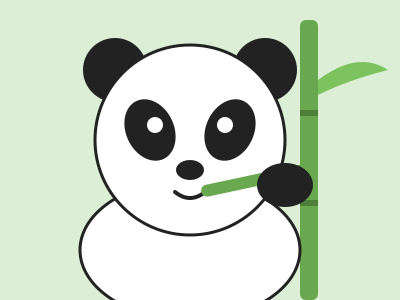

# Introduksjon {.intro}

I denne oppgåva lagar du ei nettside om noko du likar: eit dyr, ein hobby, eit
spel eller ei bok. Undervegs lærer du dei viktigaste HTML-taggane: overskrifter,
avsnitt, lister, bilete og lenkjer. Til slutt pyntar du sida med litt CSS.


Har du ikkje gjort [Kva er ei
nettside?](../hva_er_en_nettside/hva_er_en_nettside_nn.html), er det lurt å
starte der.


# Steg 1: Vel eit tema {.activity}

Bestem deg for kva sida skal handle om. I døma bruker vi *pandaer*, men du skal
byte det ut med ditt eige tema.

```html-live
<!DOCTYPE html>
<html lang="no">
  <head>
    <meta charset="utf-8">
    <title>Alt om pandaer</title>
  </head>
  <body>
    <h1>Alt om pandaer</h1>
    <p>Pandaer bor i fjellskoger i Kina og spiser nesten bare bambus.</p>
  </body>
</html>
```

## Sjekkliste {.check}

- [ ] Byt ut tittelen i `<title>` med temaet ditt.

- [ ] Byt ut overskrifta i `<h1>`.

- [ ] Skriv eitt eller to avsnitt med `<p>` om temaet ditt.

## Tips {.tip}

Du kan også skrive koden i VS Code. Trykk **Last ned som fil** under dømet,
eller lag ei ny fil. Sjå oppgåva [VS Code](../vs_code/vs_code_nn.html). I VS
Code blir arbeidet ditt lagra som ei fil du kan opne igjen seinare.


# Steg 2: Fleire overskrifter {.activity}

HTML har seks nivå av overskrifter, frå `<h1>` (størst) til `<h6>` (minst). Bruk
dei som kapittel og underkapittel i ei bok. Ei side bør ha éin `<h1>`.

## Sjekkliste {.check}

- [ ] Legg til ei mindre overskrift og eit avsnitt under henne:

  ```html
  <h2>Hva spiser pandaen?</h2>
  <p>En voksen panda kan spise over 12 kilo bambus om dagen.</p>
  ```

- [ ] Lag minst éin `<h2>` til, med eit avsnitt, om ditt eige tema.

- [ ] Prøv `<h3>` under ei av `<h2>`-overskriftene. Ser du at ho er mindre?


# Steg 3: Lister {.activity}

Lister passar når du har fleire ting som høyrer saman. `<ul>` lagar ei liste med
prikkar, og `<ol>` lagar ei nummerert liste. Kvart punkt står i `<li>`.

## Sjekkliste {.check}

- [ ] Lag ei liste med prikkar:

  ```html
  <h2>Fakta</h2>
  <ul>
    <li>Pandaen er en bjørn.</li>
    <li>Den kan bli over 20 år gammel.</li>
    <li>En nyfødt panda er mindre enn en mus.</li>
  </ul>
  ```

- [ ] Byt ut `ul` med `ol` (både i starten og på slutten). Kva skjer?

- [ ] Lag ei eiga liste om temaet ditt.


# Steg 4: Bilete {.activity}

Eit bilete legg vi inn med ``. Han har ingen slutt-tagg. I staden fortel vi
alt i *attributt*:

```html

```

- `src` er namnet på biletfila.

- `alt` er ei skildring av biletet. Ho blir lesen opp for blinde og svaksynte,
  og ho blir vist viss biletet ikkje finst.

## Sjekkliste {.check}

- [ ] Legg ``-linja over inn i sida di, under `<h1>`. Fila `panda.svg` ligg
  ved sida av denne oppgåva, så pandaen dukkar opp i resultatet.

- [ ] Skriv filnamnet feil med vilje: endre `panda.svg` til `pandaa.svg`. No
  finn ikkje nettlesaren biletet. Ser du at han viser `alt`-teksten i staden,
  ofte med eit lite ikon for eit øydelagt bilete? Den som ikkje kan sjå biletet,
  får i det minste vite kva det skulle vise. Difor er `alt` så viktig.

  

- [ ] Rett filnamnet tilbake til `panda.svg`.

- [ ] Skriv ein `alt`-tekst som fortel kva som er på *ditt* bilete. Tenk deg at
  du skildrar biletet for nokon i telefonen.

## Bilete frå eiga maskin {.tip}

Prøv selv-boksen kan berre vise bilete som ligg på nettet, slik som `panda.svg`
her. Vil du bruke dine eigne bilete, må du jobbe i VS Code. Legg biletet i same
mappe som `index.html`, og skriv filnamnet i `src`, til dømes
`src="hunden-min.jpg"`. Bruk bilete du har teke sjølv, eller bilete du har lov
til å bruke.

Tek du med pandasida over i VS Code, må du også lagre [panda.svg](panda.svg) i
same mappe som `index.html`.


# Steg 5: Lenkjer {.activity}

Lenkjer er det som bind nettet saman. Ei lenkje lagar vi med `<a>`:

```html
<a href="https://no.wikipedia.org/wiki/Kjempepanda">Les mer på Wikipedia</a>
```

`href` er adressa lenkja går til. Teksten mellom `<a>` og `</a>` er det du
klikkar på.

## Sjekkliste {.check}

- [ ] Legg til ei lenkje til ei side som handlar om temaet ditt.

- [ ] Skriv ein lenkjetekst som seier kvar lenkja går. *Les mer på Wikipedia* er
  betre enn *klikk her*.


# Steg 6: Pynt med CSS {.activity}

No har sida innhald. La oss gi henne litt stil. Her er heile pandasida med CSS.
Bruk henne som døme, eller lim inn `<style>`-delen i di eiga side.

```html-live
<!DOCTYPE html>
<html lang="no">
  <head>
    <meta charset="utf-8">
    <title>Alt om pandaer</title>
    <style>
      body {
        font-family: sans-serif;
        max-width: 40em;
        margin: 0 auto;
        padding: 1em;
        background-color: #f4f8f2;
      }
      h1 {
        color: #2e5e3a;
        text-align: center;
      }
      h2 {
        border-bottom: 2px solid #2e5e3a;
      }
      img {
        max-width: 100%;
      }
      a {
        color: #b3471d;
      }
    </style>
  </head>
  <body>
    <h1>Alt om pandaer</h1>
    
    <p>Pandaer bor i fjellskoger i Kina og spiser nesten bare bambus.</p>

    <h2>Hva spiser pandaen?</h2>
    <p>En voksen panda kan spise over 12 kilo bambus om dagen.</p>

    <h2>Fakta</h2>
    <ul>
      <li>Pandaen er en bjørn.</li>
      <li>Den kan bli over 20 år gammel.</li>
      <li>En nyfødt panda er mindre enn en mus.</li>
    </ul>

    <p>
      <a href="https://no.wikipedia.org/wiki/Kjempepanda">
        Les mer på Wikipedia
      </a>
    </p>
  </body>
</html>
```

## Sjekkliste {.check}

- [ ] Endre fargane. Fargekodar som `#2e5e3a` kan du finne med ein fargeveljar,
  til dømes ved å søkje etter *color picker* i ein søkjemotor.

- [ ] Endre `text-align: center;` til `text-align: right;` og sjå kva som skjer.

- [ ] `max-width: 40em;` gjer at teksten ikkje blir for brei på store skjermar.
  Prøv å fjerne linja og gjer vindauget breitt.

## Lagre {.save}

Prøv selv-boksen hugsar koden din berre i denne nettlesaren på denne maskina.
Trykk **Last ned som fil** for å ta vare på han. Då får du fila `index.html`,
som du kan opne i nettlesaren eller jobbe vidare med i [VS
Code](../vs_code/vs_code_nn.html).


# Utfordringar {.challenge}

- [ ] Lag ei nummerert liste med dei tre favorittane dine innanfor temaet.

- [ ] Gjer eit ord **feitt** med `<strong>` og eit ord *kursivt* med `<em>`.

- [ ] Lag ei side til i VS Code, og lenk mellom dei to sidene. Oppgåva [Lenk
  saman nettsider](../lenk_sammen_nettsider/lenk_sammen_nettsider_nn.html) viser
  korleis.

- [ ] Vil du ha med ein video eller lyd? Sjå oppgåva [Video og
  lyd](../video_og_lyd/video_og_lyd_nn.html).
